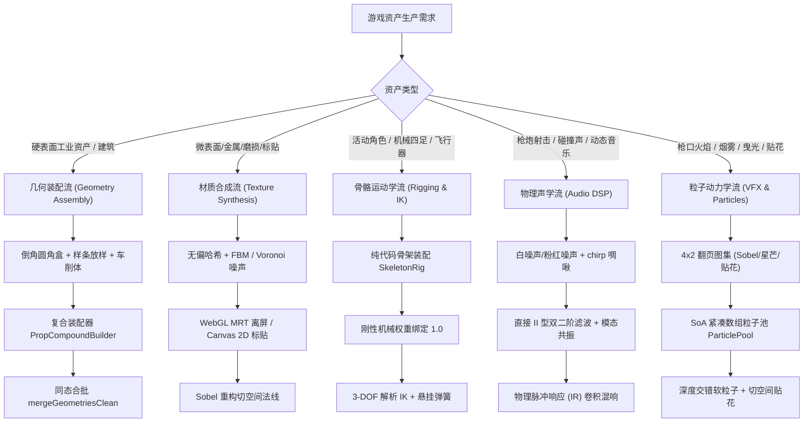

# 程序化生产游戏资产技能指南 (Procedural Game Asset Generation)

本指南系统沉淀了在《几猫国产3A大作》等超低包体、极致性能大型 Web 游戏中，**完全脱离外部模型/贴图/音频文件（Zero External Assets）**、纯通过数学算法与浏览器底层 API 实时生成高精 3D 工业资产、PBR 物理材质、纯声学 DSP 与动态粒子特效的工程实践。

---

## 核心设计哲学 (Core Philosophy)

1. **零外部网络资产 (Zero External Assets)**：
   全生命周期不加载任何静态 PNG/JPG/WebP 图像、glTF/OBJ/FBX 模型或 MP3/WAV/OGG 音频。
2. **纯内存即时构建 (Instant In-Memory Baking)**：
   在客户端毫秒级启动阶段，通过 WebGL MRT、Canvas 2D 与 Web Audio 离线上下文（OfflineAudioContext）构建就绪，首帧即开玩。
3. **极小单文件发行 (Single-File Distribution)**：
   借助算法压缩比，将拥有数百种材质、逾 270 万三角面、50+ 音效的 3A 级现场压进 **约 1.3 MB 单文件 HTML**。
4. **零 GC 垃圾回收卡顿 (Zero-Allocation Runtime)**：
   运行时物理与粒子全量采用平坦结构体数组（Structure of Arrays, SoA），严禁每帧循环内实例化临时对象。
5. **严密的显存释放生命周期 (WebGL Lifecycle Governance)**：
   所有程序化生成的几何体、多槽材质及贴图提供完整的递归销毁 (`disposeHierarchy`) 链路。

---

## 程序化资产工程决策树 (Asset Pipeline Decision Tree)



---

## 资产生产五大核心规约 (Five Golden Rules)

### 1. 几何体规约：杜绝 90° 尖锐直边

- **执行准则**：任何硬表面必须使用倒角圆角长方体算子（`createBoxBevelGeometry`）并赋予微倒角（$0.008\sim 0.02\,\text{m}$）。倒角处形成的微多边形斜面在 PBR 光照下会自动形成金属/混凝土的高光反射线，大幅提升工业真实感。
- **详见参考**：[geometry-assembly.md](./references/geometry-assembly.md)

### 2. 性能规约：按材质深度同态合批 (Homogeneous Merging)

- **执行准则**：严禁场景中每个部件作为一个独立的 `THREE.Mesh`。必须使用 `PropMeshAssembler` 将所有部件按材质槽位打散合并（`mergeGeometriesClean`），将成千上万个零件整合为个位数的主网格，确保全局 Draw Calls 维持在 20 次以内。

### 3. 材质规约：MRT 多通道与矢量标贴融合

- **执行准则**：对于连续宏观表面（如沥青路面、生锈钢板），采用 WebGL MRT 离屏着色器单 Pass 烘焙出 Albedo / Normal / ORM；对于局部箱号标贴（如 HAZMAT、ISO 6346 标志、警戒线），使用 Canvas 2D 进行抗锯齿矢量绘制并叠加至基础材质。
- **详见参考**：[textures-pbr.md](./references/textures-pbr.md)

### 4. 音频规约：声源多层物理分解 (Multi-Layer Layering)

- **执行准则**：真实音效并非单一采样，必须拆解为毫秒级物理事件层。例如单次枪击声需分解为：机械击针（高频短脉冲）+ 超音速激波（非对称激波）+ 枪膛爆燃（低频带通 + $tanh$ 软饱和）+ 机匣合金共振（模态加法滤波）+ 弹壳抛出（轻脆高频撞击）+ 泊位卷积混响（2.8s 长尾反射）。
- **详见参考**：[audio-dsp.md](./references/audio-dsp.md)

### 5. 内存规约：全生命周期递归销毁 (Dispose Hierarchy)

- **执行准则**：在创建任何动态网格或切换关卡时，必须接入 `disposeHierarchy(root)` 释放管线，深度遍历释放所有 `BufferGeometry`、`Material` 以及所有关联的 `DataTexture` / `CanvasTexture`。

---

## 实施流程与执行步骤 (Step-by-Step Runbook)

### 第一步：创建或扩展工业资产 (Props / Weapons)

1. 在 `builder.js` 中定义部件拓扑，选择适当的基底算子（倒角盒、样条管、车削体）。
2. 通过 `PropCompoundBuilder.addPart` 注入空间变换与顶点亮度微遮蔽（`applyVertexColorLuminance`）。
3. 执行 `build()`，按材质分类合并，输出最终的多材质组单网格。

### 第二步：合成 PBR 物理材质 (Materials)

1. 使用 `createSeededRandom` 获得确定性伪随机数。
2. 组合 FBM 粗糙度与 Voronoi 晶界算法，烘焙出漫反射与高度图。
3. 利用 Sobel 离散差分算子从高度场导出切空间法线图（Normal Map）。
4. 将粗糙度、金属度与环境遮蔽整合打包为单张 ORM 贴图。

### 第三步：装配活动骨骼与解算运动学 (Enemies / Rigging)

1. 实例化 `SkeletonRig`，用 `addBone` 建立自顶向下的骨骼树。
2. 机械外壳零件使用 `add(slotName, boneName, geometry)` 刚性绑定。
3. 四足/多足机械编写解析逆运动学解算器（`solveLegIK`），结合对角 Hermite 抬腿与悬挂弹簧。

### 第四步：合成声学事件 (Web Audio DSP)

1. 在 `dsp.js` 中组合双二阶滤波器、粉红噪声与模态共振。
2. 在 `sounds.js` 中实现特定声音波形数学合成函数，并注册到声效注册表。
3. 空间声音接入 HRTF `PannerNode`，并经过室内/室外双卷积混响室处理。

### 第五步：验证与零资产合规校验 (Validation)

执行技能内置的自动化合规扫描脚本，确保无任何违规静态媒体或外链请求引入：

```bash
python3 .agents/skills/procedural-game-assets/scripts/verify_asset_zero_external.py src
```

---

## 知识库深度参考手册 (Deep References)

- **[PBR 材质与 Canvas 烘焙](./references/textures-pbr.md)**：包含 PCG3 哈希、FBM 算法实现与 Sobel 法线重构公式。
- **[几何体算子与深度同态合批](./references/geometry-assembly.md)**：包含倒角盒生成、样条拉伸管、车削回转体与合批代码模板。
- **[骨架装配与 3-DOF 逆运动学](./references/rigging-ik.md)**：包含纯代码骨骼绑定、解析 IK 余弦定理解法与步态减震。
- **[纯声学合成器与 DSP 滤波](./references/audio-dsp.md)**：包含直接 II 型双二阶滤波、6 层复合枪声拓扑与脉冲响应混响。
- **[GPU 粒子池与特效动力学](./references/vfx-particles.md)**：包含 SoA 紧凑数组粒子池、软粒子着色器与切空间贴花投影。
