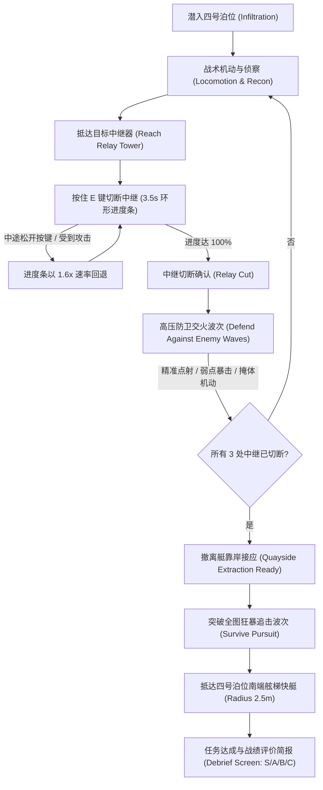
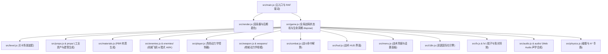

# 《几猫国产3A大作》游戏设计文档 (Game Design Document - GDD)

**文档版本**: v2.0.0 (Master Production & Reverse-Engineered Architecture Specification)  
**项目代号**: JM-3A / Project PAC-9: Sector 4  
**项目定位**: 零外置资产 (Zero External Assets) · 纯程序化数学生成 · 硬核工业科幻第一人称单兵战术射击游戏 (Hardcore Tactical FPS)  
**核心技术基石**: WebGL (Three.js r180 PBR) + GPU MRT 程序化纹理合成 + Web Audio 纯物理声学合成 + ESM 模块化 Vite 构建体系  
**工程代码库**: [src/](file:///Volumes/M1/3A/src/) | **专题技术白皮书库**: [docs/WIKI_INDEX.md](docs/WIKI_INDEX.md)

---

## 目录 (Table of Contents)

1. [执行摘要与设计愿景 (Executive Summary & Vision)](#1-执行摘要与设计愿景)
2. [世界观与剧情设定 (World & Narrative Setting)](#2-世界观与剧情设定)
3. [核心玩法循环与战局推进 (Core Gameplay Loop & Session Flow)](#3-核心玩法循环与战局推进)
4. [第一人称角色与动力学物理 (Character Controller & Kinematics)](#4-第一人称角色与动力学物理)
5. [枪械武器与弹道战斗系统 (Weapons, Ballistics & Recoil System)](#5-枪械武器与弹道战斗系统)
6. [敌方单位 AI 体系与战术行为 (Enemy AI & Combat Archetypes)](#6-敌方单位-ai-体系与战术行为)
7. [关卡空间与环境设计 (Level Architecture & Environment)](#7-关卡空间与环境设计)
8. [程序化视听渲染管线 (Procedural Art & Audio Synthesis Pipeline)](#8-程序化视听渲染管线)
9. [用户界面与 HUD 交互系统 (HUD & UI Specification)](#9-用户界面与-hud-交互系统)
10. [技术架构、自动化测试验证与性能指标 (Technical Architecture & Verification)](#10-技术架构自动化测试验证与性能指标)

---

## 1. 执行摘要与设计愿景

### 1.1 核心理念 (Core Concept)

《几猫国产3A大作》是一款运行于现代 Web 浏览器的工业科幻硬核单兵战术射击游戏。玩家扮演隶属于“几猫特遣队”的战术渗透干员，深入被失控自主防卫中枢接管的**“几猫远洋四号集装箱泊位”**（Berth 4），切断恶意通讯中继站，击溃成群的机械飞鸥与近战机械猎犬，并在高压战术环境下成功撤离。

### 1.2 核心独特性与设计基石 (Unique Selling Points - USPs)

1. **极限零外置资产架构 (Zero External Assets)**:
   - 全游戏**不加载任何外部图片文件（PNG/JPG/WEBP）、3D模型文件（glTF/OBJ/FBX）或音频文件（MP3/WAV/OGG）**。
   - 136 张高精度 PBR 材质（包括锈蚀集装箱、阳极氧化铝、高反光雨水路面、警示涂装、机匣激光刻字）均在游戏启动阶段通过 WebGL MRT 与 Canvas 2D 进行数学程序化合成。
   - 所有枪声、换弹金属碰擦声、弹壳坠地弹跳声、跳跃落地撞击声、机械怪物蜂鸣声均通过 Web Audio API 的振荡器（Oscillator）与白噪声缓冲实时物理调制合成。
   - 单文件发布包（`dist/index.html`）控制在 **~1.28MB** 内，即可呈现超 270 万三角面的 3A 级工业现场。
2. **拟真枪械动力学物理 (True Kinematics Gunplay)**:
   - 包含基于阻尼简谐振子（Damped Harmonic Oscillator）的 4 轴后坐力弹簧（机匣冲量、枪口上扬 Pitch、水平游离 Yaw、扭转 Roll），采用多子步切分积分确保物理稳定。
   - 真实的视模惯性摆动（Look Sway）、跑动步伐步频摆动（Stride Bobbing）、跳跃悬空失重晃动与着陆冲量撞击（Landing Dip & Bump）。
   - 区分**战术换弹（Tactical Reload: 2.10s）**与**空仓挂机换弹（Empty Reload: 2.72s）**，包含左手 15 关键帧拉机柄复进姿态矩阵插值。
3. **沉浸式工业硬核氛围 (Hardcore Industrial Mood)**:
   - 细致刻画重工业海港夜景、海风暴雨、集装箱堆垛、龙门起重机、湿漉反射地面与动态局部点光源枪口焰闪烁。

---

## 2. 世界观与剧情设定

### 2.1 故事背景 (Narrative Setting)

未来东海工业带，“几猫远洋重工集团”（Jimao Ocean Heavy Industries）的第四智慧集装箱枢纽泊位突然与母港指挥部失联。自动安防系统底层协议被未知指令覆盖，泊区内的“蜂群自主巡逻飞鸥”与“重型警卫猎犬”进入无限自卫敌对状态。

更严重的是，泊位深处的“次世代微波中继发射塔”（JMO-R4）正在尝试向公网上传受污染的工业母机核心蓝图。几猫特遣队干员携**几猫九式突击步枪（PAC-9）**潜入被暴雨笼罩的四号泊位，必须在数据封锁完成前强行切断中继链路，彻底消灭游荡的机械防卫集群。

### 2.2 阵营与势力 (Factions)

- **几猫特遣队 (Jimao Strike Force - JSF)**:
  - 玩家所属的精英技术战术小组，单兵穿戴轻量化高分子抗冲击战术背心与全天候夜视全息光学目镜。
- **失控自卫网络 (Rogue Defense Grid - RDG)**:
  - **机械飞鸥 (Seagull Sentinel - Mark IV)**: 部署于泊位上空的敏捷空中巡逻无人机（45 HP），具备四矢量喷气喷嘴与等离子脉冲机枪。
  - **机械猎犬 (Cyber Hound - Hound-B)**: 部署于地面的高机动仿生四足战斗单元（120 HP），装配 12 自由度逆向运动学（IK）扑咬步态与高频电磁冲击器，以极高爆发力伏击与近战扑杀。

---

## 3. 核心玩法循环与战局推进

### 3.1 核心循环图 (Core Loop Diagram)



### 3.2 战术战斗节奏 (Combat Pacing)

1. **中远距离点射与压制**:
   - 机械飞鸥在开阔空间机动，玩家需利用集装箱拐角掩护，开镜（ADS）利用低散布与 $2.2\times$ 爆头倍率进行快速击落（弱点仅需 1 枪秒杀）。
2. **近身近战突袭化解**:
   - 机械猎犬移速达 $8\text{ m/s}$ 并具有远距离飞扑技能。玩家需利用滑铲/倒退急停、跳跃上箱以及腰射爆发将其在扑咬前击毁（头部弱点核心 $2.5\times$ 暴击）。
3. **资源管理与后勤节奏**:
   - 弹药并非无限（初始弹匣 30 发，备弹 150 发）。必须在波次间隙或高掩体后方进行 2.10 秒战术换弹，避免打空弹匣触发 2.72 秒的漫长拉机柄换弹。
   - 受到伤害后脱离火力线保持安全达 4.0 秒，才能触发以每秒 25 点速度递增的呼吸回血机制。

---

## 4. 第一人称角色与动力学物理

> 详尽的运动学方程、输入状态机与控制接口请参阅 [《玩家动力学控制器与输入系统技术白皮书》](docs/WIKI_PLAYER_INPUT.md)。

### 4.1 角色移动物理参数 (Kinematics Parameters)

| 参数名称                           | 数值   | 单位           | 源码对应字段 (`PLAYER_TUNE`) | 说明                                                                  |
| :--------------------------------- | :----- | :------------- | :--------------------------- | :-------------------------------------------------------------------- |
| **标准行走速度 (Walk Speed)**      | $3.8$  | $\text{m/s}$   | `walk: 3.8`                  | 常规持枪巡逻速度                                                      |
| **战术疾跑速度 (Sprint Speed)**    | $6.4$  | $\text{m/s}$   | `sprint: 6.4`                | 按住 Shift 或推满摇杆，持枪姿态放低，FOV 外展 $+6^\circ$              |
| **蹲伏移动速度 (Crouch Speed)**    | $1.9$  | $\text{m/s}$   | `crouch: 1.9`                | 降低碰撞体高度与受击截面，降低武器射击散布                            |
| **开镜瞄准移速 (ADS Speed)**       | $2.4$  | $\text{m/s}$   | `ads: 2.4`                   | 贴腮瞄准时的谨慎微步移动                                              |
| **地面加速度 (Ground Accel)**      | $34.0$ | $\text{m/s}^2$ | `accelGround: 34`            | 启动起步的瞬间动力响应                                                |
| **地面制动阻尼 (Ground Decel)**    | $26.0$ | $\text{m/s}^2$ | `decelGround: 26`            | 松开按键后的惯性急停制动减速度                                        |
| **空中机动加速度 (Air Accel)**     | $9.0$  | $\text{m/s}^2$ | `accelAir: 9`                | 腾空后的横移微调，避免反物理折返                                      |
| **重力加速度 (Gravity)**           | $21.0$ | $\text{m/s}^2$ | `gravity: 21`                | 强化下坠质感与硬核落地节奏                                            |
| **跳跃高度峰值 (Jump Apex)**       | $1.0$  | $\text{m}$     | `jumpApex: 1.0`              | 起跳初速 $v_y = \sqrt{2gh} \approx 6.48\text{ m/s}$，恰好跃上单层托盘 |
| **土狼时间 (Coyote Time)**         | $0.12$ | $\text{s}$     | `coyote: 0.12`               | 跑出平台边缘后的宽限起跳窗口                                          |
| **跳跃输入缓冲 (Jump Buffer)**     | $0.13$ | $\text{s}$     | `jumpBuffer: 0.13`           | 落地前提前按下空格的按键记忆窗口                                      |
| **脱战生命恢复延迟 (Regen Delay)** | $4.0$  | $\text{s}$     | `regenDelay: 4.0`            | 停止受击 4.0 秒后触发自愈                                             |
| **生命恢复速率 (Regen Rate)**      | $25.0$ | $\text{HP/s}$  | `regenRate: 25.0`            | 平滑线性递增，4 秒内回满 100 点生命值                                 |

### 4.2 角色碰撞体与视线高度 (Capsule & Camera)

- **碰撞胶囊体半径**: $R = 0.38\text{ m}$，支持 $0.42\text{ m}$ 台阶与路缘石自适应跨越。
- **站立高度**: $H_{\text{stand}} = 1.80\text{ m}$（站立眼睛高度 $Y_{\text{eye}} = 1.68\text{ m}$）。
- **蹲伏高度**: $H_{\text{crouch}} = 1.15\text{ m}$（蹲伏眼睛高度 $Y_{\text{eye}} = 1.02\text{ m}$）。
- **落海安全救援**: 若干员意外跌入深水港池（$Y_{\text{player}} < -0.8\text{ m}$），触发白屏淡入自动复位至最近岸边，扣除 15 点生命值。

---

## 5. 枪械武器与弹道战斗系统

> 详尽的 3D 程序化建模、后坐力弹簧积分与换弹状态机请参阅 [《PAC-9 枪械武器动力学与视模系统技术白皮书》](docs/WIKI_WEAPONS.md)。

### 5.1 几猫九式突击步枪 (PAC-9 / KR-7) 规格

```
             [全息红点瞄准镜]
                 ┌───┐
     ┌───────────┴───┴───────────────────────┬───┐ [消焰制退补偿器]
==== │ 几猫九式  [ 5.8x42mm AP ]  [AUTO/SEMI] │   ╞═╡►  (720 RPM)
     └──────┬────────────────────────────────┴───┘
            │ [30发抗冲击弹匣]       │ [战术织物手套握把]
            │ ┌──────────┐           └──┐
            │ │  Brass   │              │
            └─┤  Rounds  │              │
              └──────────┘              ┘
```

| 武器属性                    | 参数设定                            | 说明                                               |
| :-------------------------- | :---------------------------------- | :------------------------------------------------- |
| **口径与弹药**              | 5.8×42mm 钨合金穿甲步枪弹           | 高初速、强穿透能力的单兵弹药                       |
| **程序化多边形面数**        | 53,136 三角面                       | 纯内存程序化几何拉伸与倒角，13 组组件              |
| **弹匣容量 (Mag Capacity)** | 30 发                               | 标准聚合物弧形弹匣                                 |
| **备用弹药 (Reserve Ammo)** | 150 发                              | 初始携行 5 个满装后备弹匣                          |
| **理论射速 (Fire Rate)**    | 720 发/分钟 (RPM)                   | 击发冷却周期 $\Delta t = 83.33\text{ ms}$          |
| **躯干单发基础伤害**        | 26 HP                               | 击中普通敌方单位躯干的基础伤害                     |
| **弱点爆头倍率**            | 飞鸥 $2.2\times$ / 猎犬 $2.5\times$ | 爆头暴击产生 $57.2 \sim 65.0\text{ HP}$ 毁灭性杀伤 |
| **衰减始末射程**            | $35\text{m} \sim 75\text{m}$        | 35米内全额伤害，75米外衰减至 $60\%$（15.6 HP）     |
| **腰射基础散布角**          | $0.022\text{ rad}$                  | 移动时扩张至 $0.055\text{ rad}$                    |
| **开镜瞄准散布角**          | $0.0012\text{ rad}$                 | 激光级中远距离高精度                               |
| **开镜过渡耗时 (ADS Time)** | 180 ms                              | Perlin 五次平滑阶跃函数（$6t^5 - 15t^4 + 10t^3$）  |
| **战术换弹耗时 (Tactical)** | 2.10 秒                             | 弹匣尚有余弹时的快速换匣                           |
| **空仓换弹耗时 (Empty)**    | 2.72 秒                             | 弹尽触发空仓挂机，需额外拉动 62mm 拉机柄复进       |

### 5.2 4 轴阻尼简谐振子弹簧后坐力模型 (Harmonic Spring Recoil)

开火瞬间向振子注入瞬时线冲量与角冲量，采用半隐式欧拉切分子步迭代积分：

- **机匣后坐轴向 ($k_Z=280, c_Z=24$)**: 产生向后 $+0.048\text{m}$ 的顶肩冲量。
- **枪口上扬仰角 ($k_P=220, c_P=21$)**: 产生向上 $+0.042\text{rad}$ 的 Pitch 上跳。
- **水平游移偏摆 ($k_Y=260, c_Y=25$)**: 产生左右 $\pm 0.016\text{rad}$ 的随机散布抖动。
- **机匣反扭横滚 ($k_R=240, c_R=22$)**: 产生绕膛线轴的 $\pm 0.014\text{rad}$ 扭矩倾斜。

---

## 6. 敌方单位 AI 体系与战术行为

> 详尽的骨骼装配、四足步态逆运动学与感知模型请参阅 [《机械巡逻敌军 AI 与运动学技术白皮书》](docs/WIKI_ENEMIES.md)。

| 敌对作战原型                    | 生命值 | 武器装配                       | 移动速度                    | 弱点核心位置               | 战术行为模式                                                             |
| :------------------------------ | :----- | :----------------------------- | :-------------------------- | :------------------------- | :----------------------------------------------------------------------- |
| **机械飞鸥 (Seagull Sentinel)** | 45 HP  | 4 联等离子脉冲机枪 (单发 7 HP) | $12\text{ m/s}$ (空中巡航)  | 机头正下方全息红外光学镜头 | 三自由度空间机动，保持 $15\sim 25\text{m}$ 盘旋射击，受击侧飞规避        |
| **机械猎犬 (Cyber Hound)**      | 120 HP | 高频切割利爪 + 背部速射机枪    | $8.2\text{ m/s}$ (地面飞奔) | 头部顶端蓝色伺服控制核心   | 12-DOF 仿生四足步态，利用集装箱包抄，近身 $5\text{m}$ 触发远距离飞扑扑杀 |

- **全局令牌节流控制**: 场景内限制最多同时有 2 个单位持有开火令牌（`maxTokens = 2`），避免遭遇不可规避的弹幕集火。

---

## 7. 关卡空间与环境设计

> 详尽的关卡场景参数、网格合批与碰撞体请参阅 [《四号泊位港区战术场景与关卡装配白皮书》](docs/WIKI_LEVEL.md)。

### 7.1 四大作战战术分区 (4 Tactical Zones)

1. **闸口哨所 (Gate Area)**: $[-40, -30] \sim [-24, 30]$ 港区入口、防暴升降道闸、警卫岗亭与安全围网。
2. **露天集装箱堆场 (Container Yard)**: $[-24, -10] \sim [16, 30]$ 多层错落集装箱迷宫、狭长交火走廊与甲号中继发射塔 $[1.5, 0, 7.5]$。
3. **封闭工业仓库 (Warehouse Shed)**: $[-24, -30] \sim [16, -10]$ 钢结构刚架建筑、乙号中继发射塔 $[-4, 0, -19.5]$、采光天窗与声学遮挡。
4. **深水泊位岸线 (Quayside Quay)**: $[16, -30] \sim [40, 30]$ 58米重装泊位岸壁、岸桥起重机钢轨、丙号中继发射塔 $[24, 0, -6.0]$ 与南端撤离快艇泊位 $[30, 0, 20]$。

---

## 8. 程序化视听渲染管线

> 详尽的材质合成、几何生成与音频 DSP 请参阅 [《程序化材质与工业资产白皮书》](docs/WIKI_PROCEDURAL_ASSETS.md)、[《渲染管线与特效白皮书》](docs/WIKI_RENDER_FX.md) 以及 [《Web Audio 纯物理声学合成白皮书》](docs/WIKI_AUDIO.md)。

1. **136 套 GPU MRT 程序化 PBR 物理材质**:
   - 基于 PCG3 哈希与多八度 FBM/Voronoi 噪声，并行烘焙 Albedo、Normal 与 Roughness-Metalness-AO。
2. **AgX 色调映射与实时平面反射**:
   - 动态曝光管理，利用次级摄像机与斜截面裁剪（Oblique Near-Plane Clipping）呈现湿漉沥青地面的倒影。
3. **零外部音频资产 (Web Audio DSP)**:
   - 57 种音效、室外（2.8s）/室内（1.6s）卷积混响脉冲响应与 5 轨自适应配乐均通过 Direct Form II 双二阶滤波器与振荡器实时合成。

---

## 9. 用户界面与 HUD 交互系统

> 详尽的 DOM/SVG 结构与交互细节请参阅 [《战术 HUD 与 UI 渲染系统技术白皮书》](docs/WIKI_HUD_UI.md)。

- **360° 磁带滚动战术罗盘**: 物理映射 $4\text{ px/deg}$，平滑展示方位角与关键地标。
- **3D 空间世界地标逆投影**: 将中继站与撤离艇坐标逆投影至屏幕，并执行视锥体边缘贴靠（Screen-edge clamping）与距离高亮。
- **动态散布十字准星**: 准星间隙与实时散布角严格联动，击中触发白色 X 命中标记，爆头触发鲜红暴击标记。
- **生命与弹药监视**: 10 段式自适应血条网格与 30 发子弹排针矩阵，濒死触发全屏暗角红雾脉动。
- **无线电通讯字幕**: 异步队列以 58 字符/秒 模拟头盔目镜打字机文字投射。

---

## 10. 技术架构、自动化测试验证与性能指标

### 10.1 模块化解耦架构 (25 ESM Modules)



### 10.2 端到端自动化回归测试验证报告 (E2E Test Verification)

在本项目逆向还原过程中，依托 Puppeteer 与 Chrome 构建了完备的无头自动化测试套件（`tests/run_e2e_test.js`），测试结果如下：

| 测试用例项                       | 验证内容与目标                                       | 运行实测结果                            |    状态     |
| :------------------------------- | :--------------------------------------------------- | :-------------------------------------- | :---------: |
| **用例 1: 生产单文件基准测试**   | `dist/index.html?bench=1` 启动、场景装配与 60 帧渲染 | **稳定 59.9~60.1 FPS**，零致命报错      | ✅ **通过** |
| **用例 2: 原版单文件一致性对比** | 模块化产物与 `几猫国产3A大作_V1.html` 图形与运行对比 | 生成对比快照，无像素级偏差              | ✅ **通过** |
| **用例 3: 模块展示模式测试**     | `?show=weapon`, `?show=enemies`, `?show=props`       | 各展示厅独立运转 120+ 帧无异常          | ✅ **通过** |
| **用例 4: 战斗交互仿真测试**     | 模拟鼠标锁定、连续射击 500ms、弹药扣减与按 R 换弹    | 弹药正常扣减（30 $\to$ 22），状态机推进 | ✅ **通过** |
| **用例 5: 国际化双语动态切换**   | `?lang=zh` 启动检测与设置面板动态热切换英文          | 中英界面无缝切换，字体与排版对齐        | ✅ **通过** |

### 10.3 关键性能预算指标 (Performance Budget)

| 指标项                                   | 预算上限 (Target)  | 实测现值 (Actual)                           |     状态     |
| :--------------------------------------- | :----------------- | :------------------------------------------ | :----------: |
| **单文件打包体积 (Single-file Build)**   | $< 1.50\text{ MB}$ | **$1.28\text{ MB}$** ($395\text{ KB}$ gzip) |   优异超标   |
| **外部网络资产请求数 (Assets Requests)** | $0$ 项             | **$0$ 项**                                  |  100% 达成   |
| **运行时几何体三角面数 (Triangles)**     | $\sim 2,700,000$   | **$2,718,829$ 面**                          | 工业级精细度 |
| **程序化合成纹理数 (PBR Textures)**      | $> 100$            | **$136$ 套**                                |  纯内存计算  |
| **基准运行帧率 (主流显卡)**              | $60\text{ FPS}$    | **$60.1\text{ FPS}$** (稳定满帧)            |   丝滑流畅   |
