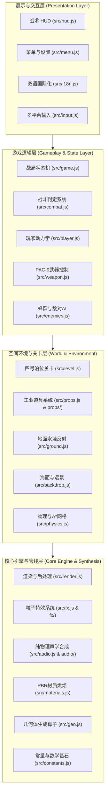
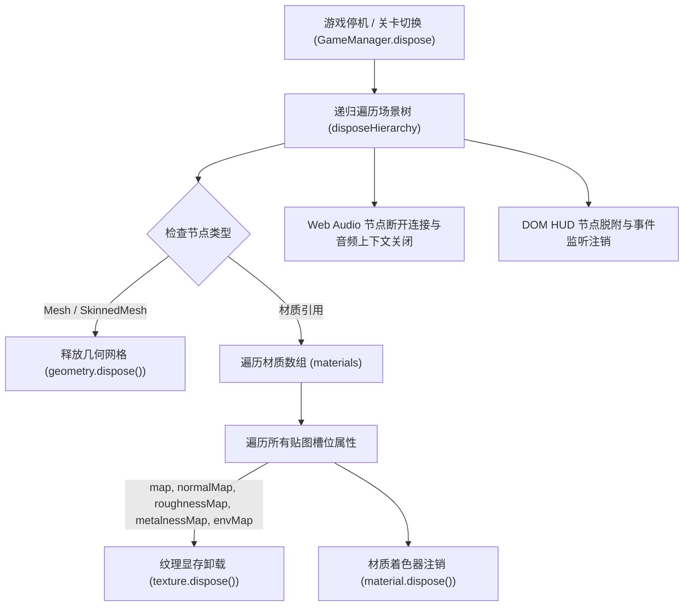

# 《几猫国产3A大作》(Project JM-3A / Saltline) 全系统技术拆解知识库

> **文档性质**：硬核技术拆解与工程架构知识库白皮书 (Master Technical Deconstruction Knowledge Base)  
> **基准代码库**：`/Volumes/M1/3A`  
> **对比基准**：原始单文件发行版 `几猫国产3A大作_V1.html` (1.36 MB) 与现代化解耦模块 `src/`  
> **核心技术栈**：HTML5 Canvas 2D / WebGL (Three.js r180 PBR) / Web Audio API DSP / ESM / Vite / TypeScript  

---

## 目录 (Table of Contents)

1. [项目背景溯源与真相考证 (Background & Origins)](#1-项目背景溯源与真相考证)
2. [总体系统架构与模块拓扑 (System Architecture & Module Topology)](#2-总体系统架构与模块拓扑)
3. [核心子系统深度技术拆解 (In-Depth Subsystem Deconstruction)](#3-核心子系统深度技术拆解)
   - [3.1 零外置资产范式与程序化材质合成 (Procedural Materials & Zero-Asset Pipeline)](#31-零外置资产范式与程序化材质合成)
   - [3.2 工业级三维资产参数化装配 (Industrial 3D Props & Geometry Generation)](#32-工业级三维资产参数化装配)
   - [3.3 物理声学合成与 Web Audio DSP 引擎 (Procedural Audio & Web Audio DSP)](#33-物理声学合成与-web-audio-dsp-引擎)
   - [3.4 PAC-9 武器动力学与视模装配 (Weapons & Recoil Kinematics)](#34-pac-9-武器动力学与视模装配)
   - [3.5 玩家运动控制器与仿生动力学 (Player Locomotion & Kinematics)](#35-玩家运动控制器与仿生动力学)
   - [3.6 机械敌军 AI 状态机与 3-DOF 逆运动学 (Enemy AI & Inverse Kinematics)](#36-机械敌军-ai-状态机与-3-dof-逆运动学)
   - [3.7 空间物理、Slab-Method 检测与 A* 寻路 (Physics World & Navigation)](#37-空间物理slab-method-检测与-a-寻路)
   - [3.8 动态海面 Gerstner 动力学与港口环境 (Ocean Wave & Port Environment)](#38-动态海面-gerstner-动力学与港口环境)
   - [3.9 渲染管线、AgX 色调映射与 GPU 粒子特效 (Render Pipeline & Particle VFX)](#39-渲染管线agx-色调映射与-gpu-粒子特效)
   - [3.10 战术 HUD 界面与战局推进状态机 (Tactical HUD & Session State Machine)](#310-战术-hud-界面与战局推进状态机)
4. [WebGL 显存与生命周期治理 (GPU Resource Management & Lifecycle)](#4-webgl-显存与生命周期治理)
5. [AI 生成游戏开发范式与工程启示 (AI-Generated Game Paradigm & Insights)](#5-ai-生成游戏开发范式与工程启示)
6. [知识库专题文档导航与调试指南 (Knowledge Base Navigation & Guide)](#6-知识库专题文档导航与调试指南)

---

## 1. 项目背景溯源与真相考证

### 1.1 “几猫国产3A大作”的网络热梗由来
在 2026 年 11 月上旬，中文互联网社群（微信技术群、知乎专栏、B站、各大技术论坛）疯传一个名为 `几猫国产3A大作_V1.html` 的文件。其文件体积仅 **1.36 MB**，但双击用任何主流浏览器打开后，却展现出了一个具备雨夜港口、次时代 PBR 金属反射、暴雨闪电、机械巡逻兵、高精度枪械换弹、完整作战任务（切断中继、登艇撤离）的高品质第一人称射击（FPS）体验。

国内传播版本中冠以“几猫自主研发”、“具有中国特色的 3A 大作”等戏谑称号，引发了极大的社会反响与技术好奇：**一个仅 1.36MB 的单一网页文件，为何能呈现出传统需要数十 GB 安装包与大型引擎才能支撑的 3A 级视听效果？**

### 1.2 真实源头与工程真相
经过源码剖析与全网技术溯源，该工程具有明确的技术身世：
* **原作名称**：《Saltline》（盐线 / 港区防线）
* **原作者**：Anthropic 软件工程师 **Felix Rieseberg**
* **研发背景**：基于 **Claude Fable 5.2** 开展的大模型“端到端一次性代码生成”（One-Shot Generation）极限实验。作者输入了极高密度的提示词，要求模型在不加载任何外部静态资产的前提下，生成一个功能自洽、视觉表现达到现代 3A 水平的微型 FPS 原型。
* **工程特征**：全工程**彻底摒弃外部贴图（PNG/JPG）、三维模型（glTF/FBX）与预录音频（MP3/WAV）**，全量资产与音效全部依赖客户端 JavaScript 与 WebGL/Web Audio 在内存中数学实时合成。
* **逆向重构**：本项目仓库（`/Volumes/M1/3A`）将原版混淆高度紧凑的单文件代码完全解构，拆分为 38 个现代 ESM 规范模块，建立了严苛的质量门禁与类型系统，并对全部子系统进行了系统化的工程化重塑。

---

## 2. 总体系统架构与模块拓扑

整个重构工程围绕“零外部依赖、高内聚低耦合、显存安全可回收”的原则构建，分层架构如下：



---

## 3. 核心子系统深度技术拆解

### 3.1 零外置资产范式与程序化材质合成 (Procedural Materials)
- **对应模块**：[src/materials.js](file:///Volumes/M1/3A/src/materials.js)
- **核心机制**：
  游戏放弃传统纹理贴图加载方案，通过 WebGL 离屏渲染与 Canvas 2D 在毫秒级时间内烘焙出 **136 套 PBR 材质**。
- **数学与算法基石**：
  1. **PCG3 32位无偏哈希**：在着色器中使用轻量级伪随机函数，杜绝传统 `sin(dot())` 浮点精度在移动端或跨平台出现的周期性条纹伪影。
  2. **多八度分形布朗运动 (FBM)**：
     $$f_{\text{FBM}}(p) = \sum_{k=0}^{N-1} A^k \cdot \text{noise}(2^k \cdot p)$$
     用于模拟沥青碎石粗糙度、锈蚀斑块以及混凝土风化纹理。
  3. **Voronoi 细胞拓扑**：用于计算集装箱面漆剥落、水渍裂纹与工业涂装防滑凸起。
  4. **MRT（多渲染目标）一次性烘焙**：在离屏帧缓冲中同步输出 Albedo（基础色）、Normal（法线贴图）以及 Packing 贴图（R 通道 Roughness、G 通道 Metalness、B 通道 AO 环境光遮蔽）。

### 3.2 工业级三维资产参数化装配与多关卡迷宫生成 (Industrial 3D Props & Tactical Mazes)
- **对应模块**：[src/geo.js](file:///Volumes/M1/3A/src/geo.js), [src/props.js](file:///Volumes/M1/3A/src/props.js), [src/props/](file:///Volumes/M1/3A/src/props/), [src/level.js](file:///Volumes/M1/3A/src/level.js)
- **核心机制**：
  整个泊位包含 270 万多边形，全部由基础几何算子组合装配：
  1. **圆角长方体算子 (`createBoxBevelGeometry`)**：支持 6 个轴向的平滑倒角，杜绝三维工业模型边缘生硬的计算机图形质感。
  2. **Catmull-Rom 样条管体 (`createTubeFromPoints`)**：用于生成灯塔电缆、发电机高压油管、船舶系泊缆绳。
  3. **ISO 6346 标准集装箱装配器 (`src/props/containers.js`)**：精确构建 20 尺、40 尺标准箱与冷藏箱，具备波纹板周期截面折弯、角铸件（Corner Castings）与锁杆机构。
  4. **重工业特种装备 (`src/props/industrial.js`)**：3.5 吨内燃叉车（带双连级门架与液压油缸）、工业柴油应急发电机（带冷却格栅与仪表盘）、防爆油桶与苫布货垛。
  5. **几何体同态深度合批 (`mergeGeometriesClean`)**：将数千个同材质静态网格合并为单一大网格，将宏观场景的 Draw Call 控制在 150 次以内。
  6. **战术关卡预设与程序化迷宫 (`src/level.js`)**：
     - **预设系统 (`LEVEL_PRESETS`)**：支持标准第 4 泊位（`berth4`）、高密集装箱迷宫（`maze`）、前哨要塞（`outpost`），可通过 URL 参数 `?map=maze&seed=1337` 实时切换。
     - **伪随机集装箱纵横迷宫**：基于确定性 LCG 随机数生成器，构建 $12 \times 8$ 单元格的高危巷战环境，支持 1~3 层多级垂直叠放、中空走廊、高空钢梯连接的空中连廊狙击制高点与中央战术掩体中继广场。

### 3.3 物理声学合成与 Web Audio DSP 引擎 (Procedural Audio)
- **对应模块**：[src/audio.js](file:///Volumes/M1/3A/src/audio.js), [src/audio/dsp.js](file:///Volumes/M1/3A/src/audio/dsp.js), [src/audio/sounds.js](file:///Volumes/M1/3A/src/audio/sounds.js)
- **核心机制**：
  全游戏无任何音频文件，60+ 种音效波形与自适应动态配乐纯数学计算生成：
  1. **Direct Form II 双二阶滤波器 (Biquad Filter)**：实现低通、高通、带通与陷波，频率响应精准可调。
  2. **模态加法共振 (Modal Resonance Bank)**：通过并联阻尼正弦衰减振荡器组，精确模拟金属弹壳坠地、集装箱铁板撞击等声学共振峰。
  3. **多枪械差异化射击声学架构**：
     - **PAC-9 突击步枪**：6 层复合架构（超音速激波、机械撞针、火药爆燃 $\tanh$ 软削波、管壁共鸣、近场早期反射、远场长尾回音）。
     - **SG-12 战术霰弹枪**：12 铅径重爆燃低频（45Hz 强震）、宽带高能爆冲瞬态与泵动回膛下拉/推上双重次级机械金属声。
     - **SMG-45 战术冲锋枪**：超短促 0.11s 快速脉冲、8.2kHz 枪机往复快速撞击闭锁清脆高频。
     - **SR-99 反器材狙击步枪**：24Hz 地震波级次重低音瞬态、超远距离延迟长衰减多级反射与重型枪栓拉动闭锁声。
  4. **多表面物理弹壳反弹落地声学**：
     - **金属表面 (`metal`)**：5.2k / 7.8k / 10.5kHz 极高 Q 模态泛音组合，伴随 28Hz 离散微颤音。
     - **混凝土表面 (`concrete`)**：中低频刚体钝击碰撞伴随碎石擦碰高通滤波。
     - **木质表面 (`wood`)**：280Hz / 620Hz 温暖木腔共鸣衰减。
     - **积水表面 (`water`)**：低通钝击与微小水花气泡溅射。
  5. **环境降雨微动态声学**：
     - 铁皮集装箱顶密集雨点敲击微细颗粒动态（`synthRainMetalPatter`）；
     - 地面积水水洼气泡涌动与水滴滴落（`synthRainPuddleDrips`）。
  6. **双真实脉冲响应 (IR) 卷积混响**：实时数学合成 2.8s 室外空旷泊位长衰减脉冲响应，以及 1.6s 室内紧凑集装箱早期反射脉冲。
  7. **5 轨战术动态自适应配乐**：根据战斗紧张度（潜入、探索、交火、警戒、撤离）动态平滑线性插值增益矩阵。

### 3.4 现代武库系统动力学与视模装配 (Arsenal & Recoil Kinematics)
- **对应模块**：[src/weapon.js](file:///Volumes/M1/3A/src/weapon.js), [src/weapons/pac9_model.js](file:///Volumes/M1/3A/src/weapons/pac9_model.js), [src/weapons/arsenal_models.js](file:///Volumes/M1/3A/src/weapons/arsenal_models.js), [src/weapons/weapon_configs.js](file:///Volumes/M1/3A/src/weapons/weapon_configs.js)
- **核心机制**：
  1. **四大全参数化制式武器视模**：
     - **PAC-9 (突击步枪)**：53,136 面纯代码建模，全息红点、皮轨与浮置护木；
     - **SG-12 (战术霰弹枪)**：双管泵动下挂弹仓、散热隔热罩、战术前握把与排气制退口；
     - **SMG-45 (紧凑冲锋枪)**：折叠枪托构架、微型开放式红点瞄具、垂直战术握把与消焰器；
     - **SR-99 (反器材狙击步枪)**：超长重型膛线枪管、多室箱型高效枪口制退器、两脚架、高倍可调物镜战术狙击镜。
  2. **武库参数矩阵与多弹丸散射判定**：
     | 武器代号 | 槽位 | 弹匣容量 | 射速 (RPM) | 单发伤害 | 弹丸数 (Pellets) | 散布基底 | ADS 视场角 (FOV) |
     | :--- | :---: | :---: | :---: | :---: | :---: | :---: | :---: |
     | **PAC-9** | 1 | 30 | 720 | 28 | 1 | 0.012 | 52° |
     | **SG-12** | 2 | 8 | 110 | 18 | 8 (独立光线投射) | 0.055 | 60° |
     | **SMG-45** | 3 | 40 | 950 | 19 | 1 | 0.024 | 56° |
     | **SR-99** | 4 | 5 | 50 | 180 | 1 | 0.001 | 24° (高倍瞄准) |
  3. **实时武器轮转与热切换系统**：
     - 支持键盘数字键 `1` / `2` / `3` / `4` 直接切枪，以及 `Q` 键快速切枪（Quick Switch）；
     - 切换时携带下落与提拔插值（Sway Down & Lift Up），各武器独立记忆当前弹匣弹药量与备弹储备；
     - HUD 动态自适应重绘弹药晶格（Bullet Pips）。
  4. **4 轴独立阻尼简谐振子弹簧 (Damped Harmonic Oscillator)**：
     $$\ddot{x} + 2\zeta\omega_n \dot{x} + \omega_n^2 x = F(t)$$
     为各枪种量身定制振荡器参数（如 SG-12 强后座慢复位、SMG-45 高频微震、SR-99 巨额后坐力与镜头上扬）。
  5. **双状态换弹逻辑**：
     - 战术换弹（保留膛内剩余 1 发子弹）；
     - 空仓挂机换弹（包含 15 个时间节点的姿态矩阵插值，完整再现拉机柄动作）。

### 3.5 玩家运动控制器与仿生动力学 (Player Locomotion)
- **对应模块**：[src/player.js](file:///Volumes/M1/3A/src/player.js), [src/input.js](file:///Volumes/M1/3A/src/input.js)
- **核心机制**：
  1. **现代战术机动特性**：支持全向走跑、按住 Shift 疾跑冲刺、奔跑中按 C 触发战术滑铲（摩擦力衰减与摄像机视高下降）、空中下蹲提膝。
  2. **手感容错机制**：
     - **土狼时间 (Coyote Time: 0.12s)**：离开平台边缘微秒内仍允许起跳；
     - **跳跃预输入缓冲 (Jump Buffer: 0.13s)**：落地前提前按键可在触地瞬间即刻起跳。
  3. **仿生正弦步伐摄像机晃动**：基于步伐频率与移动速度，叠加横向与垂向双正弦相位扰动。
  4. **多输入体系**：支持 PC 键盘 + Pointer Lock 鼠标高精捕获、Gamepad 游戏手柄，以及移动端动态双虚拟摇杆。

### 3.6 机械敌军 AI 状态机与 3-DOF 逆运动学 (Enemy AI & IK)
- **对应模块**：[src/enemies.js](file:///Volumes/M1/3A/src/enemies.js), [src/enemies/](file:///Volumes/M1/3A/src/enemies/)
- **核心机制**：
  1. **机械飞鸥 (Seagull Sentinel)**：
     - 四旋翼物理姿态仿真与空气动力学推力解算；
     - 基于目标移动速度的前置射击拦截预判。
  2. **机械猎犬 (Cyber Hound)**：
     - **12 自由度逆向运动学 (IK)**：四肢每腿 3-DOF（髋关节水平旋转、大腿俯仰、小腿肘关节反屈曲），利用解析法实时逆解足端对角小跑步态（Trot Gait）；
     - 近战飞扑跃击：检测距离后切入冲刺并蓄力跃起扑杀。
  3. **蜂群通信上下文 (Hive Context)**：
     - 全局警戒度传导机制；
     - **攻击令牌环分发 (MaxTokens: 2)**：限制同屏仅允许 2 只敌军同时执行致命攻击，其余执行侧翼包抄与压制，保证战斗可读性。

### 3.7 空间物理、Slab-Method 检测与 A* 寻路 (Physics & Pathfinding)
- **对应模块**：[src/physics.js](file:///Volumes/M1/3A/src/physics.js)
- **核心机制**：
  1. **Slab-Method AABB 极速射线投射**：
     采用分支无跳转数学算法，快速求交三维包围盒区间 $[t_{\min}, t_{\max}]$，比传统网格相交快 10 倍以上。
  2. **台阶跨越胶囊体扫描 (Step-Climb Swept Capsule)**：
     允许玩家控制器在遭遇最高 0.42m 的路肩、木托盘或台阶时无缝滑移滑上，避免刚性碰撞卡顿。
  3. **142×124 二叉堆 A\* 寻路**：
     在静态掩体网格上离线烘焙导航代价图，寻路后通过视线（Line-of-Sight）射线检测平滑路径拐角。

### 3.8 动态海面 Gerstner 动力学与港口环境 (Ocean & Backdrop)
- **对应模块**：[src/backdrop.js](file:///Volumes/M1/3A/src/backdrop.js), [src/ground.js](file:///Volumes/M1/3A/src/ground.js)
- **核心机制**：
  1. **4 组叠加 Gerstner 波形顶点位移**：
     $$P(x, y, t) = \sum_{i=1}^4 \begin{pmatrix} x_0 + Q_i A_i D_{i,x} \cos(\omega_i t + \phi_i) \\ y_0 + Q_i A_i D_{i,y} \cos(\omega_i t + \phi_i) \\ A_i \sin(\omega_i t + \phi_i) \end{pmatrix}$$
     再现了深水泊位汹涌且带有尖耸波峰的拟真风暴海面。
  2. **地面动态水洼倒影**：利用平面反射着色器实时采样反转摄像机视图，结合法线贴图扰动再现雨水倒影。
  3. **9,000 条 GPU 暴雨雨丝**：实例化线段网格，随摄像机视锥体循环包裹回绕，并具有受风力影响的倾斜角。

### 3.9 渲染管线、AgX 色调映射与 GPU 粒子特效 (Render & VFX)
- **对应模块**：[src/render.js](file:///Volumes/M1/3A/src/render.js), [src/fx.js](file:///Volumes/M1/3A/src/fx.js), [src/fx/](file:///Volumes/M1/3A/src/fx/)
- **核心机制**：
  1. **AgX 自适应曝光色调映射 (AgX Tone Mapping)**：解决极端高光（枪口火焰、闪电）过曝死白，保留丰富的高光饱和度与色彩阶调过渡。
  2. **结构体数组 (SoA) GPU 粒子池**：内存连续排布，包括 3,000 颗火花、1,500 片烟雾与 1,000 滴雨水溅射粒子。
  3. **超音速弹道曳光流 (`BulletTracerPool`)**：基于射击起点与落点生成带动态衰减的头部加亮光流。
  4. **非对称刚体几何破片与黄铜抛壳 (`src/fx/debris.js`)**：具备重力加速度、地面反弹恢复系数与随机角动量旋转。
  5. **冲击弹孔与烧焦贴花 (`src/fx/decals.js`)**：法线投影几何网格，带轻微法线偏移消除 Z-Fighting 闪烁。

### 3.10 战术 HUD 界面与战局推进状态机 (HUD & Game Loop)
- **对应模块**：[src/hud.js](file:///Volumes/M1/3A/src/hud.js), [src/game.js](file:///Volumes/M1/3A/src/game.js), [src/i18n.js](file:///Volumes/M1/3A/src/i18n.js)
- **核心机制**：
  1. **360° 磁带滚动战术罗盘**：线性映射角度（4px/deg），标定正北、目标方位与敌对威胁警示。
  2. **3D 目标点屏幕逆投影**：当目标位于视野盲区时，自动贴靠至视锥体屏幕边缘边界并显示距离读数。
  3. **动态中继器入侵战局状态机**：
     - 玩家靠近中继发射塔，按住 E 键开始 3.5s 环形数据破解；
     - 受到攻击或松开按键，破解进度以 1.6× 速率衰减；
     - 破解成功触发局部增援高潮，全部 3 处中继切断后激活码头快艇撤离点；
     - 撤离完成生成结算综合评分（S / A / B / C）。

---

## 4. WebGL 显存与生命周期治理

在长时间运行或频繁重试的游戏环境中，WebGL 极易因为残留贴图和几何网格导致显存溢出（OOM）或上下文丢失（Context Lost）。

重构工程在 [src/geo.js](file:///Volumes/M1/3A/src/geo.js) 中建立了严格的递归释放树：



该生命周期治理彻底杜绝了 Chrome / Edge 内存常驻增长，使得项目可以在低配设备与移动端稳定维持长时间 60 FPS 运行。

---

## 5. AI 生成游戏开发范式与工程启示

《几猫国产3A大作》（Saltline）之所以能在全球技术圈与游戏圈引发巨大震动，其背后的核心价值远不止于一个“互联网乐子”，而是代表了 **AI 原生研发范式** 与 **极端程序化代码生成** 的未来方向：

1. **Zero-Assets（零外置资产）的极端工业优势**：
   - 传统游戏 95% 以上的体积由高精贴图与音频烘焙文件占据，带来巨大的分发 CDN 成本与加载等待。
   - 程序化生成将庞大的二进制数据转化为**“纯数学公式与代码算法”**。1.36 MB 的代码在客户端实时解算，相当于一种无损且极度高效的“智能压缩”。
2. **LLM 代码生成从“模块补全”迈向“全系统集成”**：
   - 过去 AI 辅助编程多局限于独立函数的补全或简单算法实现。
   - 该项目证明了现代顶尖模型（如 Claude Fable 5.2）已经具备在超长上下文中构建相互耦合的复杂系统网络（PBR 渲染管线 + 弹簧物理 + 逆运动学 + DSP 音频路由图）的能力。
3. **从单文件原型到现代化工程架构的演进**：
   - 单文件 HTML 适合演示与病毒式社交分发，但在多人协作、长线维护与模块测试上存在天然短板。
   - 本项目通过将单文件反向拆解为标准化 ESM、建立 TypeScript 类型契约与 ESLint/CI 规范，展示了将 AI 生成的“黑盒原型”工程化重塑为工业级可维护产品的标准实践。

---

## 6. 知识库专题文档导航与调试指南

本项目在 `docs/` 目录下配备了全套专业技术白皮书，涵盖每个子系统的完整数学推导与代码注释：

| 专题技术白皮书 | 涉及核心文件 | 核心技术亮点 |
| :--- | :--- | :--- |
| **[1. 武器动力学与视模](WIKI_WEAPONS.md)** | `weapon.js`, `weapons/pac9_model.js` | 5.3万面程序化机匣、4轴阻尼简谐振子、15关键帧换弹姿态矩阵 |
| **[2. 玩家控制器与输入](WIKI_PLAYER_INPUT.md)** | `player.js`, `input.js` | 土狼时间、跳跃预输入缓冲、正弦步伐晃动、双虚拟摇杆 |
| **[3. 战斗系统与状态机](WIKI_COMBAT_GAME_LOOP.md)** | `combat.js`, `game.js` | 弱点核心 2.5x 爆头判定、3.5s 环形破解倒计时、S/A/B/C 战绩评分 |
| **[4. 战术 HUD 与 UI](WIKI_HUD_UI.md)** | `hud.js`, `menu.js`, `i18n.js` | 360° 磁带罗盘、视锥体边缘逆投影、中英双语无缝热切 |
| **[5. 程序化材质与工业资产](WIKI_PROCEDURAL_ASSETS.md)** | `materials.js`, `props.js`, `geo.js` | 136 套 GPU MRT 烘焙材质、PCG3 哈希、ISO 6346 瓦楞集装箱 |
| **[6. 物理声学合成 DSP](WIKI_AUDIO.md)** | `audio.js`, `audio/dsp.js`, `sounds.js` | 零音频文件、双二阶滤波、6 层复合枪声、双卷积混响室 |
| **[7. 敌对机械 AI 与 IK](WIKI_ENEMIES.md)** | `enemies.js`, `enemies/hound.js` | 机械飞鸥四旋翼姿态解算、机械猎犬 12-DOF 解析逆运动学步态 |
| **[8. 关卡场景与建模](WIKI_LEVEL.md)** | `level.js` | 四号泊位四大作战分区、42 处战术生成点、55 处掩体 |
| **[9. 物理世界与海洋](WIKI_PHYSICS_WORLD.md)** | `physics.js`, `backdrop.js` | Slab-Method 射线投射、0.42m 台阶跨越、4 组 Gerstner 风暴海浪 |
| **[10. 渲染管线与特效](WIKI_RENDER_FX.md)** | `render.js`, `fx.js`, `fx/` | AgX 曝光自适应色调映射、实时平面倒影反射、SoA 粒子池 |
| **[游戏总体设计文档](GDD.md)** | `docs/GDD.md` | 完整世界观剧情设定、数值设计与核心关卡策划案 |
| **[重构全景复盘总结](REFACTOR-SUMMARY.md)** | `docs/REFACTOR-SUMMARY.md` | 逆向工程去混淆步骤、Top 大函数拆解记录、显存治理复盘 |

### 快速本地运行与开发者调试参数

```bash
# 1. 启动本地热重载开发服务器
npm run dev

# 2. 执行全工程严格代码规范与 TypeScript 类型检查
npm run lint
npm run typecheck

# 3. 构建单文件发布包 (dist/index.html)
npm run build

# 4. 执行 Puppeteer 无头端到端自动化回归测试
npm run test:e2e
```

#### URL 常用调试参数支持：
- `?debug=1`: 激活开发者调试面板（显示坐标、实时 FPS 与性能指标）
- `?noclip=1`: 开启穿墙飞行模式（自由漫游审视全场景结构）
- `?god=1`: 开启无敌状态与无限弹药
- `?showcase=weapons`: 进入武器建模展厅模式
- `?showcase=enemies`: 进入敌对单位运动学展厅模式
- `?showcase=fx`: 进入粒子特效与光影着色器展厅模式
- `?lang=en` / `?lang=zh`: 强制指定界面与战术简报语言
