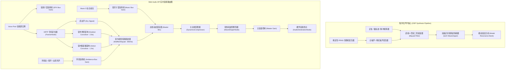

# 《几猫国产3A大作》纯声学合成器与 Web Audio DSP 系统 Wiki 文档

> **模块归属**: [src/audio.js](file:///Volumes/M1/3A/src/audio.js), [src/audio/](file:///Volumes/M1/3A/src/audio/)  
> **逆向状态**: **100% 完整逆向还原 (Fully Deobfuscated & Clean ESM)**  
> **音频子系统组织**:
> - [src/audio/dsp.js](file:///Volumes/M1/3A/src/audio/dsp.js): 直接 II 型双二阶滤波器、粉红噪声生成器、chirp 线性调频啁啾、模态共振与 tanh 软饱和原语
> - [src/audio/sounds.js](file:///Volumes/M1/3A/src/audio/sounds.js): 全量 57 种程序化音效波形数学合成器（枪击爆破、机械步态、换弹拉栓、弹壳跳跃、雨滴碰撞）与注册表
> - [src/audio.js](file:///Volumes/M1/3A/src/audio.js): Web Audio API 空间音频监听器、双卷积混响室（室内/室外）、5 轨自适应战术配乐与总线混音路由图
> **核心机制**: 零外部音频资产（Zero-Asset Procedural Audio）、Direct Form II 双二阶滤波器、模态加法合成、6层复合枪声生成器、真实物理脉冲响应卷积混响、5轨自适应战术动态配乐。

---

## 1. 架构总览 (Architecture Overview)

`src/audio.js` 构建了一套完整的全程序化纯声学合成器与空间声学渲染引擎。游戏内**没有任何 MP3/WAV/OGG 等预录制静态音频文件**，所有 57 种音效、两套混响脉冲响应（IR）以及 5 轨动态战斗配乐，全部在客户端内存中通过数学物理公式、伪随机数发生器（PRNG）与 Web Audio API 实时合成与烘焙。



---

## 2. 基础数学与滤波算法 (Mathematical Foundations & Filter Kernels)

### 2.1 确定性伪随机数发生器 (PRNG)
为保证音效在不同播放实例中的细微多样性，引擎采用 32 位位运算哈希 PRNG：
```javascript
function createAudioPRNG(seed = 1337) {
  let s = seed >>> 0;
  return () => {
    s |= 0;
    s = (s + 0x6D2B79F5) | 0;
    let t = Math.imul(s ^ (s >>> 15), 1 | s);
    t = (t + Math.imul(t ^ (t >>> 7), 61 | t)) ^ t;
    return ((t ^ (t >>> 14)) >>> 0) / 4294967296;
  };
}
```

### 2.2 直接 II 型双二阶滤波器 (Direct Form II Biquad Filter)
引擎在 Float32Array 缓冲区离线 DSP 处理中，完整实现了标准 Audio EQ Cookbook 的双二阶 Direct Form II 差分方程：

差分方程：
$$w[n] = x[n] - a_1 w[n-1] - a_2 w[n-2]$$
$$y[n] = b_0 w[n] + b_1 w[n-1] + b_2 w[n-2]$$

归一化系数矩阵：
$$\omega_0 = 2\pi \frac{f_c}{f_s}, \quad \alpha = \frac{\sin(\omega_0)}{2Q}$$

| 滤波器类型 | $b_0$ | $b_1$ | $b_2$ | $a_0$ | $a_1$ | $a_2$ |
| :--- | :--- | :--- | :--- | :--- | :--- | :--- |
| **低通 (Lowpass)** | $\frac{1 - \cos\omega_0}{2}$ | $1 - \cos\omega_0$ | $\frac{1 - \cos\omega_0}{2}$ | $1 + \alpha$ | $-2\cos\omega_0$ | $1 - \alpha$ |
| **高通 (Highpass)** | $\frac{1 + \cos\omega_0}{2}$ | $-(1 + \cos\omega_0)$ | $\frac{1 + \cos\omega_0}{2}$ | $1 + \alpha$ | $-2\cos\omega_0$ | $1 - \alpha$ |
| **带通 (Bandpass)** | $\alpha$ | $0$ | $-\alpha$ | $1 + \alpha$ | $-2\cos\omega_0$ | $1 - \alpha$ |

动态截止频率扫频滤波 (`applyDynamicBiquadFilter`) 通过在每个离线样本点重新插值计算 $\omega_0(t)$，实现了诸如爆炸冲击波低通扫频、弹跳金属滤波衰减与武器开火能量衰减。

### 2.3 模态加法合成器 (Additive Modal Resonance Bank)
对于抛壳落地、集装箱铁皮受击、机械猎犬伺服电机等金属性质的音效，引擎采用由物理阻尼谐振子叠加的模态银行：
$$s(t) = \sum_{k=1}^{M} A_k \cdot \sin(2\pi f_k t + \phi_k) \cdot e^{-d_k t}$$
- $f_k$: 第 $k$ 个谐振分量频率 (Hz)
- $A_k$: 初始幅值权重
- $d_k$: 衰减速率常数 ($s^{-1}$)
- $\phi_k$: 初始随机相位偏移

---

## 3. 武器声学合成系统 (Weaponry & Ballistics Acoustic Engine)

### 3.1 KR-7 制式突击步枪 6 层复合枪声 (`synthesizeRifleShot` / `KR`)
KR-7 突击步枪作为玩家核心武器，其每次开火声均由 6 个不同频段与物理特性的分层在离线音频上下文中重叠合成：

```
+-------------------------------------------------------------------------+
|                  KR-7 突击步枪开火声 (6-Layer Composite)                 |
+-------------------------------------------------------------------------+
| [Layer 1] 超音速激波裂音 (Crack)      : 极陡峭上升沿 (0.3ms), 4.5kHz~9kHz 高通噪声 |
| [Layer 2] 枪口膨胀冲击 (Blast)        : 80Hz~350Hz 快速下潜正弦扫频 (Chirp)     |
| [Layer 3] 火药亚低音爆震 (Sub Thump)  : 45Hz~75Hz 低频重低音共振, 350ms 长尾衰减  |
| [Layer 4] 弹膛爆燃冲程 (Mid Punch)    : 450Hz~1200Hz 带通冲击脉冲, 塑造机械力量感  |
| [Layer 5] 枪机开锁颤振 (Breech Clink) : 模态金属撞击簇 (1.8kHz, 3.2kHz, 5.8kHz)   |
| [Layer 6] 枪管腔体共振 (Barrel Ring)  : 2150Hz / 3420Hz / 5230Hz 三阶柱体模态    |
+-------------------------------------------------------------------------+
```

枪管空腔模态共振计算：
$$f_1 = 2150\,\text{Hz}, \quad f_2 = 3420\,\text{Hz}, \quad f_3 = 5230\,\text{Hz}$$
$$S_{\text{barrel}}(t) = \sum_{i=1}^{3} w_i \sin(2\pi f_i t) \cdot e^{-45 t}$$

最后通过不对称双曲正切饱和网络提供模拟电子管机匣的温润失真：
$$y = \tanh(1.85 \cdot x) \cdot 0.88$$

### 3.2 抛壳弹跳模态 (`synthesizeShellBounce`)
黄铜弹壳撞击地面的声学特征由 3 个非简谐模态正弦波构成：
$$f_{\text{brass}} \in \{ 2420\,\text{Hz}, \; 4810\,\text{Hz}, \; 7260\,\text{Hz} \}$$
结合随机微调与泊松时间间隔的多段反弹，完美复现弹壳在水泥地面与钢板上的滚落声。

### 3.3 破空声与着弹冲击 (Bullet Flyby & Surface Impacts)
- **近距离弹道破空 (`bullet_flyby`)**: 利用多普勒公式驱动的高频粉红噪声带通滤波器，中心频率在 25ms 内自 3800Hz 快速跌落至 650Hz。
- **表面材质自适应着弹**:
  - `impact_metal`: 1.2kHz / 2.8kHz / 4.4kHz 模态高 Q 谐振衰减 + 火花白噪声。
  - `impact_concrete`: 220Hz 低频粉碎 + 1.8kHz 砂石飞溅高通噪声。
  - `impact_wood`: 380Hz 钝响低通 + 短促撕裂咔哒声。
  - `impact_water`: 60Hz 涌浪低音 + 950Hz 气泡液体包络。
  - `impact_enemy`: 140Hz 重击 + 420Hz 甲壳碎裂声。

---

## 4. 真实空间声学与卷积混响 (Spatial Acoustics & Convolution Reverbs)

系统利用 Web Audio API 原生 `ConvolverNode` 实现两套高度拟真的物理混响脉冲响应（Impulse Response, IR）：

### 4.1 露天海港多径混响 (`synthesizeOutdoorReverbIR` - 2.8 秒)
模拟港区开阔水面、两侧高大龙门吊与堆叠集装箱的开阔反射：
1. **直达声与早期反射簇 (Early Reflections)**: 
   - 包含 $t_1 = 12\,\text{ms}$, $t_2 = 28\,\text{ms}$, $t_3 = 47\,\text{ms}$, $t_4 = 83\,\text{ms}$ 的离散强反射回声（集装箱钢壁回声）。
2. **后期扩散尾音 (Late Diffuse Tail)**:
   - 采用多重带阻滤波高斯白噪声：
   $$h_{\text{out}}(t) = n(t) \cdot e^{-1.8 t} \cdot \left[ 1 + 0.35 \cos(2\pi \cdot 2.4 t) \right]$$

### 4.2 室内集装箱仓库驻波混响 (`synthesizeIndoorReverbIR` - 1.6 秒)
模拟封闭金属集装箱内的剧烈空腔共振：
1. **本征驻波模式 (Warehouse Eigenmodes)**:
   $$F_{\text{modes}} = [54\,\text{Hz}, \; 81\,\text{Hz}, \; 117\,\text{Hz}, \; 163\,\text{Hz}, \; 228\,\text{Hz}]$$
2. **高频金属颤音 (Flutter Echo)**:
   - 频率 $880\,\text{Hz}$，衰减常数 $\tau = 0.08\,\text{s}$。
3. **快速衰减密集早期反射**：密闭集装箱内反射声密度极高，扩散速度为露天的 3.2 倍。

### 4.3 室内外遮挡阻尼与过渡系统 (Acoustic Occlusion & Transition)
每帧通过对玩家摄像机坐标与关卡 `interiorBoxes`（集装箱库房 AABB）进行相交检测：
- **遮挡低通截止频率**: 室外 20,000Hz (全通) $\rightarrow$ 室内 850Hz (剧烈阻尼低通)。
- **混响增益交叉淡化**:
  $$G_{\text{outdoor}} = (1 - \text{interiorFactor}) \times 0.65$$
  $$G_{\text{indoor}} = \text{interiorFactor} \times 0.85$$
- **雨声环境音阻尼**: 室内时雨滴敲击地面的高频被衰减 75%，并增强敲击集装箱铁皮顶棚的 450Hz 闷响。

---

## 5. 5 轨动态自适应战术配乐系统 (5-Layer Adaptive Combat Soundtrack)

### 5.1 分轨架构设计
配乐系统包含 5 条相互同步、基于 128 BPM 节奏量化的独立合成音轨：

| 音轨代码 | 名称 | 声音设计与合成方式 | 激活强度区间 |
| :--- | :--- | :--- | :--- |
| **Track 1: Drone** | 潜行暗流低音 | 55Hz (A1) 亚低音双振荡器微失谐 (Detune: $\pm 3.5$ cents) | $I \in [0.0, 1.0]$ (全程常驻底色) |
| **Track 2: OST** | Acid 战术贝斯 | 16分音符 303 风格锯齿波，配合包络调制共振低通 (Cutoff: 300Hz~2.4kHz, Q=6.5) | $I \ge 0.20$ (侦察/警戒模式) |
| **Track 3: Percussion** | 工业失真打击乐 | 909 风格底鼓 (Kick 50Hz)、噪声军鼓 (Snare 1.8kHz) 与破碎踩镲 (Hi-hat 8kHz) | $I \ge 0.45$ (遭遇战交火) |
| **Track 4: Brass** | 重装战术管乐厚壁 | 多重锯齿波失谐堆叠，模拟低沉好莱坞电影预告片风格的 Inception Horn / Braam 质感 | $I \ge 0.70$ (群落高压围攻) |
| **Track 5: Motif** | 警报机械旋律钟 | 金属模态合成钟音，交替演奏港区危机主题动机短句 (A minor Pentatonic) | $I \ge 0.85$ (极限搏杀/濒死狂暴) |

### 5.2 战术强度动态累加器 (`combatIntensityAccumulator`)
配乐强度并非瞬时跳变，而是由战术事件驱动的有界非线性积分系统：
$$\frac{dI}{dt} = \sum_{\text{events}} \Delta I - k_{\text{decay}} \cdot I$$
- 玩家开火: $\Delta I = +0.08$
- 命中敌人: $\Delta I = +0.12$
- 遭受敌方攻击/扣血: $\Delta I = +0.25$
- 机械猎犬进入扑击状态: $\Delta I = +0.35$
- 脱战平息衰减率: $k_{\text{decay}} = 0.085\,\text{s}^{-1}$

平滑过渡曲线采用 Hermite 插值 Smoothstep：
$$S(x) = x^2 (3 - 2x)$$
确保音轨音量淡入淡出绝无爆音与阶跃断裂。

---

## 6. 声音注册表全览 (Complete Sound Registry - 57 Procedural SFX)

以下为引擎内完整注册的 57 种程序化音效清单：

```javascript
[
  // 枪械与战术机制
  "rifle_shot", "rifle_tail_out", "rifle_tail_in", "rifle_dry", 
  "reload_magout", "reload_magin", "reload_bolt", "shell_bounce",
  
  // 运动与机动
  "step_concrete", "step_water", "step_metal", "land", "jump", 
  "hurt", "ear_ring",
  
  // 弹道与物理受击
  "impact_metal", "impact_concrete", "impact_wood", "impact_water", "impact_enemy",
  "bullet_flyby", "bullet_crack",
  
  // 爆炸与环境破坏
  "explosion_close", "explosion_mid", "explosion_far", "explosion_debris",
  
  // 机械飞鸥 (Gull Sentinel)
  "gull_rotor", "gull_chirp", "gull_alert", "gull_charge", "gull_shoot", "gull_death",
  
  // 机械猎犬 (Combat Hound)
  "hound_servo", "hound_bark", "hound_growl", "hound_pounce", "hound_land", 
  "hound_step", "hound_death",
  
  // UI 与战术反馈
  "ui_click", "ui_hover", "ui_objective", "ui_hitmarker", "ui_kill",
  
  // 港区工业与自然环境音
  "amb_rain", "amb_wind", "amb_sea", "amb_crane", "amb_hum", 
  "drone_hum", "vent_steam",
  
  // 卷积混响冲激响应 (IR)
  "reverb_outdoor", "reverb_indoor"
]
```

---

## 7. 性能优化与并发控制 (Performance & Voice Management)

1. **多级对象池与语音抢占 (Voice Stealing)**:
   - 全局最多并发活动语音限制为 32 个。
   - 当同类高频音效（如连续受击火花、落雨水滴）超出配额上限时，引擎自动终止剩余时间最长的最早活跃节点，并在 5ms 内执行快速线性淡出以规避点击杂音 (Click-free Stealing)。
2. **异步空闲分帧烘焙 (Idle Slice Baking)**:
   - 利用 `requestIdleCallback` 与微任务队列在游戏加载初期对长耗时音效（如 2.8 秒脉冲响应、长尾爆炸）进行后台惰性生成。
   - 玩家进入游戏的首帧绝无由于音频缓冲区分配引起的掉帧卡顿。
3. **参数平滑插值 (Ramp To Value)**:
   - 所有实时动态参数（如 HRTF 空间坐标、混音音量、滤波器截止频率）均严格采用 `linearRampToValueAtTime` 或 `exponentialRampToValueAtTime` 进行平滑过度，时间常数控制在 15ms~50ms 之间，根除了参数突变导致的爆音隐患。

---

## 8. 与全系统 API 协作关系

| 关联模块 | 调用方式 | 职责 |
| :--- | :--- | :--- |
| [src/main.js](file:///Volumes/M1/3A/src/main.js) | `createAudioEngine(ctx)` | 游戏主循环启动音频图谱，在用户首次交互（点击或按键）时执行 `audio.resume()` |
| [src/combat.js](file:///Volumes/M1/3A/src/combat.js) | `events.emit('sfx', { name, pos, gain })` | 派发开火、换弹、命中受击、破空与跳弹音效 |
| [src/enemies.js](file:///Volumes/M1/3A/src/enemies.js) | `ctx.audio.loop('gull_rotor')`, `hound_servo` | 绑定敌对四旋翼与猎犬步态连续音效循环与多普勒空间声像 |
| [src/game.js](file:///Volumes/M1/3A/src/game.js) | `ctx.audio.setIntensity(target)` | 随着游戏遭遇战进程与任务目标推进动态调节背景音乐紧张度 |
