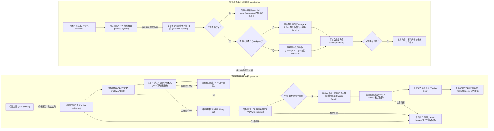

# 《几猫国产3A大作》战斗系统与战局推进状态机 Wiki 文档

> **模块归属**: [src/combat.js](file:///Volumes/M1/3A/src/combat.js) & [src/game.js](file:///Volumes/M1/3A/src/game.js)  
> **逆向状态**: **100% 完整逆向还原 (Fully Deobfuscated & Clean ESM)**  
> **核心机制**: 物理环境与敌军分层射线求交、弱点核心 2.2×~2.5× 爆头暴击判定、Hitmarker 击中反馈与打击音画联动、三处中继器入侵倒计时（3.5s 持续长按）、切断中继触发阶梯式高压敌军增援波次、深水泊位快艇撤离判定与终局 S/A/B/C 战术评价。

---

## 1. 架构总览 (Architecture Overview)

战斗系统与战局主推进系统共同构成了游戏的核心战术玩法循环。`combat.js` 作为微观判定层，负责每一发子弹的命中解算、环境穿透距离截断与弱点暴击；`game.js` 作为宏观战局状态机，驱动中继器入侵进度、波次敌军调度、无线电剧情通讯与通关结算。



---

## 2. 战斗判定与弹道伤害模型 (`combat.js`)

### 2.1 层次化射线求交算法 (Hierarchical Raycast Adjudication)
为保证高射速下（720 RPM）每秒 12 次射线检测的高性能与绝对公平性，判定系统采用“场景遮挡优先截断法”：
1. **第一步（静态环境检测）**:
   - 射线首先对港区物理空间（集装箱、墙体、吊车立柱）进行 `ctx.physics.raycast(origin, dir, 300)`。
   - 若在 $D_{\text{env}}$ 处发生碰撞，则将本次弹道最大检测距离限制为 $D_{\text{env}}$，彻底消除“隔墙穿透打怪”的物理穿模 BUG。
2. **第二步（敌人部件相交）**:
   - 在 $[0, D_{\text{env}}]$ 距离内，对场景中所有激活的机械飞鸥与机械猎犬进行部件级求交（胶囊体骨架与弱点核心球体）。
3. **第三步（物理材质反馈）**:
   - 若未击中敌人，则在 $D_{\text{env}}$ 处向物理表面触发对应的跳弹火花、碎屑与凹坑贴花。

### 2.2 弱点部位暴击与伤害倍率

| 目标类型 | 常规装甲部位 | 弱点核心部位 (Weakpoint) | 暴击倍率 | 战术射击收益 |
| :--- | :--- | :--- | :--- | :--- |
| **机械飞鸥 (Seagull Sentinel)** | 机身钛合金外壳 (`shell`)、四旋翼支臂 (`rotor`) | 机头正下方全息光学感知红外镜头 (`lens`) | **$2.2\times$** | 常规需要 4 枪（26HP×4=104HP > 45HP需击中2发），爆头仅需 **1 枪即可直接凌空打爆** (26×2.2=57.2 > 45) |
| **机械猎犬 (Cyber Hound)** | 四足复合铰链 (`abd/thigh/shin`)、背部主装甲 (`body`) | 头部顶端蓝色发光电磁伺服核心 (`head/core`) | **$2.5\times$** | 躯干需要 5 枪（26×5=130 > 120），爆头 **2 枪即可瘫痪扑咬** (26×2.5×2=130 > 120) |

### 2.3 命中反馈系统 (Hitmarker & Sound Synthesis)
- **普通命中**: HUD 准星中央瞬间弹出白色斜向交叉线（X 标记），持续 $0.12\text{ s}$；触发清脆的高频金属敲击声（DSP 8kHz 短正弦脉冲）。
- **弱点暴击**: 准星弹出鲜红色加粗 X 标记，伴随重低音蜂鸣打击音；敌人弱点部位激发出大量高亮橙色电弧粒子（Plasma Sparks）。
- **击杀确认**: 敌人殉爆并向四周飞溅机械零件残骸（Debris），伴随敌人无线电频段失真杂音中断。

---

## 3. 战局主推进状态机 (`game.js`)

游戏战局由一套严密的离散状态机（FSM）进行驱动管理：

```javascript
// 战局状态字典
const GAME_STATES = ['boot', 'title', 'playing', 'paused', 'dead', 'victory'];
```

### 3.1 状态转移逻辑
1. **Title (标题封面)**:
   - 摄像机沿港区宏观运镜轨道（`cinematicPath`）自动平滑巡航。
   - 提示玩家点击“进入泊位”或按下任意键；点击后申请鼠标锁定（Pointer Lock），无缝切入第一人称干员视口。
2. **Playing (战斗进行中)**:
   - 激活角色控制器、武器系统、敌人 AI 仇恨网络与动态战术 HUD。
   - 监听 Esc / P 键切入 `paused` 暂停状态。
3. **Paused (战术暂停)**:
   - 挂起 RAF 主循环中的敌人 AI 与物理位移，释放鼠标指针锁定，弹出工业半透明设置菜单面板。
4. **Dead (任务失败/阵亡)**:
   - 玩家生命值归零时触发，镜头产生向前脱力倒地倾斜动画，随后弹出阵亡报告（显示存活时间与中继完成度），提供“重新部署”按钮。
5. **Victory (行动成功/通关)**:
   - 干员进入撤离艇安全光圈，玩家进入无敌状态，全屏淡出并呼出最终战术简报评价面板。

---

## 4. 三处中继站战术目标机制 (Tactical Relays)

四号泊位分布有 3 处核心工业安全中继发射塔，玩家必须按照战术指引全部入侵切断：

| 中继站代号 | 地理战术分区 | 世界空间坐标 $[X, Y, Z]$ | 周边地形与战术防御要点 |
| :--- | :--- | :--- | :--- |
| **甲号中继 (Relay A: Yard)** | 露天集装箱堆场核心 | $[1.5, 0.0, 7.5]$ | 处于三层集装箱围合的狭窄天井，视野极差，极易被猎犬近身伏击 |
| **乙号中继 (Relay B: Shed)** | 封闭大型钢结构仓库 | $[-4.0, 0.0, -19.5]$ | 仓库室内昏暗，天窗有飞鸥俯冲火力网，需利用货架作掩体防守 |
| **丙号中继 (Relay C: Quay)** | 远洋深水码头防波堤前沿 | $[24.0, 0.0, -6.0]$ | 极度开阔的大纵深海岸线，飞鸥巡逻半径极大，需远距离精确点射压制 |

### 4.1 切断交互机制 (Interaction & Cut Dynamics)
- **有效交互距离**: 玩家距离中继器小于 $2.2\text{ m}$，且视线朝向与中继器连线夹角 $\cos\theta > 0.65$。
- **长按持续入侵**: 持续按住 <kbd>E</kbd> 键（或触屏按住“交互”按键）**持续 $3.5\text{ 秒}$**。
- **打断衰减惩罚**: 若入侵中途因遭受攻击或移动而松开按键，进度条不会保持，而是以 $1.6\times$ 速度平滑倒退归零，要求玩家在完全肃清周围威胁后再执行入侵。

---

## 5. 敌军波次防御与动态增援调度 (Wave Defense System)

每当一处中继站被成功切断，泊区自卫防卫中枢将触发更高级别的全区红色警报，并就近向玩家坐标空投作战波次：


- **出生点智能挑选**: 敌人生成器从关卡预设的 42 处战术生成锚点中，优先挑选距离玩家 $25\sim 45\text{ m}$ 且**处于玩家视线死角（背身或高处集装箱后）**的点位，杜绝敌人“脸贴脸凭空刷出”的穿帮体验。
- **仇恨狂暴强化 (Pursuit Mode)**:
  - 3 处中继全断后，剩余所有敌对机械进入全图透视追踪状态，移速提升 $15\%$，直扑撤离点拦截玩家。

---

## 6. 任务撤离与战绩评价系统 (Extraction & Mission Debrief)

### 6.1 撤离点判定 (Quayside Extraction Zone)
- **泊位坐标**: 四号泊位南端专用登艇舷梯 $[X=30.0\text{ m}, Z=20.0\text{ m}]$，靠泊一艘三自由度浮动快艇。
- **触发条件**:
  1. 必须 `runState.allCut === true`（3 处中继器全部被切断）。
  2. 玩家处于撤离光圈内（半径 $R = 2.5\text{ m}$）。
  3. 若中继未全部切断即冲向撤离点，HUD 将弹出无线电警示：“中继尚未断开，撤离艇无法在火力下接应”。

### 6.2 战术简报评价分级算法 (Debrief Rating Formula)
通关后系统依据**总耗时 ($T$)**、**射击精准度 ($\text{Acc}$)** 与 **中途受创死亡重试次数 ($R$)** 综合评定战绩：

$$S_{\text{score}} = \max(0, 1000 - T \times 2.5) + (\text{Acc} \times 800) - (R \times 250)$$

| 评级等级 | 分数要求 | 战术评价语 | 通关特征与要求 |
| :---: | :---: | :---: | :--- |
| **S 级** | $\ge 1200$ | **卓越特战干员 (Master Infiltrator)** | 耗时 $< 180\text{s}$，命中率 $> 65\%$，零重试一命通关 |
| **A 级** | $900 \sim 1199$ | **优秀战术执行 (Tactical Expert)** | 耗时 $< 260\text{s}$，命中率 $> 45\%$，重试 $\le 1$ 次 |
| **B 级** | $600 \sim 899$ | **达标完成任务 (Mission Accomplished)**| 稳扎稳打推进，少量失误 |
| **C 级** | $< 600$ | **艰难惨胜撤离 (Pyrrhic Survival)** | 耗时过长或多次濒死重试 |

---

## 7. 对外接口规范 (Module API)

### 7.1 `combat.js` API
```javascript
export function create(ctx);

// CombatSystem 实例方法
combat.reset();                    // 重置本局射击、命中与击杀计数
combat.playerShot(origin, dir, { damage, range, impulse }); // 玩家击发主检测
combat.stats;                      // { shots: number, hits: number, kills: number }
```

### 7.2 `game.js` API
```javascript
export function create(ctx);

// GameSystem 实例方法
game.state;                        // 'title' | 'playing' | 'paused' | 'dead' | 'victory'
game.start(options);               // 开始新一局作战 (options.skipIntro)
game.pause();                      // 暂停游戏
game.resume();                     // 继续游戏
game.update(dt);                   // 驱动中继器入侵计时、波次刷新与战局流转
```
