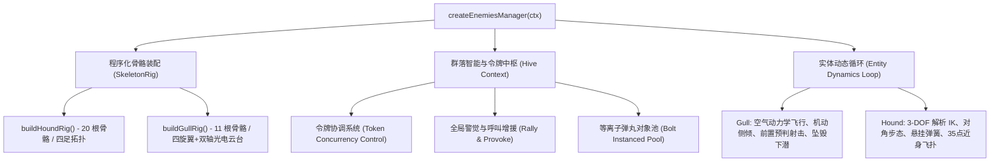
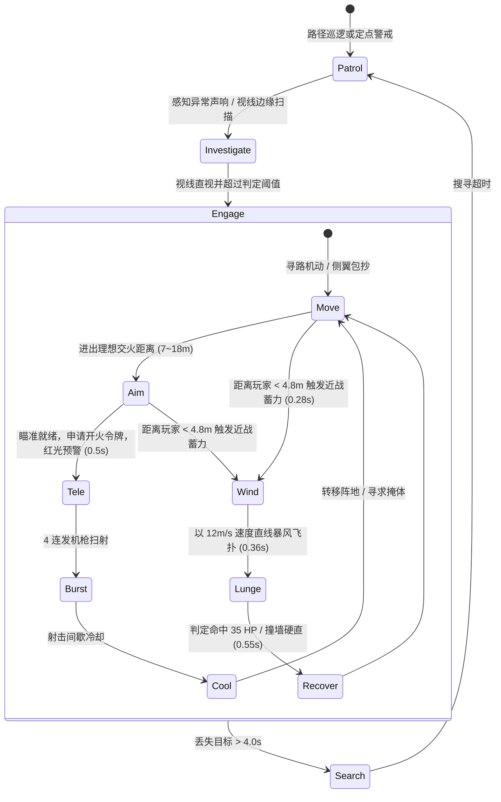

# 《几猫国产3A大作》敌方单位与 AI 动力学系统 Wiki 文档

> **模块归属**: [src/enemies.js](file:///Volumes/M1/3A/src/enemies.js), [src/enemies/](file:///Volumes/M1/3A/src/enemies/)  
> **逆向状态**: **100% 完整逆向还原 (Fully Deobfuscated & Clean ESM)**  
> **子模块组织**:
> - [src/enemies/rig.js](file:///Volumes/M1/3A/src/enemies/rig.js): 骨架装配器 `SkeletonRig`、蒙皮网格生成器与材质槽位映射
> - [src/enemies/hound.js](file:///Volumes/M1/3A/src/enemies/hound.js): 机械猎犬 3-DOF 逆运动学 IK、四足步态与飞扑状态机
> - [src/enemies/gull.js](file:///Volumes/M1/3A/src/enemies/gull.js): 机械飞鸥四旋翼空气动力学、开火决策与坠毁物理
> - [src/enemies/math.js](file:///Volumes/M1/3A/src/enemies/math.js): 射线-球体与射线-胶囊体几何相交算法
> - [src/enemies.js](file:///Volumes/M1/3A/src/enemies.js): 蜂群协同中枢 (Hive Context)、警觉度分发与隔离展厅模式
> **核心实体**: 机械飞鸥 (Gull Sentinel)、机械猎犬 (Combat Hound)、群落协同中枢 (Hive Context)

---

## 1. 架构总览 (Architecture Overview)

`src/enemies.js` 承担了全游戏的敌对实体程序化建模、装配、动力学解算、寻路与战术决策逻辑。系统完全不依赖外部模型资产（FBX/GLTF），通过 `SkeletonRig` 在内存中实时装配骨骼层次树、绑定顶点权重，并运用解析几何与物理振荡器驱动高精度的肢体与飞行表现。

---

## 2. 机械猎犬 (Combat Hound) 核心动力学与机制

### 2.1 3自由度腿部解析逆运动学 (3-DOF Analytic Leg IK)
猎犬四足（FL, FR, RL, RR）每条腿均具有 3 个自由度：
1. **外展/内收角 ($\theta_{\text{abd}}$)**：横向偏置旋转
2. **大腿俯仰角 ($\theta_{\text{hip}}$)**：髋部纵向回转
3. **小腿屈伸角 ($\theta_{\text{knee}}$)**：膝关节弯折

解算流程 (`solveLegIK`):
1. **局部投影与外展角解算**：
   $$\text{lateralDistSq} = x^2 + y^2, \quad \text{planarY} = \sqrt{\max(\text{lateralDistSq} - l_0^2, 10^{-6})}$$
   $$\theta_{\text{abd}} = \text{atan2}(y, x) - \text{atan2}(-\text{planarY}, \text{side} \cdot l_0)$$
2. **肢体平面伸展可达性截断**：
   $$\text{reachDist} = \text{hypot}(\text{planarY}, z)$$
   $$\text{reachDist} \in \left[ |L_1 - L_2| + 0.03, \; (L_1 + L_2) \times 0.995 \right]$$
3. **余弦定理求大腿与膝角**：
   $$\cos(\theta_{\text{hip\_rel}}) = \frac{L_1^2 + \text{reachDist}^2 - L_2^2}{2 L_1 \cdot \text{reachDist}}$$
   $$\cos(\theta_{\text{knee\_rel}}) = \frac{L_1^2 + L_2^2 - \text{reachDist}^2}{2 L_1 L_2}$$
   $$\theta_{\text{hip}} = \theta_{\text{hip\_rel}} - \text{atan2}(z, \text{planarY}), \quad \theta_{\text{knee}} = -(\pi - \theta_{\text{knee\_rel}})$$

### 2.2 四足对角小跑步态 (Trotting Gait Locomotion)
- **肢体配对 (Diagonal Pairs)**：
  - Pair 0: `FL` (左前) + `RR` (右后)
  - Pair 1: `FR` (右前) + `RL` (左后)
- **摆动相与支撑相 (Stance & Swing Phases)**：
  - 支撑相：四足贴地，计算支撑多边形平均标高与起伏斜率。
  - 摆动相：抬腿轨迹遵循三次 Hermite 插值结合正弦抛物线曲线：
    $$t_{\text{smooth}} = t^2 \times (3 - 2t), \quad y_{\text{lift}} = \sin(\pi t) \times \text{lift}$$
  - 踏地瞬间触发 `enemy:step` 事件，生成金属与地面撞击声，同时给底盘注入微量下坠反冲冲量。

### 2.3 底盘悬挂与天线惯性阻尼系统 (Suspension Spring Dynamics)
通过二阶阻尼简谐振子方程驱动：
$$\frac{d^2x}{dt^2} + 2\zeta\omega_n \frac{dx}{dt} + \omega_n^2 (x - x_{\text{target}}) = 0$$
- **`sY` (垂直颠簸)**：刚度 160，阻尼 17，模拟崎岖路面的底盘液压减震。
- **`sP` (车体俯仰)**：刚度 130，阻尼 15，在加减速及地表坡度变化时动态前倾/后仰。
- **`sR` (车体滚转)**：刚度 130，阻尼 15，在急速转弯向心力作用下倾斜。
- **`sA` / `sA2` (鞭状通信天线)**：刚度 60，阻尼 5，呈现随车身速度和转向产生的高拟真惯性晃动。

### 2.4 战术行为状态机与飞扑跃击 (AI State Machine & Lunge Attack)

---

## 3. 机械飞鸥 (Gull Sentinel) 核心动力学与机制

### 3.1 3D 飞行控制律与机动侧倾 (Aerodynamics & Banking Controller)
- **PD 目标位移追踪**：
  $$\mathbf{a}_{\text{target}} = (\mathbf{p}_{\text{dest}} - \mathbf{p}) \times 2.2 - \mathbf{v} \times 2.4$$
- **机体坐标系动力学侧倾 (Flight Banking)**：
  - 将世界空间加速度转换至无人机前进与侧向坐标系：
    $$F_{\text{forward}} = a_x \sin(\psi) + a_z \cos(\psi), \quad F_{\text{right}} = a_x \cos(\psi) - a_z \sin(\psi)$$
    $$\theta_{\text{pitch\_target}} = \text{clamp}(F_{\text{forward}} \times 0.04, -0.42, 0.42)$$
    $$\theta_{\text{roll\_target}} = \text{clamp}(-F_{\text{right}} \times 0.04, -0.42, 0.42)$$
  - 呈现高速压弯、急停后仰的真实空气动力学响应。

### 3.2 多触角空间避障感知 (Multi-Feeler Spatial Avoidance)
1. **前方速度矢量测距射线**：动态探测移动前方的箱体与吊机，施加侧向与垂直推离加速度，贴近严重时立即反转环绕方向。
2. **地面高度近地传感器**：检测下方净空，防止低空掠地碰撞。
3. **顶棚天花板探测器**：探测室内仓库顶棚高度，动态设定飞行上限（`ceil`）。

### 3.3 预测导引前置量射击 (Lead Prediction Targeting)
- 飞鸥向玩家射击并非直接对准当前坐标，而是预判弹丸飞行时间并叠加提前量：
  $$t_{\text{flight}} = \frac{\text{dist}}{v_{\text{bolt}}}, \quad \mathbf{p}_{\text{aim}} = \mathbf{p}_{\text{player}} + \mathbf{v}_{\text{player}} \cdot t_{\text{flight}} \cdot \text{lead}$$
- 3 发等离子高速弹丸（70 m/s）以 0.12s 间隔连射，单发造成 7 点伤害，击发产生机身后坐冲击力。

### 3.4 破损下坠自旋与触地殉爆 (Crash Spin & Explosion)
- 飞鸥生命值归零时，随机失效 1 处旋翼（`lostRotor`，转速停止并缩小）。
- 产生强烈机身横滚与偏航自旋角速度（$\omega_{\text{spin}} \approx 7 \text{ rad/s}$），沿重力抛物线下坠并持续喷溅黑烟与火星。
- 与地面发生相交时立即触发大范围冲击波爆炸（半径 4.5m，伤害 45 点），对周围地面实体造成殉爆波及。

---

## 4. 群落协同与开火并发控制 (Hive Concurrency Management)

为确保游戏体验的高压沉浸感与公平性，群落 AI 引入了**令牌调度机制 (Token Queue Control)**：
- **最大同时攻击令牌数 (`maxTokens`)**:
  - 常规小群战（$\le 5$ 只存活）: 最多 **2** 个敌对单位同时进行射击/飞扑。
  - 大规模战役（$> 5$ 只存活）: 最多 **3** 个敌对单位同时进行射击。
- **令牌发放间隔 (`tokenGap = 0.55s`)**: 杜绝多只敌人毫无间隙瞬间秒杀玩家（Damage Stacking Protection）。
- **同类型武器抑制**: 若上一轮开火是飞鸥，会优先将新令牌让渡给猎犬进行近距离压制，实现高低空协同立体攻防。

---

## 5. 命中检测与弱点判定表 (Hit Testing & Weakspots)

| 单位类型 | 检测几何体 | 部位标识 (`part`) | 伤害倍率 | 视觉 / 动力学反馈 |
| :--- | :--- | :---: | :---: | :--- |
| **机械飞鸥** | 压扁椭球体解析求交 ($x^2 + (2.3y)^2 + z^2 \le r^2$) | `body` | 1.0× | 机身火花喷溅，后退加速度冲量，飞行晃动 |
| **机械猎犬** | 头部球体 ($r = 0.155\text{ m}$) | `weak` (爆头弱点) | **2.5×** | 爆头暴击金色十字线标，底盘重度后仰受击硬直 |
| **机械猎犬** | 躯干上胶囊体 ($r = 0.27\text{ m}$) | `body` | 1.0× | 白色命中标记，侧移微扰，车身微幅受击晃动 |
| **机械猎犬** | 腹部下胶囊体 ($r = 0.25\text{ m}$) | `body` | 1.0× | 白色命中标记，火花飞溅 |

---

## 6. 逆向还原经验与最佳实践总结

1. **零垃圾收集 (Zero GC) 矢量复用**：
   - 逆向分析表明，原始逻辑在每秒 60 帧的高频物理循环中，完全复用了预分配的 `scratchVec`、`muzzleAimDir` 与 `ikAngles`，杜绝了每帧创建 `new THREE.Vector3()` 导致的浏览器垃圾回收卡顿（GC Spikes）。重构中完整保留并标准化了这一架构。
2. **多材质 SkinnedMesh 单一次性合批**：
   - 全游戏的所有飞鸥与猎犬，均通过 `SkeletonRig` 将 30+ 种机械部件程序化烘焙入单张 `BufferGeometry`，仅需 1 个 DrawCall 即可绘制出拥有 4 种 PBR 材质槽位（装甲白、发黑钛合金、发光霓虹、反光透镜）的完整骨骼动画角色。
3. **弹簧阻尼模型在 WebGL 动作系统中的普适性**：
   - 相比于传统固定的线性动画帧，采用二阶弹簧振荡器驱动的车辆/机械兽悬挂、受击晃动与天线颤抖，极大地提升了纯代码驱动 3D 画面的机械物理真实感。
