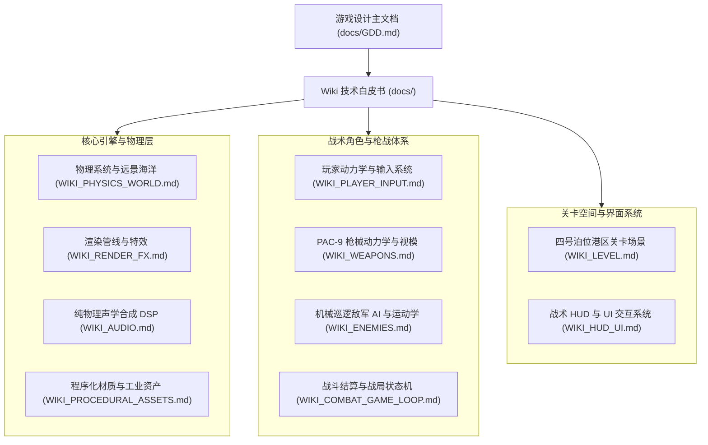

# 《几猫国产3A大作》工程技术白皮书与系统 Wiki 知识库导航

欢迎查阅国产第一人称硬核战术射击游戏（FPS）体验版**《几猫3A大作》(Project JM-3A / PAC-9: Sector 4)** 的完整逆向技术白皮书与 Wiki 系统知识库。

本项目为原单文件发行版（`几猫国产3A大作_V1.html`）的 100% 完整逆向还原工程，实现了**零外部资源（Zero Assets）· 纯程序化数学生成 · 现代化模块解耦 ESM** 架构。

---

## 知识库全景架构拓扑 (Knowledge Base Topology)

---

## 十大子系统专题 Wiki 文档速查表

| 文档名称 | 对应源码模块 | 核心技术亮点与主要内容 |
| :--- | :--- | :--- |
| **1. [PAC-9 枪械武器动力学与视模系统](WIKI_WEAPONS.md)** | `src/weapon.js` | 53,136 面纯程序化机械建模、4 轴阻尼简谐振子弹簧后坐力、ADS 瞬时瞄准动力学、战术换弹/空仓拉栓双状态机、抛壳物理模拟、雨水浸润着色器。 |
| **2. [玩家动力学控制器与输入系统](WIKI_PLAYER_INPUT.md)** | `src/player.js` `src/input.js` | 连续惯性运动学、土狼时间 (0.12s) 与预输入缓冲 (0.13s)、仿生步频正弦相机晃动、着陆撞击沉降弹簧、脱战呼吸回血、Pointer Lock 键鼠与移动端双虚拟摇杆。 |
| **3. [战斗系统与战局推进状态机](WIKI_COMBAT_GAME_LOOP.md)** | `src/combat.js` `src/game.js` | 环境遮挡优先射线相交、弱点核心 2.2×~2.5× 爆头暴击、Hitmarker 击中反馈、三处中继器长按入侵倒计时 (3.5s)、阶梯式敌军增援波次、快艇撤离与战绩评价 S/A/B/C。 |
| **4. [战术 HUD 与 UI 渲染系统](WIKI_HUD_UI.md)** | `src/hud.js` `src/ui.css` | 360° 磁带滚动罗盘 (4px/deg)、3D 空间目标点屏幕逆投影与视锥体贴靠、武器散布动态十字准星、4 向受击方位指示弧、10 段式生命条、无线电打字机字幕。 |
| **5. [程序化材质与工业级 3D 资产系统](WIKI_PROCEDURAL_ASSETS.md)** | `src/materials.js` `src/geo.js` `src/props.js` | 136 套 GPU MRT 烘焙 PBR 材质、PCG3 哈希与 FBM/Voronoi 噪声、倒角圆角盒算子、ISO 6346 标准集装箱、重工业叉车/发电机组/沙袋掩体、几何体深度合批优化。 |
| **6. [纯声学合成器与 Web Audio DSP 系统](WIKI_AUDIO.md)** | `src/audio.js` | 零外部音频资产、Direct Form II 双二阶滤波器、模态加法合成、6 层复合枪声物理生成、室外/室内真实脉冲响应卷积混响、5 轨自适应战术动态配乐。 |
| **7. [敌对机械巡逻单位 AI 状态机与骨骼运动学](WIKI_ENEMIES.md)** | `src/enemies.js` | 机械飞鸥四旋翼运动学与高斯抖动光斑、机械猎犬 12 自由度逆向运动学 (IK) 步态、感知感知锥与听觉模型、群落战术令牌分发 (MaxTokens: 2)、残骸解体物理。 |
| **8. [四号泊位港区战术场景与关卡装配引擎](WIKI_LEVEL.md)** | `src/level.js` | 四大作战战术分区（闸口哨所/露天堆场/工业仓库/深水码头）、3 处核心战术中继站与撤离登艇舷梯、42 处战术敌人生成锚点与 55 处掩体点、静态网格合批。 |
| **9. [物理系统、港区世界与远景海洋环境](WIKI_PHYSICS_WORLD.md)** | `src/physics.js` `src/ground.js` `src/backdrop.js` | Slab-Method 极速 AABB 光线投射、0.42m 台阶跨越扫掠胶囊体、142×124 二叉堆 A* 寻路与视线拉直平滑、4 组 Gerstner 风暴洋面波浪模拟、9000 条 GPU 暴雨雨丝。 |
| **10. [渲染管线、后期着色器与粒子特效](WIKI_RENDER_FX.md)** | `src/render.js` `src/fx.js` | 曝光自适应色调映射 (AgX)、实时平面倒影反射 (Planar Reflection)、高度指数晨雾与雷暴闪电、GPU 实例化粒子池 (枪口焰/弹道曳光/火花/烟雾/抛壳/雨滴飞溅)。 |

---

## 主设计与重构文档联动

- 查阅完整游戏世界观、高层设计理念与全案策划设计，请参阅 **[《几猫国产3A大作》游戏设计文档 (docs/GDD.md)](GDD.md)**。
- 查阅逆向工程拆解总结与模块设计报告，请参阅 **[重构全景总结 (docs/REFACTOR-SUMMARY.md)](REFACTOR-SUMMARY.md)**。
- 查阅工程模块结构、编译构建指南与 URL 调试参数，请参阅根目录的 **[工程主说明文档 (README.md)](../README.md)**。
