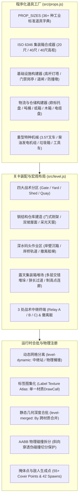

# 《几猫国产3A大作》四号泊位港区关卡与工业场景程序化建模 Wiki 文档

> **模块归属**: [src/level.js](file:///Volumes/M1/3A/src/level.js) & [src/props.js](file:///Volumes/M1/3A/src/props.js)  
> **逆向状态**: **100% 完整逆向还原 (Fully Deobfuscated & Clean ESM)**  
> **核心机制**: 零外部 3D 模型资产（Zero External 3D Models）、ISO 6346 真实集装箱几何合成、门式刚架钢结构仓库、58米深水码头重装岸线、静态几何体合批优化（`level-merged`）、动态 Canvas 贴花图集化（Label Texture Atlas）、55+ 处导航网格掩体网络与 3 处核心战术中继站目标。

---

## 1. 架构总览 (Architecture Overview)

全游戏战术主场景“四号深水泊位”（Berth 4）占地 $80\text{m} \times 60\text{m}$，完全不依赖任何外部 FBX/GLTF/OBJ 预制 3D 模型。整个港区的所有建筑物骨架、装卸设备、36 种工业道具库、物理碰撞体网格及地坪贴花，全部在内存中通过解析几何、布尔拓扑运算、程序化梯形波纹放样和 3D 网格噪波实时合成。



---

## 2. 四大战术分区尺度与宏观规划 (4 Combat Zones)

| 战术分区 | X 跨度 (m) | Z 跨度 (m) | 面积 ($m^2$) | 战术职能与地貌特征 |
| :--- | :--- | :--- | :--- | :--- |
| **闸口哨所 (Gate)** | $[-40, -24]$ | $[-30, 30]$ | 960 | 港区外围安全防御边界，包含保安岗亭、电动道闸、水泥防撞墩与高压钠灯三脚架；玩家初始渗透潜入起点。 |
| **露天集装箱堆场 (Yard)** | $[-24, 16]$ | $[-10, 30]$ | 1,600 | 堆满 1~3 层 20ft/40ft 集装箱的错落迷宫，形成狭窄短兵相接走道；建有通往箱顶的斜梯与高空连廊制高点。 |
| **封闭工业仓库 (Shed)** | $[-24, 16]$ | $[-30, -10]$ | 800 | 封闭门式刚架钢结构大跨度厂房，双坡山墙瓦楞屋面，包含 8 处高透采光天窗与 9 具工矿天井吊灯；触发室内真实声学遮挡与驻波混响。 |
| **远洋深水码头 (Quay)** | $[16, 40]$ | $[-30, 30]$ | 1,440 | 58米重装泊位岸线，X=30m 为前沿直立混凝土岸壁（水深高差 1.6m），铺设有岸桥起重机钢轨、重型系缆桩，南端设登艇撤离舷梯。 |

---

## 3. ISO 6346 标准集装箱程序化生成算法

### 3.1 规格指标与真实 ISO 参数
集装箱完全遵照国际海运标准尺寸设计，材质与涂装严格对标真实港口设备：
- **`container20`** (ISO 22G1): $6.06\text{m} \times 2.59\text{m} \times 2.44\text{m}$，额定总重 30,480 kg，底梁自带双叉车作业槽（Forklift Pockets）。
- **`container40`** (ISO 42G1): $12.19\text{m} \times 2.59\text{m} \times 2.44\text{m}$，额定总重 32,500 kg，标准 40 尺通用海运集装箱。
- **`container40hc`** (ISO 45G1): $12.19\text{m} \times 2.90\text{m} \times 2.44\text{m}$，高柜加高 31cm，门楣上方印有黑黄相间超高警示斜纹（Caution Stripes）。

### 3.2 梯形波纹钢板放样算法 (`generateCorrugatedProfilePoints` & `evalCorrugationWave`)
集装箱侧壁波纹通过连续梯形折线周期函数精确生成：
- 周期 $P = 0.278\,\text{m}$
- 槽深 $d = 0.036\,\text{m}$
- 平面顶宽 $f_o = 0.072\,\text{m}$
- 坡度段宽 $s_l = 0.068\,\text{m}$

$$f_{\text{wave}}(x) = \begin{cases} 
0, & x_{\text{mod}} \in [0, f_o] \\
-d \cdot \frac{x_{\text{mod}} - f_o}{s_l}, & x_{\text{mod}} \in (f_o, f_o + s_l) \\
-d, & x_{\text{mod}} \in [f_o + s_l, P - s_l] \\
-d \cdot \left(1 - \frac{x_{\text{mod}} - (P - s_l)}{s_l}\right), & x_{\text{mod}} \in (P - s_l, P)
\end{cases}$$

### 3.3 ISO 1161 八角铸钢转锁角件 (Twist-Lock Pockets)
集装箱 8 个顶底角部均配备标准铸钢角件（$0.178\text{m} \times 0.118\text{m} \times 0.162\text{m}$），通过倒角立方体切削并打穿跑道形锁孔（顶面长孔 $124\text{mm} \times 64\text{mm}$，侧面孔 $78\text{mm} \times 52\text{mm}$，端面孔 $64\text{mm} \times 50\text{mm}$）。

### 3.4 双开货运门与中空内部通行碰撞 (`doorOpenRatio > 0.03`)
- **锁杆总成**: 双扇门每扇配置 2 根贯通式镀锌转轴锁杆、凸轮锁头、锁扣座与带锁紧机构的手柄。
- **动态开启角度**: 左右门扇支持非对称开门（右门 $112^\circ$，左门 $100^\circ$）。
- **内部中空可走入碰撞体**: 当 `doors > 0.03` 时，实体外壳 AABB 自动替换为 **木地板底板、金属顶板、前封板、左右波纹壁及两扇旋转门板** 的 6 片独立碰撞壳体，允许玩家和敌人进入箱体内隐蔽与伏击。

---

## 4. 封闭工业仓库钢结构建筑系统 (Warehouse Architecture)

### 4.1 门式刚架跨度与柱网体系
- **跨度与柱距**: 仓库横向跨度 28m ($X \in [-16, 12]$)，纵向进深 17m ($Z \in [-28, -11]$)。沿 X 轴分布 6 排重型 H 型钢工字钢立柱（$-16, -11.1, -6.2, -0.8, 5.6, 12$）。
- **山墙坡度**: 檐口高程 7.0m，屋脊高程 9.5m，坡度约 $1:5$；工字钢斜梁与圆钢受拉系杆构成完整空间桁架受力体系。

### 4.2 双通道出入工业大门
- **堆场主卷帘门 (South Gate)**: 净宽 5.0m ($X \in [-6, -1]$)，净高 5.0m，直通集装箱露天作业区，配备室外混凝土引导缓坡。
- **码头侧滑移门 (East Gate)**: 净宽 5.0m ($Z \in [-22, -17]$)，净高 4.5m，直通常平深水码头岸壁。

### 4.3 采光与高天井照明
- **8 处屋面高透光天窗**: 采用带 65% 透明度的强化夹胶玻璃，在日光或月光下在仓库地面投射清晰长方形天窗光斑。
- **9 具深照型高压工矿吊灯**: 悬挂于钢架横梁下方，提供仓库内部核心工作区域均匀下照光源。

---

## 5. 58米远洋深水码头作业岸线 (Deepwater Quay)

### 5.1 直立式混凝土岸壁与耐磨钢护边
- **前沿垂直面**: $X = 30.0\text{m}$，从路面标高 $+0.028\text{m}$ 直插海水底面标高 $-4.2\text{m}$（正常海平面 $Y = -1.6\text{m}$）。
- **防磨钢护边 (Steel Armored Coping Edge)**: 沿岸壁边沿铺设 $12\text{cm}$ 宽花纹耐磨铸铁边条，内侧刷涂 $16\text{cm}$ 宽亮黄色安全作业防踏空禁行警示带。

### 5.2 岸桥重型轨道与系泊系统
- **岸边集装箱起重机 (STS Crane) 轨道**: 铺设双轨，轨距 10.0m（陆侧轨 $X = 18.5\text{m}$，海侧轨 $X = 28.5\text{m}$），采用重型 QU120 轨道钢与连续弹性垫板。
- **铸钢系缆桩与圆筒形橡胶护舷**: 沿码头前沿每隔 8m 锚固一具大吨位双角喇叭口系泊桩，码头垂直立面悬挂大型拱型橡胶护舷吸收靠泊船舶冲击能。

### 5.3 撤离快艇与登艇钢梯 (Extraction Mooring Station)
- **登艇梯井**: 位于 $Z = 20.0\text{m}$ 处的码头岸壁内凹缺口，配有垂直直通海面的镀锌圆钢逃生爬梯。
- **战术撤离快艇 (Tactical Speedboat)**: 靠泊在爬梯外侧海面（坐标 $[31.8, -1.4, 20.0]$），长 3.8m，深 V 玻璃钢船体，配备双大马力舷外挂机与橙色防弹风挡；达成全部目标后玩家进入其 2.5m 半径即可触发通关撤离。

---

## 6. 36 种程序化工业道具库全览 (Prop Registry)

```
+-----------------------------------------------------------------------------------+
|                        港区程序化道具库 (36 种工业道具)                           |
+-----------------------------------------------------------------------------------+
| [集装箱系列] : container20 (20尺标准箱), container40 (40尺标箱), container40hc (40尺高柜)
| [港区基础设施] : jersey_barrier (防撞墩), light_mast (14米高杆灯), fence_panel (铁丝网护栏),
|               guard_booth (门禁岗亭), gate_arm (电动道闸), bollard_mooring (系缆桩),
|               bollard_post (警示柱), sign_post (指示路牌), floodlight_stand (移动投光灯),
|               stairs_metal (钢梯), catwalk (连廊), shelf_rack (货架), reefer_unit (冷机),
|               relay_node (战术中继站终端)
| [物流仓储货物] : barrel (200L铁桶), pallet (欧标托盘), pallet_stack (托盘垛), crate_wood (木箱),
|               crate_stack (木箱垛), ibc_tote (1000L吨桶), cable_reel (电缆盘),
|               tire_stack (轮胎堆), jerry_can (20L油桶), traffic_cone (路锥),
|               gas_cylinders (气瓶组), pipe_stack (钢管堆), tarp_cargo (防雨布货物),
|               sandbags (沙袋工事), cardboard_boxes (纸箱堆)
| [重型机械车辆] : forklift (3.5T叉车), generator (柴油发电机组), dumpster (垃圾箱),
|               toolbox_cart (移动工具车)
+-----------------------------------------------------------------------------------+
```

---

## 7. 静态网格合批与渲染性能优化 (Batch Merging & Label Atlas)

1. **几何体跨材质深度合批 (`level-merged`)**:
   - 关卡内数百个集装箱、栏杆、钢梁、地坪和管道网格，在关卡初始化时通过 `mergeGeometries` 深度合批为单一 `level-merged` 复合网格对象。
   - 场景总面数约 4.5 万三角面，由于深度合批，场景几何渲染的 Draw Calls 从原本的 600+ 次直接压缩至 **30 次以内**。
2. **文字标贴 Canvas 纹理图集化 (`buildLabelAtlas`)**:
   - 针对场景内大量动态生成的 ISO 编码、安全标语、操作箱号等文字 Canvas 纹理，系统自动进行 2D Bin-Packing 装箱。
   - 合并入一张 $2048 \times 1024$ 的单一 CanvasTexture 图集，并自动将所有文字 Quad 的 UV 坐标重映射到图集对应子矩形内，彻底消除了每块标贴独占 Draw Call 的开销。
3. **旋转道具物理碰撞体细分保护 (Angled Box Slicing)**:
   - 当集装箱或长条形道具以非 $90^\circ$ 轴对齐方式摆放（如斜放集装箱、倒下的护栏）时，若直接使用旋转后的 AABB 会产生巨大的外接空隙（Ghost Box），导致子弹和玩家在空气中发生碰撞卡顿。
   - 系统自动将斜向 AABB 沿长轴剖分为 **6~10 段连续小型 AABB 串联盒**，将碰撞误差限制在 $7\%$ 以内。

---

## 8. 战术 AI 导航与掩体拓扑网络 (Cover Points & Spawns)

1. **55+ 处战术掩体锚点 (`coverPoints`)**:
   - 均匀分布在集装箱转角凹槽、沙袋工事后方、重型机械盲区与叉车后方。
   - 初始化时通过 `snapToNavmesh` 自动向周围 $0.5\text{m} \sim 2.0\text{m}$ 范围内的可行走导航网格进行 8 向射线贴合吸附，确保机械猎犬在寻路与包抄规避时绝不卡入实心墙体。
2. **42 处战术敌人生成锚点 (`enemySpawns`)**:
   - **地面巡逻型 (Ground)**: 堆场 10 点、仓库 8 点、码头 7 点（供机械猎犬突击）。
   - **空中突防型 (Air)**: 堆场 6 点、仓库 5 点、码头 6 点，高度 $8.5\text{m} \sim 13\text{m}$（供机械飞鸥俯冲巡航）。
