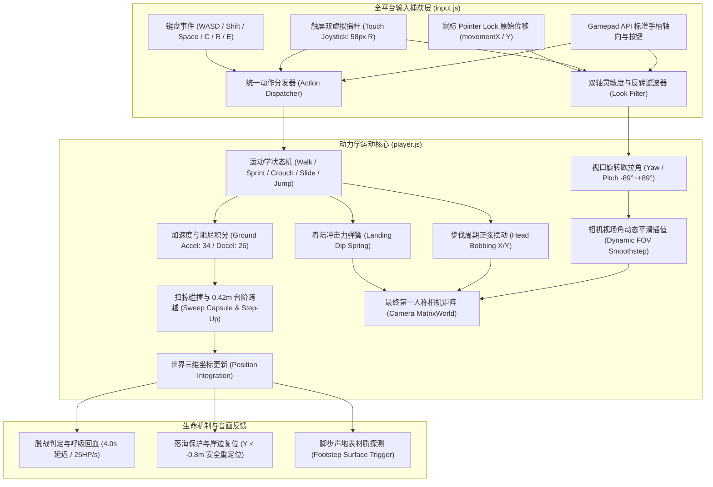
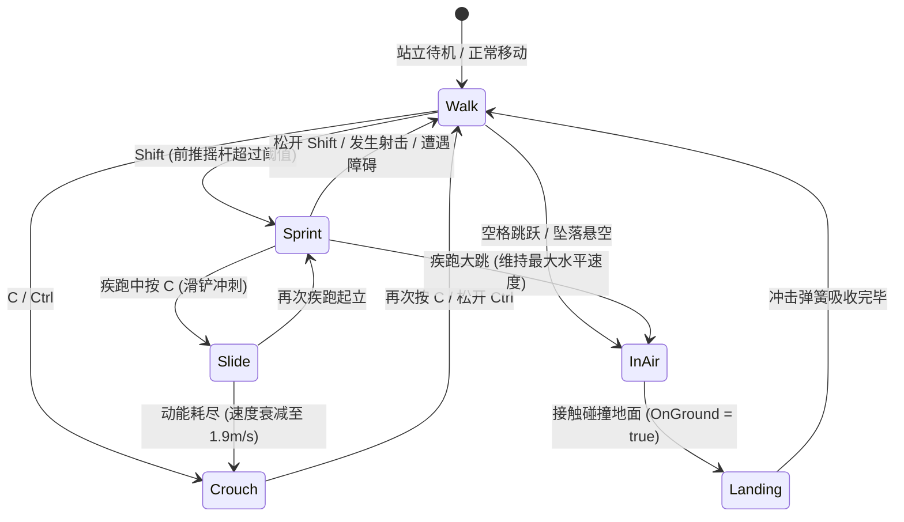

# 《几猫国产3A大作》玩家动力学控制器与跨平台输入系统 Wiki 文档

> **模块归属**: [src/player.js](file:///Volumes/M1/3A/src/player.js) & [src/input.js](file:///Volumes/M1/3A/src/input.js)  
> **逆向状态**: **100% 完整逆向还原 (Fully Deobfuscated & Clean ESM)**  
> **核心机制**: 连续惯性运动学、半隐式欧拉积分、土狼时间 (Coyote Time: 0.12s)、跳跃预输入缓冲 (0.13s)、仿生第一人称步频振荡相机、4轴受击多频噪声镜头震颤、全自动脱战呼吸回血、Pointer Lock 键鼠与移动端双虚拟摇杆无缝适配。

---

## 1. 架构总览 (Architecture Overview)

本系统由**玩家运动学控制器 (`player.js`)** 与 **全平台输入管理器 (`input.js`)** 协同构成。输入管理器对物理按键、鼠标微位移、触屏虚拟摇杆与 Gamepad 手柄进行抽象与死区滤波，以统一的 Action 动作流向玩家控制器注入动力学指令。



---

## 2. 运动学物理模拟与动力学方程 (Kinematics & Equations)

玩家在水平面（XZ）与垂直轴（Y）上分别采用独立的动力学积分模型，确保在复杂集装箱障碍地形中拥有极致顺滑的操作手感。

### 2.1 水平速度更新方程 (Horizontal Velocity Integration)
在地面状态下，控制器依据当前期望移动方向 $\vec{d}_{\text{wish}}$ 计算加速度或制动阻尼：

$$\vec{v}_{t+\Delta t} = \vec{v}_t + \vec{a} \cdot \Delta t$$

- **加速阶段** ($\vec{d}_{\text{wish}} \cdot \vec{v} > 0$): $\vec{a} = \vec{d}_{\text{wish}} \cdot a_{\text{ground}} \quad (a_{\text{ground}} = 34.0\text{ m/s}^2)$
- **减速/急停制动** ($\vec{d}_{\text{wish}} = 0$): $\vec{a} = -\frac{\vec{v}}{\|\vec{v}\|} \cdot d_{\text{ground}} \quad (d_{\text{ground}} = 26.0\text{ m/s}^2)$
- **空中机动微调**: 加速度降至 $a_{\text{air}} = 9.0\text{ m/s}^2$，避免玩家在空中反物理无惯性折返。

### 2.2 垂直下坠与跳跃动力学 (Vertical Jump Dynamics)
- **重力加速度**: $g = 21.0\text{ m/s}^2$（显著高于现实重力 $9.8\text{ m/s}^2$），赋予角色下坠时极强烈的工业下沉感与扎实质感。
- **跳跃起跳初速**:
  
  $$v_{y0} = \sqrt{2 \cdot g \cdot h_{\text{apex}}} = \sqrt{2 \times 21.0 \times 1.0} \approx 6.48\text{ m/s}$$
  
  达到刚好跳上 1.0 米高单层集装箱托盘/货架的临界战术高度。

### 2.3 竞技级跳跃手感容错机制
1. **土狼时间 (Coyote Time: 0.12s)**:
   - 当玩家从集装箱边缘跑出落空的瞬时，在 $0.12\text{ s}$ 内按下跳跃键依然判定有效起跳，消除因跑出边缘 $1\text{ px}$ 无法起跳的落空感。
2. **跳跃预输入缓冲 (Jump Buffer: 0.13s)**:
   - 在空中下落即将着地前的 $0.13\text{ s}$ 内提前按下跳跃键，着地瞬间立即自动起跳，支持流畅的连跳战术机动。

---

## 3. 战术动作状态机 (Tactical Locomotion State Machine)



### 3.1 状态速度矩阵与碰撞盒高度

| 战术状态 | 目标移速 ($v_{\max}$) | 碰撞胶囊体高 ($H$) | 相机眼睛高度 ($Y_{\text{eye}}$) | 战术特征与规则 |
| :--- | :--- | :--- | :--- | :--- |
| **正常行走 (Walk)** | $3.8\text{ m/s}$ | $1.80\text{ m}$ | $1.68\text{ m}$ | 准星稳定，允许开火与精准点射 |
| **战术疾跑 (Sprint)** | $6.4\text{ m/s}$ | $1.80\text{ m}$ | $1.68\text{ m}$ | 持枪放低，FOV 自动外展 $+6^\circ$，开火立即打断疾跑 |
| **蹲伏机动 (Crouch)** | $1.9\text{ m/s}$ | $1.15\text{ m}$ | $1.02\text{ m}$ | 受击截面缩小 $36\%$，武器固有散布降低 $40\%$ |
| **战术滑铲 (Slide)** | 初始 $7.2\text{ m/s}$ 衰减 | $1.15\text{ m}$ | $0.92\text{ m}$ | 疾跑时按 C 触发，低摩擦滑行推进，钻过低矮管道与集装箱底缝 |
| **空中悬垂 (InAir)** | 继承起跳速度 | $1.80\text{ m}$ | $1.68\text{ m}$ | 失去地面支撑，武器射击散布扩张至 $2.5\times$ |

---

## 4. 仿生第一人称相机系统 (Biomimetic Camera Kinematics)

为杜绝传统 WebGL 射击游戏如“滑冰漂移”般的生硬视口，`player.js` 实现了多层仿生动力学叠加：

### 4.1 头部步频正弦晃动 (Head Bobbing)
依据角色在地面行进的实际路程周期累计相位 $\Phi = \int \frac{v(t)}{\text{stride}} dt$：

$$\Delta Y_{\text{bob}} = \sin(2\pi \Phi \cdot 2) \cdot A_y \quad (\text{双峰垂直沉浮，模拟骨盆垂直落差})$$
$$\Delta X_{\text{bob}} = \cos(2\pi \Phi) \cdot A_x \quad (\text{单峰水平摆动，模拟身体重心左右交替})$$

- 正常行走: $A_y = 0.024\text{ m}, A_x = 0.013\text{ m}$
- 战术疾跑: 幅度放大 $1.9\times$，步频跨距从 $1.55\text{ m}$ 扩展至 $2.10\text{ m}$
- ADS 开镜: 头部晃动幅度自动衰减至 $0.22\times$，保证瞄准分划稳定不晕眩。

### 4.2 着陆冲击沉降弹簧 (Landing Dip Harmonic Spring)
角色从空中落地的瞬间，依据垂直着陆速度 $v_y$ 计算撞击冲量，压迫相机向下沉降：

$$\Delta Y_{\text{land}} = -\text{clamp}(|v_y| \times 0.036, 0, 0.20)\text{ m}$$

该位移通过阻尼简谐振子在 $0.25\text{ s}$ 内回弹到位，并触发伴随低频重音的落地触地音效与地面尘土粒子飞溅。

### 4.3 侧身横移微倾角 (Strafe Roll) 与 动态 FOV 呼吸
- **侧身微倾**: 左右横移（A/D 键）时，相机 Roll 轴向侧面自然微倾 $0.02\text{ rad}$（约 $1.15^\circ$），并在摇杆回正时平滑归零。
- **动态 FOV 呼吸**:
  - 疾跑时视野向前拉伸 ($75^\circ \rightarrow 81^\circ$)，强化风驰电掣的速度张力。
  - ADS 开镜时视野向前聚拢收窄 ($75^\circ \rightarrow 52^\circ$)，产生望远变焦与精神高度集中的隧道效应。

---

## 5. 战术生命与脱战恢复机制 (Tactical Health & Regen)

| 机制状态 | 参数数值 | 逻辑触发与音画联动 |
| :--- | :--- | :--- |
| **最大生命值 (Max HP)** | $100.0$ | HUD 左下角绿色网格血条 |
| **脱战恢复延迟 (Regen Delay)** | $4.0\text{ s}$ | 受到攻击后立即重设脱战计时器，必须连续 4 秒未受任何伤害 |
| **自动恢复速率 (Regen Rate)** | $25.0\text{ HP/s}$ | 触发脱战后，每秒以平滑线性递增回血，4 秒内回满 |
| **低血量危殆状态 (Critical HP)** | $\text{HP} \le 25.0$ | 画面边缘触发全屏暗角脉动红雾滤镜，伴随低沉急促的心跳音效 |
| **落海安全救援机制 (Sea Rescue)** | $Y_{\text{player}} < -0.8\text{ m}$ | 玩家若意外坠入港区深水海湾，系统触发白屏淡入，自动将玩家捞回最近的岸边安全重生点，并扣除 $15\text{ HP}$ |

---

## 6. 跨平台输入系统架构 (`input.js`)

### 6.1 桌面端高精按键映射与 Pointer Lock
- **鼠标锁定**: 点击游戏画面进入 `canvas.requestPointerLock()`，支持原生鼠标硬件原始偏移输入。
- **灵敏度缩放**: 默认基础灵敏度 $0.0021$，开镜时灵敏度自动缩减至 $0.60\times$，避免开镜时准星飞移。
- **垂直轴反转**: 支持在设置菜单中一键开启 Invert Y 轴。

### 6.2 移动端双虚拟摇杆与触屏交互 (Dual Touch Joysticks)
- **左半屏全向移动摇杆**:
  - 动态锚定（Dynamic Anchor）：手指触碰屏幕左半区任意位置即以此点为虚拟圆心，最大拖拽半径 $58\text{ px}$。
  - 径向死区过滤（Deadzone: $8\text{ px}$），超过死区后将位移归一化映射为 $X/Y$ 模拟量。
- **右半屏滑动瞄准区**:
  - 无边界滑动，直接将手指滑动差值乘上触屏灵敏度 $0.0052$ 转化为相机 Yaw/Pitch 转动。
- **移动端战术按键排布**:
  - 右下角大号开火按键、开镜切换键、跳跃键、换弹键与快速交互 E 键。

### 6.3 Gamepad 标准手柄支持
通过原生 `navigator.getGamepads()` 每帧采样：
- 左摇杆（Axes 0/1）驱动移动与滑铲
- 右摇杆（Axes 2/3）驱动视角旋转，自带立方死区曲率平滑
- 右扳机（RT / Button 7）开火，左扳机（LT / Button 6）开镜
- 按下左摇杆（L3 / Button 10）疾跑，A 键（Button 0）跳跃，B 键（Button 1）蹲伏/滑铲

---

## 7. 对外接口规范 (Module API)

```javascript
/**
 * 实例化第一人称角色控制器
 * @param {object} ctx 全局引擎上下文
 * @returns {PlayerController}
 */
export function create(ctx);

// PlayerController 核心方法与属性
player.pos;                     // Vector3 角色世界坐标
player.vel;                     // Vector3 实时三维速度
player.yaw;                     // 水平旋转角 (弧度)
player.pitch;                   // 垂直俯仰角 (弧度, 限制在 -89°~+89°)
player.health;                  // 实时生命值 (0 ~ 100)
player.alive;                   // 存活状态布尔值
player.onGround;                // 地面接触状态
player.sprinting;               // 疾跑状态
player.crouching;               // 蹲伏状态
player.ads;                     // ADS 因子 [0.0, 1.0]

player.update(dt);              // 帧循环驱动运动学物理、相机振动与生命恢复
player.damage(amount, dir);     // 注入受击伤害、触发受击红晕与相机微震
player.heal(amount);            // 补充生命值
player.addRecoil(pitch, yaw);   // 注入开火后坐力视口上跳
player.addShake(intensity);     // 触发多频噪声爆炸/震动镜头晃动
```
