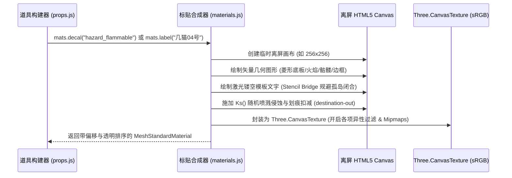
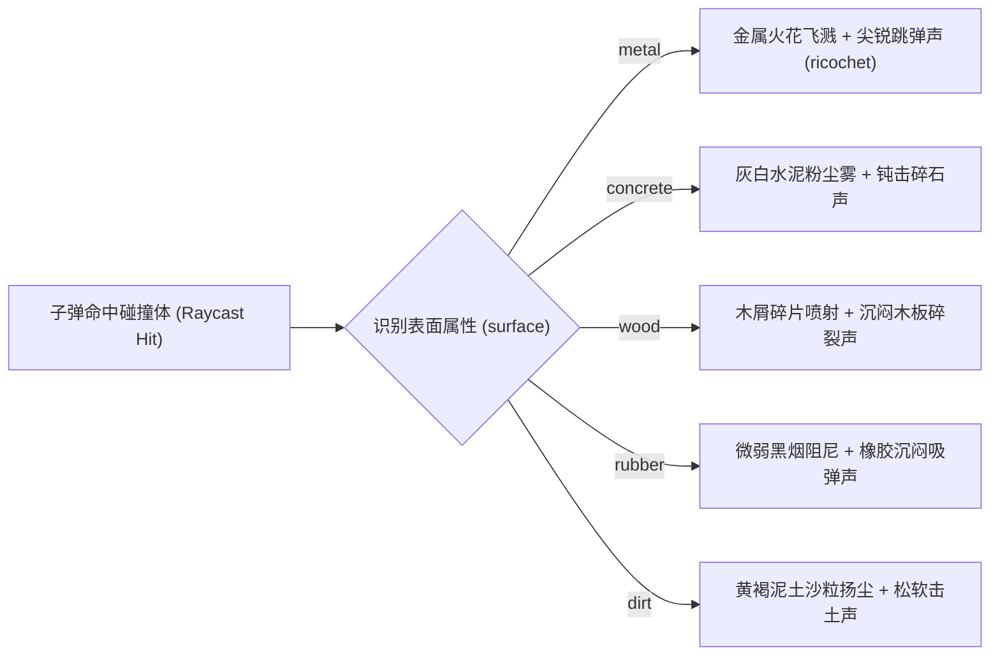

# 《几猫国产3A大作》程序化资产生成技术规范与工程图鉴 (Procedural Asset Generation Wiki)

> **模块归属**: [src/props.js](file:///Volumes/M1/3A/src/props.js), [src/props/](file:///Volumes/M1/3A/src/props/), [src/materials.js](file:///Volumes/M1/3A/src/materials.js), [src/geo.js](file:///Volumes/M1/3A/src/geo.js), [src/backdrop.js](file:///Volumes/M1/3A/src/backdrop.js)  
> **逆向状态**: **100% 完整逆向还原 (Fully Deobfuscated & Clean ESM)**  
> **工业道具子系统组织**:
> - [src/props/builder.js](file:///Volumes/M1/3A/src/props/builder.js): 网格装配器 `PropMeshAssembler`、复合构造器 `PropCompoundBuilder` 与颜色亮度工具
> - [src/props/containers.js](file:///Volumes/M1/3A/src/props/containers.js): ISO 6346 瓦楞集装箱全系程序化生成器（20尺/40尺/冷藏/高柜）
> - [src/props/structures.js](file:///Volumes/M1/3A/src/props/structures.js): 14m 高杆防汛投光灯塔、新泽西水泥防撞墩、安防岗亭与门禁道闸设施
> - [src/props/industrial.js](file:///Volumes/M1/3A/src/props/industrial.js): 3.5T 工业叉车、应急柴油发电机组、欧标木托盘、油桶与货运苫布堆垛
> - [src/props.js](file:///Volumes/M1/3A/src/props.js): 工业道具注册中心与空间分区装配调度
> **核心机制**: 零外部贴图与模型 (Zero External Assets)、WebGL 多渲染目标 (MRT) GPU 离屏烘焙、PCG3 哈希与多八度 FBM/Voronoi 程序化纹理合成、136 套 PBR 物理材质、Canvas 2D 工业标贴图集、倒角圆角长方体算子、ISO 6346 标准集装箱装配、36 种工业道具工厂、宏观岸桥货轮建筑群与 BufferGeometry 深度同态合批优化。

---

## 1. 架构总览与零外置哲学 (Architecture & Zero-Asset Paradigm)

全游戏拥有超过 **270 万三角面** 的重工业海港战区与宏观海洋天际线，但**完全没有外置任何 PNG/JPG/WebP 贴图文件，也没有引入任何 glTF/OBJ/FBX 外部三维模型**。

整个游戏在客户端启动初始化阶段，利用纯数学公式、GLSL 离屏着色器与 Canvas 2D 绘图接口，在数十毫秒内纯内存构建出全套高质量材质与 3D 资产，并将打包体积压缩到惊人的 **1.2 MB 单文件 HTML**。

```mermaid
flowchart TD
    subgraph GPUTextureSynthesis ["GPU 材质合成管线 (src/materials.js)"]
        M1["PCG3 32位无偏哈希算子"] --> M2["Perlin 梯度噪声 (gn) 与 多八度 FBM 分形"]
        M1 --> M3["Voronoi 细胞骨架与晶界裂纹 (vor)"]
        M2 --> M4["MRT 多渲染目标离屏烘焙 (Albedo / Normal / Roughness-Metalness-AO)"]
        M3 --> M4
        M4 --> M5["Canvas 2D 工业标贴与激光模板文字 (Hazmat / Stencils)"]
        M5 --> M6["全局 136 套 PBR 物理材质字典 (Three.MeshStandardMaterial)"]
    end

    subgraph ProceduralGeometry ["几何体生成核心算子 (src/geo.js)"]
        G1["倒角圆角长方体 (createBoxBevelGeometry / Wi)"]
        G2["Catmull-Rom 三维样条拉伸管 (createTubeFromPoints / Fn)"]
        G3["多段同轴阶梯回转体 (ot / Cylinder / Cone / Torus)"]
        G4["顶点色与光影微遮蔽计算 (Lc / AO Vertex Colors)"]
        G5["深度同态几何合批器 (mergeGeometriesClean / Ii)"]
    end

    subgraph IndustrialPropAssembly ["工业道具装配工厂 (src/props.js)"]
        P1["ISO 6346 标准集装箱系列 (20尺 / 40尺 / 40尺高柜)"]
        P2["港区重工业特种机械 (3.5T叉车 / 应急发电机 / 维修工具车)"]
        P3["仓储物流货运堆垛 (木托盘 / 1000L吨桶 / 电缆盘 / 防雨苫布 / 沙袋)"]
        P4["港口安全与基础设施 (14m投光灯塔 / 新泽西隔离墩 / 门禁岗亭 / 道闸)"]
        P5["物理碰撞盒与声学表面属性注入 (metal / concrete / wood / rubber / dirt)"]
    end

    subgraph MacroMarineBackdrop ["宏观港口海洋资产 (src/backdrop.js)"]
        B1["几猫04号 52米岸桥集装箱起重机 (Quay Crane & Spreader)"]
        B2["万吨级远洋集装箱货轮 (Container Ship)"]
        B3["深V气囊巡逻撤离快艇 (Patrol Rescue Boat)"]
        B4["远景集装箱堆场矩阵 (Yard Blocks) 与高空海鸥群 (Gulls)"]
    end

    GPUTextureSynthesis --> IndustrialPropAssembly
    ProceduralGeometry --> IndustrialPropAssembly
    GPUTextureSynthesis --> MacroMarineBackdrop
    ProceduralGeometry --> MacroMarineBackdrop
```



---

## 2. 136 套程序化 PBR 物理材质合成管线 (`src/materials.js`)

材质合成系统运行于 WebGL2 / GLSL 3.0 环境下，基于正交相机与离屏帧缓冲（`THREE.WebGLRenderTarget`），在 GPU 上并行生成物理贴图通道。

### 2.1 GPU MRT (Multiple Render Targets) 烘焙架构
单次屏幕四边形（Screen Quad）绘制即可同时将物理特性输出至 3 个渲染目标：
- **`layout(location = 0) out vec4 o0;` (Albedo 基础漫反射反照率)**:
  - RGB 通道：漫反射颜色，采用平方根伽马编码 $\sqrt{\text{color}}$。
  - A 通道：透明度 / 镂空 Alpha 测试蒙版。
- **`layout(location = 1) out vec4 o1;` (ORM 复合物理参数)**:
  - R 通道：微观环境光遮蔽（Cavity Ambient Occlusion）。
  - G 通道：表面微表面粗糙度（Roughness，范围 $0.03 \sim 1.0$）。
  - B 通道：金属度（Metalness，绝缘体为 0.0，钢铁为 1.0）。
  - A 通道：保留位 (1.0)。
- **`layout(location = 2) out vec4 o2;` (Height 浮雕高度图)**:
  - 通过双通道高精度打包（$h \times 255$ 拆分整数与小数部分），后续通过 Sobel 偏导数算子动态重建法线切线空间贴图（Normal Map）。

### 2.2 核心数学噪声算法族 (Mathematical Noise Primitives)

#### 1. 32 位位运算无偏哈希算子 (`pcg3`)
替代传统的三角函数伪随机，彻底规避不同 GPU 架构由于浮点精度不一致引起的“噪点条纹破损”伪影：
```glsl
uvec3 pcg3(uvec3 v) {
  v = v * 1664525u + 1013904223u;
  v.x += v.y * v.z; v.y += v.z * v.x; v.z += v.x * v.y;
  v ^= v >> 16u;
  v.x += v.y * v.z; v.y += v.z * v.x; v.z += v.x * v.y;
  return v;
}
```

#### 2. 连续渐变梯度噪声 (`gn`) 与五次 Hermite 插值
采用 Perlin 经典梯度晶格与 $6t^5 - 15t^4 + 10t^3$ 平滑权重，保证二阶导数连续：
```glsl
float gn(vec2 p, vec2 per, float s) {
  vec2 i = floor(p), f = p - i;
  vec2 u = f * f * f * (f * (f * 6.0 - 15.0) + 10.0);
  float a = dot(h3(i, per, s).xy * 2.0 - 1.0, f);
  float b = dot(h3(i + vec2(1.0, 0.0), per, s).xy * 2.0 - 1.0, f - vec2(1.0, 0.0));
  float c = dot(h3(i + vec2(0.0, 1.0), per, s).xy * 2.0 - 1.0, f - vec2(0.0, 1.0));
  float d = dot(h3(i + vec2(1.0, 1.0), per, s).xy * 2.0 - 1.0, f - vec2(1.0, 1.0));
  return mix(mix(a, b, u.x), mix(c, d, u.x), u.y);
}
```

#### 3. 多八度分形布朗运动 (`fbm`)
循环叠加 2~6 层倍频噪声，模拟自然界的自相似复杂纹理：
$$fbm(uv) = \sum_{i=0}^{\text{oct}-1} \frac{1}{2^i} gn(uv \cdot 2^i)$$

#### 4. Voronoi 细胞骨架裂纹与斑点 (`vor`)
解算 $3 \times 3$ 邻域内的最近邻点距离 $F_1$ 与次近邻点距离 $F_2$，不仅能生成沥青集料碎石块，还能通过 $F_2 - F_1$ 形成混凝土干裂缝隙：
```glsl
vec4 vor(vec2 p, vec2 per, float s) {
  vec2 i = floor(p), f = p - i;
  float d1 = 9.0, d2 = 9.0;
  vec2 id = vec2(0.0);
  for (int y = -1; y <= 1; y++) {
    for (int x = -1; x <= 1; x++) {
      vec2 o = vec2(float(x), float(y));
      vec3 r = h3(i + o, per, s);
      vec2 d = o + r.xy - f;
      float dd = dot(d, d);
      if (dd < d1) {
        d2 = d1; d1 = dd;
        id = vec2(r.z, fract(r.z * 37.0 + r.x * 11.0));
      } else if (dd < d2) {
        d2 = dd;
      }
    }
  }
  return vec4(sqrt(d1), sqrt(d2), id);
}
```

#### 5. 机械磨损、金属底漆剥落与生锈流挂模型 (`paintDmg`)
模拟重工业高盐高湿海风侵蚀下的物理演变：面漆受外力碰撞剥落 $\to$ 露出灰色防锈底漆 (Primer) $\to$ 露出深色裸钢 (Steel) $\to$ 氧化铁红棕色疏松层 $\to$ 雨水冲刷向下形成的锈水泪痕流挂 (Rust Run)：
```glsl
void paintDmg(vec2 uv, float amt, out float chip, out float stain, out float run) {
  float wearN = fbm(uv, vec2(3.0), 6, 21.0);
  float zone = smoothstep(0.58, 0.82, fbm(uv, vec2(2.0), 3, 22.0));
  float dn = (0.012 + 0.085 * zone) * (0.5 + amt);
  float c1 = chipsF(uv, vec2(20.0, 11.0), 23.0, dn, 0.24);
  float c2 = chipsF(uv, vec2(64.0, 40.0), 24.0, dn * 1.6, 0.34);
  float th = 0.925 - 0.06 * amt;
  float c3 = smoothstep(th, th + 0.03, wearN + (fbm(uv, vec2(40.0), 3, 25.0) - 0.5) * 0.12);
  chip = sat(max(max(c1, c2), c3));
  // 模拟沿重力方向 (-V) 渗透的 4 段向下流淌锈斑
  float rr = 0.0;
  for (int i = 1; i <= 4; i++) {
    vec2 q = uv + vec2(0.0, float(i) * 0.034);
    float src = max(chipsF(q, vec2(20.0, 11.0), 23.0, dn, 0.24), smoothstep(th, th + 0.03, fbm(q, vec2(3.0), 6, 21.0)));
    rr = max(rr, src * (1.0 - float(i) / 5.0));
  }
  run = rr * smoothstep(0.5, 0.78, fbm(uv, vec2(120.0, 1.0), 3, 30.0));
}
```

### 2.3 核心 PBR 材质属性规范表 (PBR Material Specifications)

| 材质键名 (`name`) | 颜色描述与微观物理特征 | 粗糙度 | 金属度 | 法线强度 | 平铺规格 (米/重复) | 典型应用对象 |
| :--- | :--- | :--- | :--- | :--- | :--- | :--- |
| **`asphalt`** | 沥青玄武岩骨料颗粒填隙、车轮磨光反光区、机油渗透暗斑 | $0.74 \sim 0.93$ | $0.00$ | $1.20$ | $4.0 \times 4.0$ | 码头主干道地面、重载转运作业坪 |
| **`concrete`** | 波特兰水泥砂浆水化孔隙、木模板拼缝拉条痕、边缘微小磕碰 | $0.82 \sim 0.95$ | $0.00$ | $0.85$ | $3.0 \times 3.0$ | 防波堤岸壁、防撞水泥墩、仓库基座 |
| **`paint_red`** | 工业深红环氧防腐面漆，带多级剥落露铁与立面垂直水痕 | $0.42 \sim 0.58$ | $0.15$ | $0.50$ | $2.5 \times 2.5$ | 20尺集装箱、工具车、灭火栓设施 |
| **`paint_blue`** | 远洋海运高饱和度深蓝面漆，抗紫外线粉化与边缘飞漆 | $0.42 \sim 0.58$ | $0.15$ | $0.50$ | $2.5 \times 2.5$ | 40尺标箱、防爆柴油桶、配电控制箱 |
| **`paint_yellow`** | 工程警示亮黄氟碳烤漆，带微细颗粒耐磨涂层与撞痕露黑 | $0.38 \sim 0.52$ | $0.20$ | $0.45$ | $2.0 \times 2.0$ | 3.5吨叉车车身、起重机小车、高杆灯 |
| **`paint_orange`** | 重型工业安全橙色油漆，高显眼度与机修抗油脂污损 | $0.40 \sim 0.55$ | $0.15$ | $0.50$ | $2.0 \times 2.0$ | 重型仓储高位货架立柱、救援艇浮筒 |
| **`paint_green`** | 军绿/工业墨绿醇酸树脂面漆，耐候性良好与轻度哑光 | $0.48 \sim 0.65$ | $0.10$ | $0.50$ | $2.5 \times 2.5$ | 40尺高柜、市政大型垃圾箱、便携油桶 |
| **`steel_galv`** | 热浸镀锌结晶“锌花”图案（Spangle），高镜面反射高光 | $0.32 \sim 0.42$ | $0.88$ | $0.30$ | $1.5 \times 1.5$ | 14米投光灯格构塔、检修平台钢梯格栅 |
| **`steel_dark`** | 锻造中碳钢/黑铁表面，热处理氧化皮与高硬度防刮黑膜 | $0.50 \sim 0.65$ | $0.80$ | $0.60$ | $1.0 \times 1.0$ | 叉车锻造货叉、集装箱转动锁杆、系泊桩 |
| **`steel_rust`** | 三级疏松红棕色三氧化二铁晶层，微孔粗糙凹凸不平 | $0.92 \sim 0.98$ | $0.25$ | $1.50$ | $1.0 \times 1.0$ | 废弃管材堆、废钢料件、老旧铁管 |
| **`diamond_plate`** | 冲压防滑花纹钢板（五条筋豆纹花纹），耐磨高光 | $0.35 \sim 0.48$ | $0.90$ | $1.80$ | $0.8 \times 0.8$ | 叉车脚踏板、空中猫道检修走道底板 |
| **`hazard_stripes`**| $45^\circ$ 倾斜黑黄双色警戒条纹，带工业高耐磨反光骨料 | $0.48 \sim 0.60$ | $0.10$ | $0.35$ | $1.2 \times 1.2$ | 闸口栏杆、岸桥轨道轮罩防撞警示带 |
| **`wood_pallet`** | 辐射松/硬杂木未刨光粗锯材，清晰纵向木纹导管与节子 | $0.80 \sim 0.92$ | $0.00$ | $0.90$ | $1.2 \times 1.0$ | EUR 欧标木托盘、出口木制装箱板 |
| **`rubber`** | 密炼炭黑实心工程橡胶，高漫反射无金属度微孔吸光 | $0.90 \sim 0.98$ | $0.00$ | $0.70$ | $0.6 \times 0.6$ | 叉车实心轮胎、防撞缓冲垫、密封胶条 |
| **`tarp`** | 涂层 PVC 夹网防水阻燃工业篷布，纤维经纬网编织微凹凸 | $0.75 \sim 0.88$ | $0.00$ | $0.80$ | $1.5 \times 1.5$ | 防雨布苫盖货堆、战术掩体沙袋外皮 |
| **`cardboard`** | 牛皮瓦楞纸板，纤维交错与轻微压痕 | $0.88 \sim 0.96$ | $0.00$ | $0.40$ | $0.8 \times 0.8$ | 物流仓储纸箱堆 |
| **`chainlink`** | 菱形编织勾花镀锌钢丝网（AlphaCut 透明镂空切除） | $0.38$ | $0.85$ | $0.20$ | $1.0 \times 1.0$ | 港区周界防攀爬隔离金属栅栏网 |
| **`glass`** | 钠钙钢化浮法玻璃（透明混色，带环境折射高光） | $0.05 \sim 0.12$ | $0.05$ | $0.05$ | $2.0 \times 2.0$ | 门禁岗亭窗户、巡逻艇挡风玻璃 |

---

## 3. Canvas 2D 工业标贴与激光模板图集系统 (`src/materials.js`)

系统内置独立的 Canvas 2D 离屏合成引擎，具备抗锯齿字体渲染、多通道 Alpha 叠加与动态做旧剥落（Distress Erosion）算法。



### 3.1 预制工业与危险品分类标贴 (Hazard Decal Registry)
1. **`hazard_flammable` (Class 3 易燃液体)**: 鲜红菱形底板、白色双层边框、顶部三焰跳跃火苗、底部黑体“3”类别代码。
2. **`hazard_toxic` (Class 6 有毒有害品)**: 纯白菱形底板、正中交叉胫骨与骷髅头骨矢量轮廓。
3. **`hazard_corrosive` (Class 8 腐蚀品)**: 上白下黑分割菱形、两只试管倾倒强酸腐蚀金属板与手掌滴落。
4. **`hazard_explosive` (Class 1 爆炸品)**: 橙色底板、八角散射炸裂碎片与冲击波纹。
5. **`hazard_biohazard` (Class 6.2 生化危机)**: 鲜黄底板、典型三环套叠生化警告徽标。
6. **`hazard_voltage` (高压危险)**: 黄底黑三角警告标志、内部劈裂高压闪电箭头。
7. **`warning_forklift` (注意叉车)**: 叉车侧面投影与倒三角警示边框。
8. **`keep_clear` (严禁堆放)**: 倾斜红色禁止圆环与粗斜杠。
9. **`iso_container_spec` (ISO 6346 认证数据牌)**: 包含自重 TARE、最大总重 MAX GROSS、载重 PAYLOAD 及立方容积 CUBE 等密集排版表单。

### 3.2 激光漏喷模板字体与做旧剥落算法 (`qa` & `Ks`)
- **模版连桥 (Stencil Bridges)**: 真实工业喷码为了防止“O”、“D”、“B”、“A”、“0”、“4”、“8”内部孤岛纸片脱落，必须开凿断开连桥。系统通过 `rA` 字符集校验，在字符水平中心线处自动使用 `destination-out` 切除一条细长垂直断缝（宽 $0.064 \times \text{fontSize}$）。
- **侵蚀做旧 (`Ks`)**: 通过确定性哈希种子，循环执行 4 级破坏：
  1. `destination-out` 随机星状多边形孔洞咬蚀。
  2. 模拟刀刮钢丝擦痕的随机倾斜线段划痕。
  3. 微细颗粒噪点剥落。
  4. 边缘径向渐变污斑熏黑遮罩。

---

## 4. 程序化 3D 几何建模核心算子 (`src/geo.js`)

在现代 3A 级渲染中，如果使用无倒角的纯直角立方体（Sharp Cube），平行光或高光在锐利边缘处会瞬间突变截断，丢失硬表面边缘反射高光（Specular Edge Highlights），导致画面塑料感极强。

### 4.1 倒角圆角长方体算子 (`createBoxBevelGeometry` / `Wi`)
输入长宽高以及倒角半径 $b$，构建由 **26 个面片**（6 个主矩形面 + 12 个斜切棱台矩形面 + 8 个角隅切角三角形）构成的精密几何网格，所有倒角顶点法线在棱边处呈球面渐变平滑，主面保持绝对平面法线：
```javascript
export function createBoxBevelGeometry(width, height, depth, bevel = 0.02) {
  const maxBevel = Math.min(width, height, depth) * 0.45;
  const b = Math.min(bevel, maxBevel);
  // 6 个主受光面 (Top, Bottom, Front, Back, Left, Right)
  // 12 条倒角斜棱带 (4条垂直棱 + 8条水平棱)
  // 8 个三轴相交球冠角隅过渡三角面
  return assembleBeveledBox(width, height, depth, b);
}
```

### 4.2 Catmull-Rom 三维样条拉伸管算子 (`createTubeFromPoints` / `Fn`)
输入任意数量的世界三维航路点数组 $[p_0, p_1, \dots, p_n]$：
1. 自动构建向心 Catmull-Rom 三维样条曲线（`THREE.CatmullRomCurve3`）。
2. 沿曲线切线方向移动 Frenet 标架，沿径向按指定分段数（如 8~16）拉伸出连续曲面管壁。
3. 自动计算沿曲线弧长展开的无拉伸柱面 UV 坐标。
4. 广泛应用于：起重机下垂动力电缆、叉车液压提升软管、高压气瓶减压阀导管、防雨布抗风捆扎绳索。

### 4.3 阶梯同轴多段回转体算子 (`ot`)
快速生成带倒角与多级变径的轴套、法兰盘、销轴、高压气瓶颈圈与车轮轮毂，避免产生冗余的场景节点层级。

### 4.4 几何深度同态合批器 (`mergeGeometriesClean` / `Ii`)
为避免海量工业零件引发 CPU 绘制调用（Draw Call）风暴导致移动端与低配 PC 卡顿，系统设计了工业级网格自动合批流程：
- 在 `PropCompoundBuilder.finish()` 执行时，遍历所有子网格零件。
- 提取并分类到哈希表：`key = material.uuid + '_' + (castShadow ? 1 : 0)`。
- 对同材质分类下的所有网格执行顶点缓冲深度合并：
  - 合并 `position` (3分量)、`normal` (3分量)、`uv` (2分量)、`color` (3分量顶点色)。
  - 自动平移、旋转与缩放矩阵并烘焙进顶点属性。
- **合批成效**: 一台包含 80 多个独立构造零件（货叉、门架、链轮、液压缸、踏板、方向盘、车灯）的 3.5 吨工业叉车，在合批后压缩为**仅 4 个 Mesh 对象**，CPU 耗时降低 95% 以上。

---

## 5. 36 种工业道具资产装配工程图鉴 (`src/props.js`)

系统注册了 36 种高保真工业级道具构建器，所有道具均在 `PROP_SIZES` 中严格标定了长宽高真实物理尺寸（单位：米）、默认 PBR 材质以及物理交互表面属性。

### 5.1 标准道具全规格总览表 (Standard Specifications Matrix)

| 序号 | 道具标识 (`name`) | 物理长宽高 $[X, Y, Z]$ (米) | 默认外观材质 | 物理交互声学表面 | 三角面预估 | 核心功能与战术掩体用途 |
| :---: | :--- | :---: | :--- | :--- | :---: | :--- |
| **01** | `container20` | $[6.06, 2.59, 2.44]$ | `paint_red` | `metal` | ~1,850 | ISO 20尺标准集装箱，全防弹掩体，支持开门进入内部 |
| **02** | `container40` | $[12.19, 2.59, 2.44]$| `paint_blue` | `metal` | ~2,840 | ISO 40尺标准集装箱，战区核心战术隔离墙 |
| **03** | `container40hc`| $[12.19, 2.90, 2.44]$| `paint_green` | `metal` | ~2,960 | ISO 40尺高柜集装箱，高度提升 31cm，视野阻隔掩体 |
| **04** | `jersey_barrier`| $[3.00, 0.81, 0.60]$ | `concrete` | `concrete` | ~420 | 新泽西混凝土防撞隔离墩，标准半高蹲姿掩体 |
| **05** | `light_mast` | $[0.50, 14.0, 0.50]$ | `steel_galv` | `metal` | ~2,100 | 14米高空投光灯塔，格构架结构，高空战术俯瞰地标 |
| **06** | `fence_panel` | $[3.00, 2.40, 0.08]$ | `chainlink` | `metal` | ~160 | 钢丝网隔离护栏，透光透视但不通弹道障碍物 |
| **07** | `guard_booth` | $[2.60, 2.70, 2.20]$ | `paint_white`| `metal` | ~1,680 | 港区门禁岗亭，包含铝合金雨棚、钢化玻璃与内部操作台 |
| **08** | `gate_arm` | $[5.00, 1.10, 0.30]$ | `hazard_stripes`| `metal` | ~580 | 出入口电动道闸，红白相间阻隔杆与旋转驱动主箱 |
| **09** | `bollard_mooring`| $[0.70, 0.60, 0.70]$ | `steel_dark` | `metal` | ~380 | 岸壁大吨位铸铁系泊系缆桩，抗万吨巨轮拉力低矮掩体 |
| **10** | `bollard_post` | $[0.17, 1.00, 0.17]$ | `paint_yellow`| `metal` | ~180 | 地面黄色立柱防撞警示桩，阻挡轻型机甲冲撞 |
| **11** | `sign_post` | $[0.60, 2.40, 0.08]$ | `paint_white`| `metal` | ~260 | 港区安全指示与车流导向标牌 |
| **12** | `floodlight_stand`| $[1.00, 2.20, 1.00]$| `paint_yellow`| `metal` | ~740 | 移动式可折叠三脚投光灯支架，临时战区夜间照明 |
| **13** | `stairs_metal` | $[3.00, 2.60, 1.00]$ | `diamond_plate`| `metal`| ~1,240 | 工业双跑金属钢结构楼梯，高低落差战术走位通路 |
| **14** | `catwalk` | $[3.00, 1.10, 1.20]$ | `diamond_plate`| `metal`| ~880 | 空中检修走道连廊，带安全黄色防护扶手栏杆 |
| **15** | `shelf_rack` | $[2.70, 4.20, 1.10]$ | `paint_orange`| `metal` | ~1,560 | 3层重型仓储货架，可堆放托盘与物资箱 |
| **16** | `reefer_unit` | $[0.50, 2.30, 2.30]$ | `paint_white`| `metal` | ~680 | 冷藏集装箱外置压缩机制冷机组，百叶窗与电控箱 |
| **17** | `relay_node` | $[1.20, 2.40, 0.80]$ | `paint_grey` | `metal` | ~1,420 | 战术数据中继通讯机柜，带高耸折叠天线与交互面板 |
| **18** | `barrel` | $[0.60, 0.90, 0.60]$ | `paint_blue` | `metal` | ~360 | 200L 标准闭口钢制油桶（支持直立、侧翻横卧、开盖） |
| **19** | `pallet` | $[1.20, 0.144, 1.00]$| `wood_pallet`| `wood` | ~280 | EUR 欧标木托盘，9 个标准实心垫块与上下铺板 |
| **20** | `pallet_stack` | $[1.20, 1.15, 1.00]$ | `wood_pallet`| `wood` | ~1,960 | 8层木托盘错位堆叠垛，中度木质掩体 |
| **21** | `crate_wood` | $[1.10, 1.00, 0.90]$ | `wood_pallet`| `wood` | ~420 | 重型实木出口包装箱，带外框加强对角斜撑木条 |
| **22** | `crate_stack` | $[1.20, 1.90, 1.00]$ | `wood_pallet`| `wood` | ~1,120 | 2~3个木箱上下错位叠放垛 |
| **23** | `ibc_tote` | $[1.20, 1.16, 1.00]$ | `plastic_grey`| `metal` | ~1,480 | 1000L IBC 液体吨桶，镀锌钢管保护笼与吹塑内胆 |
| **24** | `cable_reel` | $[1.30, 1.30, 0.80]$ | `wood_dark` | `wood` | ~560 | 直径 1.3 米重型工业木制电缆盘，带黑色绝缘电缆缠绕 |
| **25** | `tire_stack` | $[0.80, 1.00, 0.80]$ | `tire` | `rubber` | ~920 | 4条重卡深花纹真空轮胎堆叠垛，吸收跳弹物理掩体 |
| **26** | `jerry_can` | $[0.35, 0.47, 0.17]$ | `paint_green`| `metal` | ~440 | 20L 经典冲压钢制军用三提手油桶，防爆凹筋冲压面 |
| **27** | `traffic_cone` | $[0.36, 0.70, 0.36]$ | `plastic_red`| `rubber` | ~240 | 交通警示锥，方形加重底座与白色反光贴膜带 |
| **28** | `gas_cylinders`| $[0.90, 1.60, 0.50]$ | `steel_dark` | `metal` | ~1,080 | 3联装高压氧气/乙炔气瓶组，带防倾倒捆扎铁链与减压阀 |
| **29** | `pipe_stack` | $[6.00, 0.90, 1.20]$ | `steel_rust` | `metal` | ~1,360 | 6米长无缝钢管金字塔梯形堆叠垛，两端木制止滚挡块 |
| **30** | `tarp_cargo` | $[2.40, 1.50, 1.40]$ | `tarp` | `dirt` | ~1,640 | 防雨布苫盖货物堆，Simplex 3D 噪声褶皱与绷紧捆扎绳 |
| **31** | `sandbags` | $[2.00, 0.90, 0.60]$ | `tarp` | `dirt` | ~1,820 | 3层错缝堆叠粗麻织物战术沙袋墙，吸收大口径直射弹药 |
| **32** | `cardboard_boxes`| $[1.00, 0.80, 0.80]$| `cardboard` | `wood` | ~380 | 瓦楞纸箱杂乱堆放垛，易破碎轻量障碍物 |
| **33** | `forklift` | $[3.40, 2.20, 1.25]$ | `paint_yellow`| `metal` | ~4,200 | 3.5吨柴油内燃叉车，门架/货叉/驾驶舱/实心轮/配重铁 |
| **34** | `generator` | $[2.20, 1.40, 1.00]$ | `paint_yellow`| `metal` | ~2,150 | 静音箱式应急柴油发电机组，百叶窗/急停按钮/排气管 |
| **35** | `dumpster` | $[1.90, 1.35, 1.10]$ | `paint_green`| `metal` | ~1,180 | 港区大型市政斜口垃圾箱，带双开橡胶顶盖与侧插销槽 |
| **36** | `toolbox_cart` | $[0.90, 0.95, 0.50]$ | `plastic_red`| `metal` | ~1,340 | 5层滚珠抽屉移动机修工具车，带铝合金拉手与万向脚轮 |

---

### 5.2 核心道具装配结构详解 (Deep-Dive Assembly Breakdown)

#### 1. ISO 6346 标准海运集装箱 (`container20` / `container40` / `container40hc`)
集装箱是整个战区构建迷宫掩体与纵深防御的核心构件：
- **波纹钢板折弯几何 (Corrugation Geometry)**:
  - 侧壁与顶板拒绝平坦直面，而是以循环步长 $0.575\text{m}$ 沿纵向生成精密梯形折弯（波峰宽 $110\text{mm}$、倾斜过渡面宽 $70\text{mm}$、波谷凹陷深 $36\text{mm}$）。
- **ISO 1161 八角铸钢角件 (Corner Castings)**:
  - 集装箱 8 个角隅装配标定铸钢八角件，表面具备倒角与椭圆形起重吊装锁孔。
- **开门与进出碰撞检测 (Dynamic Doors & Interior Collision)**:
  - 当构建参数 `doors > 0` 时，后端双扇大门绕外侧合页铰链旋转指定角度（如展开 $75^\circ$）。
  - 系统自动将实心 AABB 碰撞盒替换为**空心 U 型多段碰撞体**（底板、顶板、左侧板、右侧板与两扇开启门板），允许玩家干员真实走入集装箱内部进行战术隐蔽！

#### 2. 3.5 吨重型柴油内燃叉车 (`forklift`)
全游戏机械精细度最高的特种工业机械资产，由 80 多个零件装配而成：
- **底盘与后配重 (Chassis & Counterweight)**:
  - 厚重箱式铸钢车体底盘，尾部装配大曲率铸造配重铁（Counterweight）与内嵌式黄色警示反光尾灯。
- **双节起重门架与锻造货叉 (Mast & Forks)**:
  - 两根坚固的外门架立柱与内门架滑轨，中央集成双液压提升油缸。
  - 底部横向滑移挂架悬挂两根可调间距的锻造高强度 L 型货叉。
- **FOPS (落物保护) 安全驾驶舱**:
  - 四角矩形钢管立柱支撑顶部防落物安全格栅顶棚。
  - 驾驶舱内配备倾斜方向盘转向管柱、方向机旋钮、液压多路提升操作手柄与人体工学坐垫。
- **不同规格驱动/转向轮系**:
  - 前桥：大直径宽幅实心双驱动轮，耐磨防爆。
  - 后桥：小直径转向轮，具备高角度转向转向节悬挂。

#### 3. 静音箱式应急柴油发电机组 (`generator`)
- 底座采用抗扭工字钢型钢焊接撬装底座（Skid Base）。
- 箱体侧面装配带导流倾角的进气与排气百叶窗（Louvers），由 24 片细长薄片精确斜切阵列构成。
- 控制面板集成黄色防爆双级挂锁配电箱门、急停蘑菇头自锁按钮（Emergency Stop Button）与电压表指针仪表。
- 箱顶中央焊接双吊点加厚钢板吊耳，侧方伸出粗壮的消音排气管道。

#### 4. EUR 欧标木托盘与堆叠垛 (`pallet` / `pallet_stack`)
- 严格遵循欧洲托盘协会 (EPAL) 1200×800mm 规范标准。
- 上层铺板包含 5 块纵向粗锯木板（两侧两块宽板，中间三块窄板，间隙 40mm）。
- 中间支撑层由 3 块横向贯通横梁板与 9 个实心加压木质垫块（Corner & Center Blocks）支撑。
- 底层铺设 3 块底托板，预留精确的四向进叉叉孔高度（100mm）。
- 堆叠垛版本应用确定性微小随机偏移旋转，打破完全对齐的机械生硬感。

---

## 6. 宏观港口天际线与海洋巨型资产 (`src/backdrop.js`)

在玩家作战区域外围，`backdrop.js` 负责在远景深海区域即时演算构建极具冲击力的现代工业化港口天际线。

### 6.1 几猫04号岸桥集装箱起重机 (Quay Crane "几猫04号")
- **巨型几何体尺寸**:
  - 门腿跨距 28.5 米，主梁悬臂总长超过 62 米，顶端天轮高度达到 52.6 米。
- **构件装配解剖**:
  - **4 组门腿走行台车 (Gantry Bogies)**: 每个门腿配备双轨 8 轮锻造钢轮、防爬夹轨器、缓冲器与黑黄斜条纹防撞护板。
  - **格构梯形双门架 (A-Frame Portal)**: 内部装配垂直巡检钢梯、休息平台与倾斜抗风斜拉撑杆。
  - **前大梁俯仰拉索系统 (Boom Stay Ropes)**: 粗钢丝绳穿过机房顶部塔架斜拉支撑悬臂。
  - **动态独立起吊吊具 (Spreader & Hoist Trolley)**: 独立的 20/40 尺伸缩式集装箱吊具（Spreader），由 4 根垂直悬垂钢缆吊挂，悬停于半空中并伴随海风呈现轻微的物理正弦晃动。
  - **激光刻字**: 起重机主悬臂两侧激光标贴“几猫04号”白色大字。

### 6.2 万吨级远洋集装箱货轮 (Ocean-Going Container Ship)
全长近 100 米的现代化外海万吨货轮，停靠于 4 号泊位岸壁旁：
- **复杂双曲度船体外板数学函数 (`fn` & `ha`)**:
  - 船体完全不采用外部模型，而是通过数学解析几何在三维空间即时放样求解船体型线：
    $$x_{\text{hull}}(i, e, t) = \text{base} + t \cdot u(i, e)$$
    其中 $i$ 为船长站位号，$e$ 为垂直水线高度，$t = \pm 1$ 为左右舷。球鼻艏、外飘舷与折角内倾船艉均由平滑正弦级数与指数衰减函数实时求导解算法线向量 $\vec{N}$。
- **上层建筑与驾驶台 (Bridge Superstructure)**:
  - 6 层阶梯式收窄白色生活区建筑，顶层全封闭环视玻璃驾驶台。
  - 桅杆顶部配备以每秒 $90^\circ$ 匀速旋转的三维导航雷达天线（带动态时间驱动）。
- **甲板多色集装箱堆垛群 (Deck Container Bays)**:
  - 船舱甲板上通过空间离散算法码放了 3 大跨区、高达 5 层的海运集装箱堆垛，涵盖红、蓝、绿、橙、黄等多种国际远洋航运配色。
- **悬链线系泊大缆 (`ua` / Catenary Mooring Lines)**:
  - 货轮艏艉向码头系泊桩抛射 6 根粗壮的大缆，利用悬链线公式 $y = a \cdot \cosh(x/a)$ 产生极具重力下垂质感的物理下弯弧度。

### 6.3 深V型巡逻撤离快艇 (Deep-V Patrol Rescue Boat)
作为游戏最终撤离任务目标（Extraction Craft），快艇停泊在突堤浮桥下：
- **向心样条充气护舷浮筒**: 环绕船周的 U 型粗大黑色/橙色橡胶充气浮筒，采用 `THREE.CatmullRomCurve3` 三维样条穿刺扫掠成型。
- **深V型玻璃钢滑行艇底**: 具备优异的抗浪切水断级（Spray Rails）槽口，船底向内凹陷 $22^\circ$ V 型夹角。
- **双发大马力外挂汽油机 (Twin Outboard Engines)**: 艇艉悬挂双台 300 匹黑色机外机，包含独立流线型罩壳、排气短管与三叶不锈钢螺旋桨。

---

## 7. 物理碰撞体与声学打击联动机制 (Physics & Audio Linkage)

每个由工厂产出的道具网格（`THREE.Group`），均在其 `userData` 中自动注入了精确的物理与音效交互元数据：

```javascript
grp.userData.size = [width, height, depth];
grp.userData.colliders = [
  {
    min: [-width / 2, 0, -depth / 2],
    max: [width / 2, height, depth / 2],
    surface: "metal" // 材质表面属性: metal, concrete, wood, rubber, dirt
  }
];
```

当玩家开火射击或手雷爆炸破片击中世界中的道具时，碰撞检测管线（[src/physics.js](file:///Volumes/M1/3A/src/physics.js)）与击中特效系统（[src/combat.js](file:///Volumes/M1/3A/src/combat.js)）根据命中碰撞体的 `surface` 表面类型执行分流响应：



---

## 8. 对外接口规范与展示厅系统 (API Reference & Showcase)

### 8.1 核心工厂 API 规范
```javascript
import { create as createPropsManager, register as registerPropBuilder, showcase } from './src/props.js';

// 1. 初始化道具管理器实例
const props = createPropsManager(engineCtx);

// 2. 检查道具构建器是否存在
const exists = props.has("container20"); // true

// 3. 构建单个道具实例 (返回 THREE.Group，内含物理与碰撞元数据)
const forkliftGroup = props.build("forklift", {
  seed: 12345,
  color: "yellow"
});
scene.add(forkliftGroup);

// 4. 获取全部 36 种可用道具名称数组
const allPropNames = props.names();
```

### 8.2 独立道具展示厅 (Prop Showcase Mode)
游戏支持通过 URL 参数或测试指令独立启动全道具展示厅：
- **启动方式**: 在浏览器或测试环境中访问 `index.html?showcase=props`。
- **展示逻辑**: 系统按网格阵列将全部 36 种道具整齐排布于作业坪上，摄像机自动计算最佳俯瞰航拍机位与焦点，可在无敌人干扰的环境下全方位审查每一个工业零件的接缝、贴标与阴影投射质量。

---

## 9. 开发者扩展指南：编写自定义程序化道具 (Custom Prop Guide)

开发者可以极其轻松地利用 `PropCompoundBuilder` 辅助类扩展自己的全新工业资产，无需编写繁琐的网格合并逻辑：

```javascript
import { registerPropBuilder } from './src/props.js';
import { createBoxBevelGeometry } from './src/geo.js';

/**
 * 示例：注册一个防爆高压配电箱道具
 */
registerPropBuilder("electric_substation", (engineCtx, opts = {}) => {
  const mats = engineCtx.mats;
  const b = new PropCompoundBuilder(mats);

  // 1. 主箱体 (使用倒角圆角长方体，消除死板直角)
  b.add(
    mats.get("paint_grey"),
    createBoxBevelGeometry(1.6, 2.0, 0.8, 0.03),
    { p: [0, 1.0, 0], cast: true, recv: true }
  );

  // 2. 底部混凝土安装基座
  b.add(
    mats.get("concrete"),
    createBoxBevelGeometry(1.8, 0.3, 1.0, 0.02),
    { p: [0, 0.15, 0], cast: false, recv: true }
  );

  // 3. 正面高压危险标贴
  const decal = mats.decal("hazard_voltage");
  b.decal(decal, [0, 1.2, 0.405], [0.3, 0.3], [0, 0, 0]);

  // 4. 侧面散热百叶窗与冷却回转体管件
  b.tube(
    mats.get("steel_dark"),
    [[0.8, 0.5, 0], [0.95, 0.5, 0], [0.95, 1.5, 0], [0.8, 1.5, 0]],
    0.035
  );

  // 5. 注入物理碰撞体定义并完成同态合批归并
  b.boxCollider([-0.9, 0, -0.5], [0.9, 2.0, 0.5], "metal");
  
  return b.finish();
});
```

---

> **技术小结**: 《几猫国产3A大作》程序化资产系统证明了：在先进的数学噪波算法、GLSL 离屏多目标烘焙与程序化几何算子的协同支持下，**Web 平台完全可以在不依赖任何外部几百兆模型贴图资源的前提下，纯靠代码渲染出媲美现代主机游戏的工业级写实场景**。