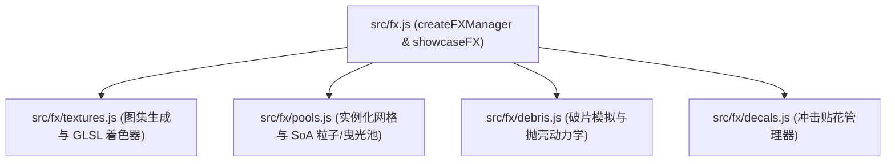

# 3A-GAME 渲染与视觉特效引擎技术白皮书 (Rendering & Visual Effects Engine)

> 本文档详细记录《3A-GAME》四号泊位前线行动的完整渲染管线（`src/render.js`）与视觉特效动力学系统（`src/fx.js`）的架构设计、着色器实现、数学模型与技术规范。

---

## 目录
1. [渲染管线架构概述](#1-渲染管线架构概述)
2. [环境天穹与大气散射模型](#2-环境天穹与大气散射模型)
3. [多级后处理管线 (Post-Processing Pipeline)](#3-多级后处理管线)
   - [3.1 半分辨率深度缓冲与法线重构](#31-半分辨率深度缓冲与法线重构)
   - [3.2 屏幕空间环境光遮蔽 (SSAO)](#32-屏幕空间环境光遮蔽-ssao)
   - [3.3 阴影投射体积光 (Volumetric Fog / Crepuscular Rays)](#33-阴影投射体积光)
   - [3.4 双重滤波六级泛光金字塔 (Dual-Filter Bloom Pyramid)](#34-双重滤波六级泛光金字塔)
   - [3.5 变形镜头光晕与镜头污渍 (Anamorphic Streak & Lens Dirt)](#35-变形镜头光晕与镜头污渍)
   - [3.6 动态曝光与人眼自适应 (Temporal Auto-Exposure)](#36-动态曝光与人眼自适应)
   - [3.7 AgX 胶片色调映射与终级调色 (AgX Tone Mapping & Grade)](#37-agx-胶片色调映射与终级调色)
4. [阴影级联与软阴影 (CSM & PCSS)](#4-阴影级联与软阴影)
5. [平面地面镜面反射 (Planar Reflection)](#5-平面地面镜面反射)
6. [动态点光源池 (Dynamic Light Pool)](#6-动态点光源池)
7. [视觉特效引擎架构 (VFX Engine Overview)](#7-视觉特效引擎架构)
8. [纯程序化特效图集生成 (Procedural Texture Atlases)](#8-纯程序化特效图集生成)
   - [8.1 4×2 翻页烟雾法线图集 (Smoke Atlas)](#81-42-翻页烟雾法线图集)
   - [8.2 4×2 高动态火花图集 (Sparks Atlas)](#82-42-高动态火花图集)
   - [8.3 4×2 碰撞弹孔贴花图集 (Decals Atlas)](#83-42-碰撞弹孔贴花图集)
9. [深度感知软粒子与着色器 (Depth-Aware Soft Particles)](#9-深度感知软粒子与着色器)
10. [粒子对象池与结构体数组 (ParticlePool - SoA)](#10-粒子对象池与结构体数组)
11. [高超音速弹道曳光流 (BulletTracerPool)](#11-高超音速弹道曳光流)
12. [刚体碰撞飞溅破片系统 (DebrisPhysicsSystem)](#12-刚体碰撞飞溅破片系统)
13. [车削黄铜弹壳抛壳动力学 (SpentShellEjectionSystem)](#13-车削黄铜弹壳抛壳动力学)
14. [切空间法线投影贴花 (ImpactDecalManager)](#14-切空间法线投影贴花)
15. [全材质碰撞物理响应矩阵 (Surface Interaction Matrix)](#15-全材质碰撞物理响应矩阵)

---

## 1. 渲染管线架构概述

游戏采用面向现代高端 WebGL2 的前向增强（Forward+）及半精度高动态范围（HDR HalfFloat RGBA16F）渲染管线。由于场景包含海量高密度工业结构、半透明烟雾粒子、高频自发光与水坑雨夜反光，管线通过预通道深度降采样与后处理金字塔分离，实现画质与 60 FPS 性能的最优平衡。

```
[场景几何渲染 (Scene Mesh Pass)]
         │
         ├──> [主 HDR 渲染目标 (rtScene - RGBA16F)]
         │         │
         │         ├──> [半分辨率深度 (depthhalf)] ──> [SSAO 遮蔽] ──> [双边滤波]
         │         │                                      │
         │         ├──> [阴影体积光 (Volumetric)] <───────┘
         │         │           │
         │         │           └──> [双边滤波] ──┐
         │         │                             │
         │         ├──> [主场景 + AO + 体积光混合合成 (Composite)]
         │         │                  │
         │         │                  ├──> [运动模糊 (Motion Blur)]
         │         │                  │
         │         │                  ├──> [6 级下采样金字塔 (Downsample)]
         │         │                  │          │
         │         │                  │          └──> [变形耀斑 (Streak)]
         │         │                  │          │
         │         │                  │          └──> [6 级上采样金字塔 (Upsample)]
         │         │                  │
         │         │                  ├──> [1×1 亮度自适应 (Temporal Auto-Exposure)]
         │         │                  │
         │         └──> [终级合成色调映射 (AgX Tonemap + Grade + FXAA + Dither)]
         │                                    │
         └──> [呈现至屏幕 Canvas (Backbuffer)] <┘
```

---

## 2. 环境天穹与大气散射模型

天穹网格通过程序化顶点/片元着色器（`GLSL_SKY_ATMOSPHERE`）模拟微光黄昏到暴雨阴霾的大气光传输特性：
- **太阳方位**：标准化向量 $\mathbf{L} = (0.916, 0.225, 0.331)$，低角度斜射工业港口。
- **光学散射**：
  - **瑞利散射（Rayleigh Scattering）**：呈现高空深蓝灰与低空橙黄渐变天顶色。
  - **米氏散射（Mie Phase Function）**：模拟太阳日冕的强前向散射光晕：
    $$P_{\text{Mie}}(\theta) = \frac{1 - g^2}{(1 + g^2 - 2g \cos\theta)^{1.5}}$$
    其中各向异性因子 $g \approx 0.78$。
  - **低空薄雾层（Low-altitude Sea Fog）**：在视线接近海平面处引入渐进指数吸收衰减。

---

## 3. 多级后处理管线 (Post-Processing Pipeline)

### 3.1 半分辨率深度缓冲与法线重构
为了降低全分辨率屏幕空间采样的显存带宽开销，后处理管线首先使用 `depthhalf` 着色器将全分辨率深度缓冲提取至半分辨率浮点缓冲，并在 SSAO 中基于相邻像素深度差使用偏导数重构几何表面法线：
$$\mathbf{N} = \text{normalize}\left(\frac{\partial \mathbf{P}}{\partial x} \times \frac{\partial \mathbf{P}}{\partial y}\right)$$

### 3.2 屏幕空间环境光遮蔽 (SSAO)
- **采样模式**：12 个螺旋泊松分布采样点（Poisson Spiral Taps），依据世界空间半径 $R = 0.75\,\text{m}$ 动态自适应屏幕投影视差。
- **几何偏置**：引入法线角度偏置 $\cos(\theta) > 0.15$，消除平面低倾角假阴影（Self-Shadowing Artifacts）。
- **双边深度感知模糊**：采用 $5\times 5$ 高斯双边滤波器（Bilateral Depth-Aware Blur），保持深度断层处的边缘锐利度。

### 3.3 阴影投射体积光 (Volumetric Fog / Crepuscular Rays)
- **光线步进（Raymarching）**：从近平面到远平面进行 16~40 次等距采样（依据配置 `volSteps`）。
- **阴影映射比对**：将每一步世界坐标投影回日光主级联阴影贴图，采样透射率：
  $$T(\mathbf{x}) = \exp\left(-\sigma_e \cdot d\right) \cdot \mathbb{I}(\mathbf{x} \notin \text{Shadow})$$
- **大气悬浮颗粒衰减**：在货仓与龙门吊下方模拟局部微尘密度叠加。

### 3.4 双重滤波六级泛光金字塔 (Dual-Filter Bloom Pyramid)
采用高性能双重滤波算法（Kawase / Call of Duty: Advanced Warfare 风格）：
1. **下采样（Downsampling）**：6 级连续二分之一降采样，每级使用带有卡扣抗闪烁（Firefly Karis Average）的 13-Tap 帐篷滤波核。
2. **上采样（Upsampling）**：6 级逐级反向放大，使用 9-Tap 双三次滤波核并与上一级纹理加权融合，形成极其柔和自然的电影级大半径漫射光晕。

### 3.5 变形镜头光晕与镜头污渍 (Anamorphic Streak & Lens Dirt)
- **变形拉伸光晕（Anamorphic Streak）**：在泛光金字塔底层对最高发光强度的水平像素执行 1D 高斯模糊拉伸，营造宽荧幕变形镜头的水平横向浅蓝/橙色耀斑。
- **镜头污渍掩模（Lens Dirt）**：程序化白噪波生成水珠痕迹与工业油污斑纹，在高亮度爆发时浮现于视野边缘。

### 3.6 动态曝光与人眼自适应 (Temporal Auto-Exposure)
- 使用 $1\times 1$ 浮点纹理执行乒乓迭代（Ping-Pong RT Feedback）。
- 实时计算画面对数平均亮度 $L_{\text{avg}}$，并采用指数渐进平滑逼近目标曝光度：
  $$E_{t} = E_{t-1} + (E_{\text{target}} - E_{t-1}) \cdot \left(1 - \exp(-\lambda \Delta t)\right)$$
  适配室内货仓到开阔泊位强光直射的平滑暗/亮适应过渡。

### 3.7 AgX 胶片色调映射与终级调色 (AgX Tone Mapping & Grade)
- **色彩空间变换**：将线性 Rec.709 转换至 AgX 宽色域对数空间，彻底解决传统 ACES 在高饱和高亮度（如爆炸火球、激光曳光弹）下的色彩偏黄、色相漂移与边缘过饱和裁剪（Hue Skewing & Clipping）。
- **S 曲线对比度**：施加轻度 S 曲线对比度与暗角衰减（Vignette）。
- **色像差（Chromatic Aberration）**：视场边缘根据视线角半径微量分离红蓝通道。
- **抗色带抖动（Dithering）与胶片颗粒（Film Grain）**：向 8-bit 输出通道注入高频低幅随机噪声，彻底消灭雨夜暗部色阶断层。

---

## 4. 阴影级联与软阴影 (CSM & PCSS)

日光阴影采用单主通道大画幅（2048~4096）正交投影覆盖：
- 动态紧致包围盒（Tight Frustum Fitting）：阴影投影盒随玩家移动以固定纹素步长移动（Texel Snapping），消除摄像机平移时的阴影边缘抖动（Edge Crawling）。
- **百分比渐进软阴影（PCSS - Percentage Closer Soft Shadows）**：
  1. 深度阻挡物搜索（Blocker Search）：在遮挡区域内搜索遮挡物的平均深度。
  2. 半影宽度估算：
     $$w_{\text{penumbra}} = \frac{d_{\text{receiver}} - d_{\text{blocker}}}{d_{\text{blocker}}} \cdot w_{\text{light}}$$
  3. 自适应泊松圆盘滤波（Adaptive Poisson PCF）：依据半影宽度动态调节采样半径，实现近处坚硬、远处羽化散焦的自然阴影。

---

## 5. 平面地面镜面反射 (Planar Reflection)

针对四号泊位积水路面与海港水面：
- 创建专用反向对称虚拟相机，沿地平面 $Y = 0$ 或海平面 $Y = -1.6$ 翻转摄像机视锥。
- 渲染裁剪反向场景至低分辨率反射目标（Half-Res Planar RT）。
- 在地面 PBR 着色器中通过菲涅尔公式（Fresnel-Schlick）将反射图像与基于粗糙度的漫反射颜色动态混合。

---

## 6. 动态点光源池 (Dynamic Light Pool)

为了在保持 60 FPS 性能的同时呈现极其逼真的枪口闪光、爆炸火光与电弧火花，系统构建了可重用动态点光源缓冲池：
- **最大容量**：16 盏瞬态点光源。
- **LRU 淘汰与复用**：按激活时间衰减自动回收。
- **指数闪烁衰减**：
  $$I(t) = I_0 \cdot \exp\left(-\frac{t}{\tau}\right) \cdot (1 + \delta \sin(\omega t))$$
  使得枪口闪火具有强烈的冲击力与金属反射质感。

---

## 7. 视觉特效引擎架构 (VFX Engine Overview)

视觉特效引擎已完成高内聚模块化解耦，由核心调度门面 `src/fx.js` 统一编排四大专业子系统（`src/fx/`）：



| 特效子系统 | 物理与渲染实现 | 归属子模块 | 最大实例容量 | 内存/绘制开销 |
|---|---|---|---|---|
| **受光烟雾与火焰** | GPU 实例化公告板、4×2 法线图集、半兰伯特包裹光 | `src/fx/pools.js`<br>`src/fx/textures.js` | 1,400 粒子 | 1 次 Draw Call (动态 SoA) |
| **加色火花与电弧** | 速度拉伸线段、高动态 HDR 自发光、发光衰减阶梯 | `src/fx/pools.js`<br>`src/fx/textures.js` | 3,040 粒子 | 1 次 Draw Call |
| **弹道曳光流带** | 超音速速度拉伸四边形 + 柔和膨胀光晕 + 尖端耀斑 | `src/fx/pools.js` | 48 曳光弹道 | 共享加色通道 |
| **飞溅刚体碎屑** | 颤动凸包 BoxGeometry、自旋四元数、重力反弹 | `src/fx/debris.js` | 256 破片 | 1 次 InstancedMesh |
| **抛壳黄铜弹壳** | 车削 LatheGeometry、角动量积分、地面声效事件 | `src/fx/debris.js` | 60 弹壳 | 1 次 InstancedMesh |
| **动态表面贴花** | 正交切空间投影 Quad、多边形法线抬升防 Z-Fighting | `src/fx/decals.js`<br>`src/fx/textures.js` | 160 贴花 | 1 次 Draw Call |

---

## 8. 纯程序化特效图集生成 (Procedural Texture Atlases)

代码中严禁依赖任何外部 PNG/JPG 贴图，全部纹理均在游戏启动瞬间基于数学公式与画布完全合成。

### 8.1 4×2 翻页烟雾法线图集 (Smoke Atlas)
- **尺寸**：$512 \times 256$（每帧 $128 \times 128$，共 8 帧）。
- **第 0~5 帧**：各向同性分形布朗运动（FBM）滚翻对流烟团。
- **第 6 帧**：垂直向上撕裂的锥形火舌核心。
- **第 7 帧**：细微低密度消散烟丝。
- **Sobel 表面法线导出**：
  $$N_x = \frac{\rho(x+1, y) - \rho(x-1, y)}{2\Delta x}, \quad N_y = \frac{\rho(x, y+1) - \rho(x, y-1)}{2\Delta y}$$
  将密度梯度编码为 RG 表面法线贴图，使粒子在日光直射下具备极具立体感的明暗体块凹凸。

### 8.2 4×2 高动态火花图集 (Sparks Atlas)
- **帧 0**：高斯衰减柔和光斑（Soft Dot）。
- **帧 1**：轴向拉伸高光线段（Streak）。
- **帧 2~3**：多角不对称辐射星芒（Starburst Rays）。
- **帧 4**：同心圆水面冲击涟漪环（Ripple Ring）。
- **帧 5**：带噪声扰动的脉冲电浆光球（Plasma Bead）。
- **帧 6**：雨滴溅射与悬浮水滴（Droplet）。
- **帧 7**：超音速穿甲弹头尖端锥形辉光（Tracer Tip）。

### 8.3 4×2 碰撞弹孔贴花图集 (Decals Atlas)
利用 HTML5 离线 Canvas 2D 矢量与梯度管线程序化光栅化，并同时生成 Albedo、ORM（粗糙度/金属度）和法线贴图：
- **金属弹孔**：黑色穿孔中心、高温变色蓝紫色氧化环、边缘银灰色金属剥落反光。
- **混凝土碎裂**：不规则多边形碎裂凹坑、白色粉状粉碎中心、放射状碎屑晕。
- **木质撕裂**：顺着木纹方向拉伸的椭圆形纤维破裂纹路。
- **爆炸烧焦**：大范围羽化渐变沥青焦黑痕迹。
- **玻璃蛛网**：12 束放射状折角碎纹。

---

## 9. 深度感知软粒子与着色器 (Depth-Aware Soft Particles)

传统粒子在穿过地面、集装箱或墙壁时会出现生硬的几何切割线。引擎在顶点与片元着色器中注入线性深度羽化：
$$\Delta z = z_{\text{scene}} - z_{\text{particle}}$$
$$\text{Fade} = \text{clamp}\left(\frac{\Delta z}{d_{\text{soft}}}, 0.0, 1.0\right)$$
使烟雾与水雾在接触地面与掩体时产生平滑透视交融。

---

## 10. 粒子对象池与结构体数组 (ParticlePool - SoA)

为了彻底消除 JavaScript 垃圾回收（GC）引发的微卡顿，所有粒子物理属性采用紧凑扁平化 `Float32Array` 结构体数组（Structure of Arrays）：
- `px, py, pz, vx, vy, vz`：位置与速度。
- `age, life, s0, s1, sk`：时间与非线性尺寸幂律缓动。
- `rot, rotv, r, g, b, a`：自旋角与色彩透明度。
- `drag, grav, wind, turb`：空气阻力、重力加速度、风力响应系数、湍流噪声强度。
- `flags`：包含 `BOUNCE_FLOOR`（地面弹跳系数 0.25~0.55）、`DIE_ON_FLOOR`（触地消亡）、`STICK_FLOOR`（落地静止）。

---

## 11. 高超音速弹道曳光流 (BulletTracerPool)

子弹曳光不仅是一条线，而是由三层结构复合而成的电影级弹道视觉流：
1. **高亮核心流光（Core Laser Filament）**：沿子弹运动轴向拉伸的狭窄四边形，自发光强度高达 $16\times$。
2. **外部膨胀柔光（Outer Bloom Sheath）**：宽幅达到核心 $6\times$ 的低浓度辉光带，提供强烈的视觉压迫感。
3. **弹头气化耀斑（Tracer Tip Glow）**：跟随弹头位置的面向相机圆形等离子体光斑。
4. **超音速空泡尾迹（Cavitation Smoke Trail）**：当弹道长度超过 2 米时，每隔固定间距在弹道路径上生成微细烟团。

---

## 12. 刚体碰撞飞溅破片系统 (DebrisPhysicsSystem)

当子弹击中掩体时，系统发射真实物理弹跳的刚体多边形破片：
- **网格**：具有非对称顶点随机抖动（Jittered Vertices）的 Box 几何体。
- **运动学**：三维重力抛物线运动，配合独立随机轴向角动量自旋（Spin Angular Velocity）。
- **碰撞响应**：向下光线投射获取地面高程。当发生碰撞时，若垂直速度小于 $-1.2\,\text{m/s}$ 则发生动能衰减反弹；若速度较小则平稳平躺在地面，持续停留数秒后缩小编号回收。

---

## 13. 车削黄铜弹壳抛壳动力学 (SpentShellEjectionSystem)

- **真实几何体**：以 11 组轮廓点进行旋转车削生成的 1:1 标准步枪黄铜弹壳。
- **四元数姿态积分**：
  $$\mathbf{q}_{t+\Delta t} = \text{normalize}\left(\mathbf{q}_t + \frac{\Delta t}{2} \cdot \boldsymbol{\omega} \otimes \mathbf{q}_t\right)$$
- **音效联动**：弹壳前两次撞击硬质地面时，自动向全局事件总线发射 `shell:bounce` 事件，触发基于 Web Audio 滤波合成的金属脆响音效。

---

## 14. 切空间法线投影贴花 (ImpactDecalManager)

- 基于碰撞点与表面法线 $\mathbf{N}$，动态构造正交切空间基底 $(\mathbf{T}, \mathbf{B})$。
- 沿切平面施加随机滚动旋转（Roll Angle）。
- 四个顶点坐标沿法线微量提升 $0.004\,\text{m}$，配合 WebGL 硬件多边形偏移（`polygonOffsetFactor = -4`），杜绝深度撕裂与 Z-Fighting。
- 容量达到上限（160 枚）时，最旧的 14 枚贴花通过顶点颜色透明度平滑淡出回收。

---

## 15. 全材质碰撞物理响应矩阵 (Surface Interaction Matrix)

| 材质类型 | 闪光与光照 | 火花微粒 | 烟雾/粉尘 | 飞溅破片 | 表面贴花 |
|---|---|---|---|---|---|
| **金属 (metal)** | 橙黄反光 + 动态点光源 | 18+ 枚高亮反弹火花 | 少量蓝灰薄烟 | 2 枚细小金属剥落渣 | bullet_metal (弹坑+银边) |
| **混凝土 (concrete)** | 无直射反光 | 少量偶发摩擦火星 | 8 枚灰白厚重膨胀粉尘 | 4 枚低速多边形碎石块 | bullet_concrete (碎裂坑) |
| **木材 (wood)** | 无 | 偶发暗红小火星 | 棕黄色细微木屑尘 | 7 枚狭长木质破片 | bullet_wood (纤维孔) |
| **水面 (water)** | 菲涅尔波光 | 14 枚高抛水花飞沫 | 5 朵水雾喷射 | 无 | 同心扩散涟漪环 |
| **泥土/橡胶 (dirt)** | 无 | 无 | 5 朵暗褐/黑色泥团 | 3 块土颗粒 | soot (黑色微粒附着) |
| **玻璃 (glass)** | 瞬态高光 | 12 枚透明反光碎屑 | 稀薄白色粉晶烟 | 4 块锋利玻璃碎片 | bullet_glass (蛛网碎纹) |
| **机械敌兵 (enemy)** | 强烈橙红闪火 + 点光源 | 15 枚爆裂电弧火花 | 2 朵重度机油黑浓烟 | 3 块金属外壳碎片 | 机体材质损毁变色 |
| **大爆炸 (explosion)** | 320W 强闪光 + 次级红光 | 90+ 枚超高速火星 | 13 朵火舌 + 11 朵浓烟柱 | 19 块大质量抛射碎石 | scorch (大面积高温灼痕) |

---
*本文档由 3A-GAME 架构团队自动化逆向与技术规格沉淀生成。*
