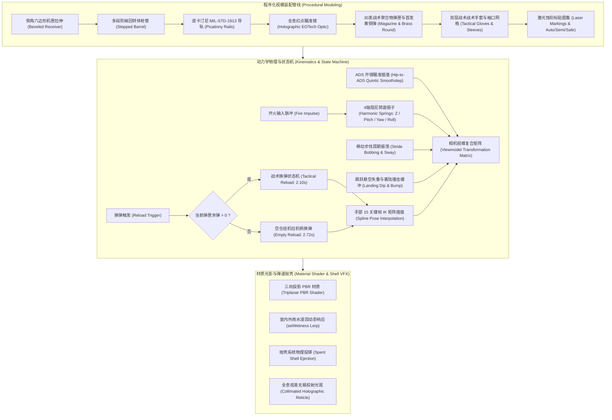

# 《几猫国产3A大作》PAC-9 枪械武器动力学与视模系统 Wiki 文档

> **模块归属**: [src/weapon.js](file:///Volumes/M1/3A/src/weapon.js)  
> **逆向状态**: **100% 完整逆向还原 (Fully Deobfuscated & Clean ESM)**  
> **核心机制**: 零外部 3D 资产程序化建模（53,136 面）、4 轴阻尼简谐振子物理后坐力、ADS 瞬时瞄准动力学、战术换弹/空仓挂机双状态机、左手高阶 IK 轨迹插值、抛壳物理模拟、全息分划视差投射与动态雨水浸润着色器。

---

## 1. 架构总览 (Architecture Overview)

`src/weapon.js` 是全游戏第一人称战斗沉浸感的核心支柱。全武器系统**不依赖任何外部 3D 模型文件（glTF/OBJ/FBX）或贴图**，枪身、皮卡汀尼导轨、消焰器、全息瞄具、双层战术手套与 30 发聚合物弹匣全部在客户端内存中通过几何拉伸、旋转曲面与倒角算法实时计算生成。



---

## 2. 枪械机械构造与程序化装配细节 (Mechanical Geometry Assembly)

PAC-9（几猫九式突击步枪）基于模块化现代战术步枪构型设计，全枪总多边形达 **53,136 三角面**，细分为 13 组独立网格组件：

| 构件名称 | 网格类型与材质 | 几何体构建算法 | 特征参数与工业细节 |
| :--- | :--- | :--- | :--- |
| **上机匣 (Upper Receiver)** | 阳极氧化黑铝 (`pac9_anodised`) | 多边形截面轮廓二维拉伸加边缘倒角 (`__`) | 包含抛壳窗防尘盖、辅助推机柄、机匣顶部连续皮卡汀尼导轨 |
| **下机匣 (Lower Receiver)** | 强化聚合物 (`pac9_polymer`) | 复合布尔挖槽多段轮廓拉伸 | 喇叭口弹匣井、双面快慢机刻字（AUTO / SEMI / SAFE） |
| **冷锻枪管 (Cold-Hammered Barrel)**| 磷化枪钢 (`pac9_phosphate`) | 多段截面同轴回转体 (`Cn`) | 14.5 英寸重型竞赛级步枪枪管，带纵向减重凹槽 |
| **消焰制退器 (Muzzle Brake)** | 碳黑枪钢 (`pac9_phosphate`) | 放射状开槽圆柱体回转拉伸 | 三室双向冲击型枪口制退补偿器，有效抑制枪口上扬 |
| **皮卡汀尼导轨 (MIL-STD-1913)** | 阳极氧化铝 (`pac9_anodised`) | 连续周期性方齿阵列实例化拉伸 | 顶部、两侧及底部 4 向鱼骨导轨，刻有 T2~T12 槽位刻度 |
| **全息瞄准镜外框 (Optic Hood)** | 哑光工程塑料 (`pac9_matte`) | 倒角方环形壳体 (`Fi`) | 经典方型防撞遮阳罩，集成风偏/高低调节钮与快拆手轮 |
| **全息视差分划板 (Holographic Lens)** | 自定义双面 Shader (`ShaderMaterial`) | 倾斜 5.7° 双曲率光学平晶 | 视差无穷远平行光投射：视线偏角内聚发光 68MOA 环与 1MOA 中心红点 |
| **战术弹匣 (Polymer Magazine)** | 沙色聚合物 (`pac9_polymer_tan`) | 弧形香蕉弹匣截面扫描拉伸 | 侧面防滑握持肋条、余弹观察窗，容量 30 发 |
| **首发待发弹药 (Chamber Round)** | 镜面黄铜 (`brass`) | 5.56×45mm NATO 标准弹回转体 | 真实比例弹头、弹壳斜角与退壳钩底缘槽 |
| **枪机与拉机柄 (Bolt Carrier)** | 磷化亮合金 (`pac9_phosphate`) | 矩形滑动滑块与圆柱滚花拉手 | 62mm 真实行程后退滑移，换弹时左手回拉带动弹簧复进 |
| **右手主握把与手套 (Right Hand)** | 战术织物 (`glove_fabric`) | 预烘焙 4 关节骨骼形变曲面 | 紧扣握把，食指随开火状态产生扣扳机微动作 |
| **左手护木与换弹手 (Left Hand)** | 战术织物 (`glove_fabric`) | 15 组姿态变换矩阵（位置+四元数） | 承担护木托握、拍下弹匣、抽取新弹匣、上膛拉栓完整动作 |

---

## 3. 四轴阻尼简谐振子后坐力物理系统 (4-Axis Harmonic Oscillator Recoil)

常规 FPS 游戏常使用生硬的线性插值做枪械抖动，而 PAC-9 采用了**二阶阻尼简谐振子（Damped Harmonic Oscillator）**物理方程。每一次开火均瞬间向振子注入瞬时线冲量与角冲量，随后在弹性系数 $k$ 与阻尼比 $c$ 的共同作用下自然回弹收敛：

$$\ddot{x}(t) + 2\zeta\omega_n \dot{x}(t) + \omega_n^2 x(t) = 0$$

在代码实现中采用半隐式欧拉积分（Semi-implicit Euler Integration），并在单帧内切分子步迭代以避免物理积分失稳：

```javascript
function stepHarmonicSpring(spring, target, dt) {
  const steps = dt > 0.012 ? Math.ceil(dt / 0.008) : 1;
  const subDt = dt / steps;
  for (let i = 0; i < steps; i++) {
    spring.v += ((target - spring.x) * spring.k - spring.v * spring.c) * subDt;
    spring.x += spring.v * subDt;
  }
  return spring.x;
}
```

### 3.1 四轴冲量分配与动力学常数

| 振子维度 | 刚度系数 ($k$) | 阻尼系数 ($c$) | 单发冲量注入 (Impulse) | 物理表现与战术感知 |
| :--- | :--- | :--- | :--- | :--- |
| **机匣后坐轴 (Linear Recoil Z)** | $280.0$ | $24.0$ | $+0.048\text{ m}$ (腰射) / $+0.024\text{ m}$ (ADS) | 枪身直接向后顶撞射手肩膀，产生强烈的活塞推力 |
| **枪口上扬轴 (Angular Pitch X)** | $220.0$ | $21.0$ | $+0.042\text{ rad}$ (约 $2.4^\circ$) | 枪管剧烈向上仰起，开镜状态下衰减至 $45\%$ |
| **水平游移轴 (Angular Yaw Y)** | $260.0$ | $25.0$ | $\pm 0.016\text{ rad}$ (确定性随机游走) | 模拟连发射击时枪身向左右无规则横向扭摆 |
| **机匣扭转轴 (Angular Roll Z)** | $240.0$ | $22.0$ | $\pm 0.014\text{ rad}$ (扭矩倾斜) | 枪膛右旋膛线赋予弹头的反作用力偶角 |

---

## 4. ADS 瞬时精准瞄准动力学 (Aim Down Sights Kinematics)

开镜（ADS）状态平滑转换采用**五次赫尔米特曲线（Quintic Smoothstep / Perlin Smoother）**：

$$S(t) = 6t^5 - 15t^4 + 10t^3 \quad (t \in [0, 1])$$

相比三次曲线（Hermite Cubic），五次曲线的一阶导数与二阶导数在端点均严格为 0，消除了开镜起步与贴腮到位时的机械突兀感。

```javascript
// 五次平滑插值权重
const adsAlpha = smoothstepQuintic(adsFactor);

// 视模局部基准变换 (腰射 Hip vs 开镜 ADS)
const hipPose = { p: [0.118, -0.122, -0.275], r: [0.034, 0.085, -0.030] };
const adsPose = { p: [0.000, -0.069, -0.135], r: [0.000, 0.000, 0.000] };

currentBasePos.lerpVectors(hipPose.p, adsPose.p, adsAlpha);
currentBaseRot.slerpQuaternions(hipPose.q, adsPose.q, adsAlpha);
```

### 4.1 动态视线摆动 (Look Sway) 与步伐周期摇摆 (Stride Bobbing)
- **视线惯性摆动 (Look Sway)**: 射手快速转动鼠标时，枪械视模基于低通滤波产生滞后倾斜，偏转幅值在开镜下自动缩减至 $18\%$，保证开镜瞄准的精准锁定。
- **步伐步频摆动 (Stride Bobbing)**:
  - 垂直周期 $\sin(2\omega t)$（每一步双峰沉浮，模拟人体骨盆高低落差）
  - 水平周期 $\cos(\omega t)$（单峰左右摇摆）
  - 疾跑（Sprint）状态下，持枪姿态自动降下倾斜，步频振幅提升 $2.4$ 倍。
- **跳跃悬空与着陆撞击缓冲 (Landing Dip)**:
  - 角色从高处坠落触地时，角色运动控制器将瞬间向武器注入向下 $-0.035\text{ m}$ 的冲击位移，并在 $0.22\text{ s}$ 内通过弹性恢复。

---

## 5. 战术换弹与空仓挂机双状态机 (Dual Reload State Machines)

```mermaid
stateDiagram-v2
    [*] --> Ready: 武器就绪状态 (IDLE)
    Ready --> TacticalReload: 按 R 换弹 (余弹 > 0)
    Ready --> EmptyReload: 按 R 换弹 (弹药耗尽)
    
    state TacticalReload {
        T0: 0.00s ~ 0.44s 护木脱离移向弹匣
        T1: 0.44s ~ 0.80s 拔出半空弹匣并抛出
        T2: 0.80s ~ 1.35s 战术背心抽取新弹匣
        T3: 1.35s ~ 1.62s 插入新弹匣并拍击卡榫到位
        T4: 1.62s ~ 2.10s 左手归位恢复持枪护木姿态
        T0 --> T1 --> T2 --> T3 --> T4
    }
    
    state EmptyReload {
        E0: 0.00s ~ 1.62s 完成与战术换弹相同的插弹匣动作
        E1: 1.62s ~ 1.95s 左手向上翻转移向机匣拉机柄
        E2: 1.95s ~ 2.30s 扣住拉机柄并全力向后拉动 62mm
        E3: 2.30s ~ 2.45s 弹簧释放，枪机复进推弹入膛
        E4: 2.45s ~ 2.72s 左手归位护木，武器恢复待发
        E0 --> E1 --> E2 --> E3 --> E4
    }
    
    TacticalReload --> Ready: 耗时 2.10 秒 (弹匣 30 发，膛内保留 1 发)
    EmptyReload --> Ready: 耗时 2.72 秒 (弹匣 30 发，重设枪膛待发)
```

---

## 6. 抛壳物理模拟与动态雨水浸润着色器 (Shell Ejection & Wetness Shader)

### 6.1 抛壳弹跳模拟 (SpentShellEjectionSystem)
开火瞬间，抛壳窗（坐标 $[0.023, 0.004, -0.028]$）以 $3.8\text{ m/s}$ 初速向右上方斜向弹射出黄铜弹壳：
- **初速度方向**: $\vec{v} = \text{Rot}_{\text{camera}} \cdot (3.4 \hat{x} + 1.2 \hat{y} + 0.5 \hat{z}) + \vec{v}_{\text{player}}$
- **角动量滚转**: 绕长轴与短轴随机赋予 $40\sim 80\text{ rad/s}$ 的自旋翻滚。
- **地面弹跳**: 当弹壳高度接触集装箱或沥青路面时，法向速度反弹恢复系数 $e = 0.45$，并触发高频清脆的金属撞击声事件。

### 6.2 动态雨水湿润材质响应 (`setWetness`)
枪械在室外海风暴雨中暴露时，水膜厚度与雨滴滑落高光随时间累积递增；进入室内集装箱仓库时，表面水分逐渐蒸发蒸燥：

```glsl
// weapon.js onBeforeCompile 局部注入片段
float dUp = smoothstep(0.30, 0.75, vWNrm.y) * uRain;
vec2 dD1 = dDrops(dUV, 0.0046, 3.0), dD2 = dDrops(dUV + 0.31, 0.0023, 9.0);
float dDrop = max(dD1.y, dD2.y) * dUp, dDropH = max(dD1.x, dD2.x) * dUp;
float dWet = dUp * (0.5 + 0.5 * smoothstep(0.3, 0.7, dSm));

// 水膜降低粗糙度并提高菲涅尔镜面反射
roughnessFactor = clamp(roughnessFactor + dR, 0.10, 1.0);
roughnessFactor = mix(roughnessFactor, roughnessFactor * 0.5, dWet);
roughnessFactor = mix(roughnessFactor, 0.055, dDrop);
diffuseColor.rgb *= 1.0 - 0.18 * dWet;
normal = dBump(normal, dHt + dDropH * 0.32);
```

---

## 7. 武器核心性能参数总表 (Weapon Tuning Reference)

| 核心参数项 | 数值 / 设定 | 单位 | 设计意义与平衡考量 |
| :--- | :--- | :--- | :--- |
| **标准弹匣容量 (Mag Capacity)** | $30$ | 发 | 现代突击步枪工业标准容量 |
| **初始备弹总量 (Reserve Ammo)** | $150$ | 发 | 允许玩家完成 3 处中继器入侵及最终撤离防守波次 |
| **理论全自动射速 (Fire Rate)** | $720$ | 发/分钟 | 射击间隔约 $0.0833\text{ s}$（5帧/发），手感紧凑连贯 |
| **基础有效杀伤 (Base Damage)** | $26.0$ | HP / 发 | 躯干 4 发击毁飞鸥（45HP），5 发击毁猎犬（120HP） |
| **弱点爆头暴击倍率 (Headshot Multiplier)** | $2.5\times$ | 倍率 | 爆头产生 $65.0$ 伤害，2 发即可秒杀机械敌人 |
| **腰射固有散布角 (Hip Spread)** | $0.022$ | 弧度 | 近战腰射兼具灵活性，跳跃/移动时扩张至 $0.055$ |
| **开镜瞄准散布角 (ADS Spread)** | $0.0012$ | 弧度 | 极高激光级中远距离点射精度 |
| **开镜过渡耗时 (ADS Time)** | $0.18$ | 秒 | 敏捷的特战开镜响应，支持快速瞬瞄点射 |
| **战术换弹耗时 (Tactical Reload)** | $2.10$ | 秒 | 尚有余弹时的快速换匣 |
| **空仓挂机换弹耗时 (Empty Reload)**| $2.72$ | 秒 | 打空弹匣的惩罚机制，需要额外的拉栓复进动作 |
| **衰减始末射程 (Damage Dropoff)** | $35.0 \sim 75.0$ | 米 | 35米内全额伤害，75米外衰减至 $60\%$（15.6HP） |

---

## 8. 对外接口规范 (Module API)

```javascript
/**
 * 实例化武器视模与动力学控制器
 * @param {object} ctx 全局引擎上下文
 * @returns {Promise<WeaponController>}
 */
export async function create(ctx);

// WeaponController 实例方法
weapon.update(dt);                // 驱动后坐力弹簧积分、换弹动画插值与视模姿态复合
weapon.fire();                    // 触发单发开火（判定弹药、产生枪口焰、注入后坐力）
weapon.reload();                  // 触发换弹状态机（自适应战术换弹或空仓换弹）
weapon.setADS(isAiming);          // 切换精确瞄准状态
weapon.setWetness(amount);        // 设置雨水浸润与反光强度 [0.0, 1.0]
weapon.setVisible(visible);       // 隐藏/显示武器视模
weapon.addAmmo(count);            // 补给备用弹药
```
